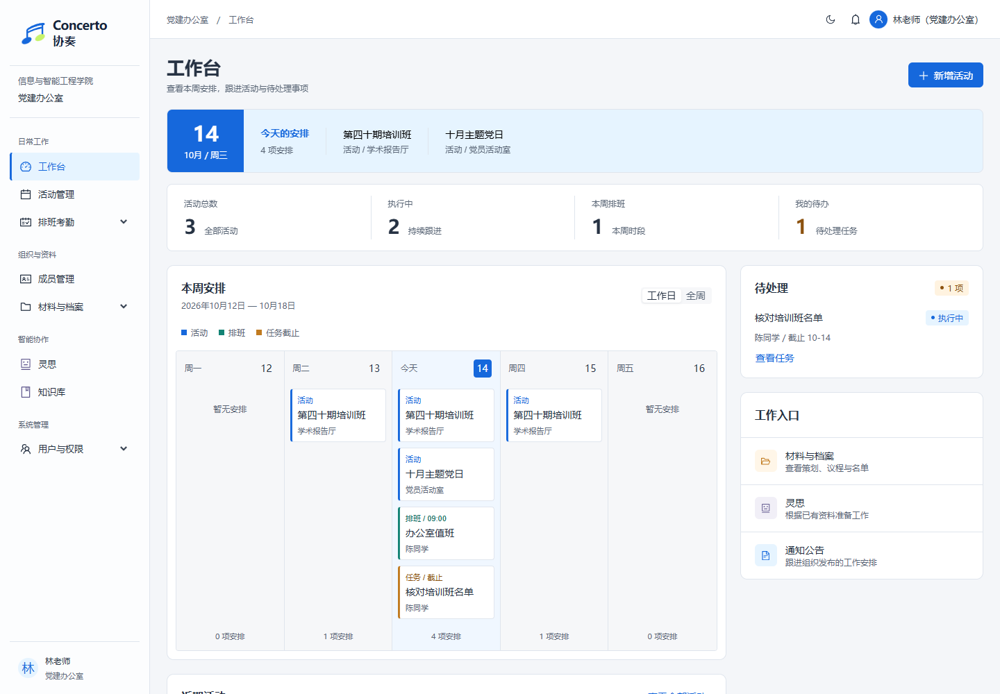

# 协奏 Concerto

**面向学生组织的活动与协作工作台**

协奏源于信息与智能工程学院党建办公室的党务管理需求。每个组织可以在自己的工作区管理活动、排班、成员和档案，用内置 AI 助手 Concerto Agent 查找资料、准备业务操作和跟进任务。工作台汇总一周的活动、排班与任务截止时间。

[快速开始](#快速开始) · [主要功能](#主要功能) · [Concerto Agent 与知识库](#concerto-agent-与知识库) · [本地开发](#本地开发) · [部署](#部署) · [文档](#文档) · [许可证](#许可证)



*工作台验收截图，使用示例数据。*

## 快速开始

使用 Docker 和 Compose 插件可在容器中运行 MySQL、后端和 Web。Windows 可在 Git Bash 中执行以下命令。

```bash
git clone https://github.com/RanranCoder/Concerto.git
cd Concerto
test -f .env || cp .env.example .env
```

在根目录的 `.env` 中配置 `MYSQL_ROOT_PASSWORD`、`MYSQL_USER`、`MYSQL_PASSWORD` 和 `PAMS_JWT_SECRET`。MySQL 应用账号可沿用 `pams`，请将示例密码和签名密钥换成自己的值。Concerto Agent 可以用内置规则模式启动，接入真实模型的配置见下文。

```bash
docker compose up -d --build
docker compose ps
docker compose logs -f backend
```

等待后端完成 Flyway 迁移并启动，然后访问 <http://127.0.0.1:3000>。后端在容器网络内监听 `8080`，由前端容器代理访问。首次使用时，从登录页进入「创建组织」，填写组织信息、添加部门或小组、设置管理员账号并选择所需扩展。创建完成后，用管理员账号登录即可继续设置组织架构和权限。 [环境变量示例](.env.example) · [Compose 配置](docker-compose.yml)

## 主要功能

| 工作场景 | 可完成的操作 |
| --- | --- |
| 活动 | 立项、编辑 Word 策划书并送审、按甘特图分工、编排议程与座位、评分、核对应签名单和二维码签到 |
| 排班考勤 | 维护常规排班、导入 Excel 课表、查看共同空闲、预览或手动编排活动班次、发布排班并生成待签到记录 |
| 成员与权限 | 维护组织树、岗位、成员名册与届别，按名册批量开户并发放一次性设密凭证，发布角色权限并委派组织管理员 |
| 内容与档案 | 起草和审核推文、管理新闻稿，归档活动材料，管理模板、素拓加分、公告和群聊资料 |
| 通知中心 | 接收任务和审核消息、查看截止提醒、确认公告及配置个人通知偏好 |
| 组织扩展 | 按组织启用党建、团务和志愿服务。党建工作区包含成员发展历程、函调记录、组织关系转移和专项名册 |

策划书使用 SuperDoc 编辑原生 DOCX。可以导入 Word 文件、保存草稿、下载已保存文档，并以新版本发起修订。 [Word 编辑器接入说明](docs/design/PAMS-SuperDoc-接入与验收.md)

「课表导入」按部门和学期处理 Excel。文件全部解析成功时自动发布无课表。有文件解析失败时，可以修正后重试，或核对预览并确认「仅发布已解析文件」。之后可用空闲信息预览活动排班，按需调整草稿并发布。 [业务操作手册](docs/协奏PAMS-当前业务功能与使用流程说明.md)

各组织独立管理数据、品牌主题、功能开关和角色。业务主角色决定日常可操作的权限，所有者与受委派的组织管理员负责相应治理操作。权限配置经预览和发布后生效，当前可配置范围为 `ORG`（本组织）。 [角色权限与租户管理](docs/PAMS-角色权限与租户管理-首版落地记录.md) · [花名册批量开户](docs/PAMS-花名册批量开户流程.md)

## Concerto Agent 与知识库

打开 `/agent` 进入 Concerto Agent，在同一工作区查看对话、任务进度和成果版本。

| 模式 | 用途 |
| --- | --- |
| 标准模式 | 查询业务数据、准备策划书修订或排班等操作，核对待确认清单后执行 |
| 只读模式 | 查询权限内的业务信息 |
| 资料问答 | 检索制度、公告、策划书等组织资料，并给出可回查的引用来源 |

标准模式可按任务需要调度多 Agent 协作。缺少信息时在对话中补齐，确认前可查看内容差异和参考资料，执行结果通过回执记录。确认后生成排班草稿，可在「活动排班」核对并发布。任务和成果可从历史会话继续查看，个人长期记忆可在 Concerto Agent 中管理。 [Concerto Agent 操作手册](docs/协奏PAMS-当前业务功能与使用流程说明.md#16-concerto-agent-与自动协作) · [长期记忆](docs/design/PAMS-Agent长期记忆落地说明.md)

有 `org:manage` 权限的账号可在「系统设置 → AI 服务」测试连接并启用组织默认服务。未设置组织默认服务时，部署侧可以通过 `PAMS_AGENT_MODEL` 和 `PAMS_AGENT_API_KEY` 提供模型，并用 `PAMS_AGENT_PROTOCOL` 和 `PAMS_AGENT_BASE_URL` 选择协议及 API 根地址。默认协议是 `openai_responses`，兼容的 Chat Completions 服务可配置 `openai_chat_completions`。模型 ID 或密钥缺失时，部署默认服务使用内置规则模式（stub）。 [AI 服务设置](docs/design/ai-services/README.md)

## 本地开发

准备 **JDK 21、Maven 3.9+、Node.js 22.20+（22.x）和 MySQL 8**。在仓库根目录运行以下命令安装前端依赖。

```bash
test -f .env || cp .env.example .env
npm --prefix pams-web ci
```

在根目录 `.env` 中添加 `DB_PASSWORD`，填写本机 MySQL 的 root 密码，并配置自己的 `PAMS_JWT_SECRET`。后端会从启动目录及其上一级读取 `.env`。基础配置连接 `pams_concerto_demo`，下面的命令通过 `SPRING_DATASOURCE_URL` 显式指定开发库 `pams_db`。 [后端配置](pams-backend/src/main/resources/application.yml)

### 手动启动

启动 MySQL，在仓库根目录建库并启动后端。表结构由 Flyway 维护。

```bash
mysql -u root -p < database/init_db.sql
export SPRING_DATASOURCE_URL='jdbc:mysql://localhost:3306/pams_db?useUnicode=true&characterEncoding=utf8&serverTimezone=Asia/Shanghai&allowPublicKeyRetrieval=true&useSSL=false'
mvn -f pams-backend/pom.xml spring-boot:run -Dspring-boot.run.profiles=dev
```

在另一个终端从仓库根目录启动前端。

```bash
npm --prefix pams-web run dev
```

前端访问 <http://localhost:3000>。Vite 将 `/api`、`/uploads` 和 `/ws` 代理到 `http://localhost:8080`。如果 `3000` 已被占用，Vite 会报错退出。使用 IntelliJ IDEA 时可导入根 `pom.xml`，运行 `com.pams.PartyAffairsManagementSystemApplication`，并使用相同的数据库连接变量和 `dev` profile。 [Vite 配置](pams-web/vite.config.ts)

### Windows 启动脚本

安装前端依赖并启动 MySQL，确保 `mysql` 和 `mysqladmin` 已加入 `PATH`。在仓库根目录打开 PowerShell 执行以下命令，脚本会创建 `pams_db` 并分别启动前后端。

```powershell
$env:SPRING_DATASOURCE_URL = 'jdbc:mysql://localhost:3306/pams_db?useUnicode=true&characterEncoding=utf8&serverTimezone=Asia/Shanghai&allowPublicKeyRetrieval=true&useSSL=false'
.\start.bat
```

### 开发与演示账号

空库首次以 `dev` profile 初始化基础部门和角色时，可以用 `admin` / `123456` 登录默认组织进行本地验证，也可在登录页创建新组织。登录页的演示账号选择器对应独立的 `pams_concerto_demo` 演示库。 [演示库初始化](scripts/concerto-demo/README.md)

### 测试与构建

```bash
mvn -pl pams-backend test
npm --prefix pams-web test
npm --prefix pams-web run build
```

后端测试使用 H2 与 Flyway，前端单元测试使用 Vitest，构建命令会执行 TypeScript 检查和 Vite 打包。

`feature` 分支推送以及以 `feature` 或 `main` 为目标的 PR 会自动运行 `Backend tests` 和 `Web tests and build`。后者先使用 `npm ci` 按锁文件安装依赖。在 GitHub 仓库的分支规则中将这两个检查设为必需状态检查，可要求它们通过后才能合并。 [CI 工作流](.github/workflows/ci.yml)

运行完整 Playwright 测试前，先启动本地 MySQL 和 `dev` 后端。默认配置会在 `127.0.0.1:13000` 单独启动 Vite。部分 Windows 用例使用本机 Microsoft Edge。

```bash
cd pams-web
npx playwright install chromium
npm run test:e2e
```

## 部署

PostgreSQL 预发使用独立的 Compose 项目、迁移任务和数据库角色。 [PostgreSQL 迁移与候选验收](scripts/postgresql/README.md)

直接运行 `docker compose up` 时，前端默认发布到 `127.0.0.1:3000`。通过 `deploy.sh` 更新服务器时，前端默认发布到 `127.0.0.1:8080`。两种方式均可通过调用命令的环境变量或 `.env` 设置 `PAMS_WEB_PORT`，命令环境变量优先。宿主机 Nginx 示例的上游端口是 `8080`。使用其他端口时，请同步更新常规请求、WebSocket 和通知 SSE 的上游端口。 [容器内 Nginx 配置](pams-web/nginx.conf) · [宿主机 Nginx 配置](scripts/notification-acceptance/concerto-domain.conf)

从使用 `8081` 的旧版首次升级时，请先在服务器的 `.env` 中设置 `PAMS_WEB_PORT=8081`，再执行 `./deploy.sh`。这样旧版脚本拉取新版 Compose 后，已安装的 Nginx 仍能转发。若要迁移到 `8080`，请在维护窗口内同时更新 `.env` 和宿主机 Nginx 的上游配置，运行部署脚本并重新加载 Nginx，然后通过域名验证 `/api/ping`。

`main` 分支更新后，GitHub Actions 复用 CI 的后端测试、Web 单测和生产构建，通过后以完整提交 SHA 为标签推送两套镜像。使用 GHCR 预构建镜像时，在服务器的 `.env` 中设置 `PAMS_IMAGE_PREFIX=ghcr.io/ranrancoder/pams`，并配置独立生成的 `PAMS_JWT_SECRET`。`deploy.sh` 默认部署当前提交，也可通过 `PAMS_IMAGE_TAG` 固定到已发布的提交 SHA。旧配置中的 `PAMS_IMAGE_TAG=latest` 需移除。直接用 Compose 拉取预构建镜像时，请显式设置 `PAMS_IMAGE_TAG`。

```bash
./deploy.sh
```

配置上述 GHCR 前缀后，脚本会快进更新代码、拉取并启动镜像。 [部署脚本](deploy.sh) · [镜像发布工作流](.github/workflows/build-push-images.yml)

- 仓库中的 Flyway 迁移目前到 V74。升级存量实例前，备份数据库并在目标 MySQL 环境中验证迁移。 [V74 迁移](pams-backend/src/main/resources/db/migration/V74__no_class_schedule_publication.sql)
- Compose 将 MySQL 数据、上传附件和自动生成的 AI 密钥分别保存在 `pams-mysql-data`、`pams-uploads`、`pams-ai-secrets` 卷中。备份组织 AI 配置时同时保留对应的加密主密钥。 [Compose 配置](docker-compose.yml)
- SuperDoc 许可证通过 `VITE_SUPERDOC_LICENSE_KEY` 在前端构建时注入。Compose 本地构建读取根 `.env`，Vite 开发服务可在 `pams-web/.env.local` 中配置。更新部署许可证后需要重新构建前端。 [前端 Dockerfile](pams-web/Dockerfile)

## 技术栈与目录

前后端模块沿用 PAMS 工程名。

| 路径 | 内容 |
| --- | --- |
| `pams-web/` | React 18、TypeScript 5.7、Vite 7、Ant Design 5、Zustand。使用 Vitest 和 Playwright 验证页面与交互 |
| `pams-backend/` | Java 21、Spring Boot 4.0.2、Spring Data JPA 和 Spring Security。通过 MySQL 8 持久化业务数据，Flyway 管理迁移 |
| `database/` | 本地建库和数据导入工具 |
| `scripts/` | 演示数据、Concerto Agent 和通知专项验收 |
| `docs/` | 业务操作、接口清单、设计和验收记录 |

通知中心使用 SSE，Concerto Agent 事件与权限刷新使用 WebSocket（STOMP / SockJS）。生产 Web 镜像由 Nginx 提供前端并转发后端请求。 [API 接口清单](docs/API-inventory.md)

## 文档

- [业务操作手册](docs/协奏PAMS-当前业务功能与使用流程说明.md) · [文档索引](docs/README.md)
- [AI 服务设置](docs/design/ai-services/README.md) · [Concerto Agent S5 验收](scripts/agent-s5/README.md)
- [演示库初始化](scripts/concerto-demo/README.md) · [通知管线验收](scripts/notification-acceptance/README.md)

## 许可证

Copyright (c) 2026 RanranCoder

协奏（Concerto / PAMS）的自有代码采用 PolyForm Strict License 1.0.0。源码公开，符合许可条款的个人和非商业用途可以免费使用。按许可部署原版时，可以使用系统内置的品牌、组织和流程设置。 [许可证全文](LICENSE)

商业使用、修改源码进行二次开发、制作衍生版本或再分发，超出许可证和适用法律允许的范围时，需要单独授权。二次开发和商业使用可向项目维护者申请付费授权。 [联系 RanranCoder](https://github.com/RanranCoder)

已按 MIT License 发布的历史版本继续适用当时的许可证。 [历史 MIT 许可证](https://github.com/RanranCoder/Concerto/blob/ab4382970c2c5241ca41bd38b0588d143d74c873/LICENSE)

第三方组件适用各自的许可证。SuperDoc 提供 AGPLv3 和商业授权，分发或部署包含 SuperDoc 的前端时应遵守适用条款。 [SuperDoc 许可说明](https://docs.superdoc.dev/resources/license/)
