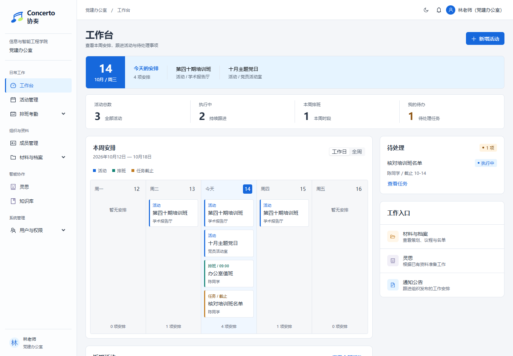
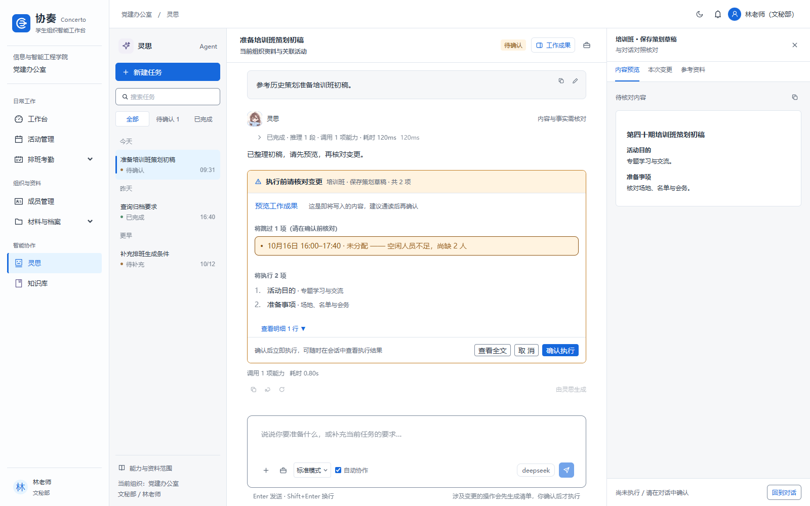

# 协奏 Concerto

**学生组织智能工作台 · PAMS**

协奏把活动筹备、排班考勤、成员资料、内容宣传和档案归集放进同一个工作台，并通过「灵思」AI 助手连接资料检索与业务操作。项目起源于信息与智能工程学院党建办公室的党务管理场景，现已支持多组织注册、数据隔离、组织主题和领域包配置。

本文更新于 **2026-10-30**，对应 **`Concerto` 分支**，覆盖 UI v6、Word 策划书、灵思任务工作区与长期记忆、租户角色权限及通知管线。仓库与后端工程继续使用 PAMS 名称，界面产品名为「协奏」，智能助手名为「灵思」。源码能力与生产部署可能不同步，部署状态以相应发布记录为准。

[快速启动](#快速启动) · [功能概览](#功能概览) · [灵思与知识库](#灵思与知识库) · [组织与权限](#组织与权限) · [开发与验证](#开发与验证) · [文档导航](#文档导航)



*截图来自 UI 验收样本，用于展示布局与交互；示例名称、日期和数量不代表实际部署数据。*

## 功能概览

| 工作区 | 主要能力 |
| --- | --- |
| 工作台 | 本周活动、排班和任务截止聚合，待办入口，工作日 / 全周切换 |
| 活动管理 | 活动阶段推进、原生 DOCX 策划书编辑与版本审核、议程、座位表、评分、签到、任务甘特图与活动排班 |
| 排班考勤 | 常规排班、我的排班、活动排班预览与发布、考勤核对与修正、课表导入、无课时间查询 |
| 成员与党务 | 成员名册、届别、发展阶段、考察记录、转入转出和党务名册 |
| 宣传与档案 | 推文、新闻稿、材料、模板、素拓加分、公告和群聊资料 |
| 智能协作 | 灵思对话、资料问答、多 Agent 协作、持久任务与成果版本、变更确认、历史摘要与个人长期记忆 |
| 组织管理 | 自助注册、组织架构树、岗位、用户、租户角色、权限工作稿、发布历史与管理员委派 |
| 通知中心 | 业务消息、未读与截止提醒、公告确认、通知偏好、SSE 实时更新及投递运维 |

UI v6 提供明暗主题、组织品牌色、桌面侧栏和手机抽屉导航。活动、排班、档案与灵思采用各自的业务工作面，创建和编辑表单复用公共组件。菜单与操作入口会根据当前账号权限及组织领域包调整。

## 技术栈

| 层次 | 实现 |
| --- | --- |
| 前端 | React 18、TypeScript 5.7、Vite 7、Ant Design 5、Zustand、React Router 6 |
| 后端 | Java 21、Spring Boot 4.0.2、Spring Data JPA、Spring Security、JWT |
| 数据 | MySQL 8、Flyway；测试使用 H2 的 MySQL 兼容模式 |
| 实时通信 | 通知使用 SSE；聊天等场景使用 WebSocket、STOMP、SockJS |
| 文档编辑 | SuperDoc 2.24.0 原生 DOCX 编辑、导入、保存与下载 |
| AI | DeepSeek 接入、stub 规则模式、工具注册与确认门禁、多 Agent 编排 |
| 资料处理 | 关键词检索、MySQL ngram 全文索引及 LIKE 降级，Excel 与 Word 文档处理 |
| 验证与部署 | JUnit / MockMvc、Vitest、Playwright、Docker Compose、Nginx |

## 快速启动

### 1. 准备环境与依赖

本地开发需要 **JDK 21、Maven 3.9+、Node.js 22.12+ 和 MySQL 8**，并确保相关命令已加入 PATH。

```bash
git clone --branch Concerto git@github.com:RanranCoder/PAMS.git
cd PAMS

cd pams-web
npm ci
cd ..
```

### 2. 配置本地环境

在 Git Bash 或其他 Bash 终端复制配置示例，随后编辑 `.env`：

```bash
cp .env.example .env
```

`.env.example` 中的 `MYSQL_*` 供 Docker Compose 使用；**本地直连 MySQL 的密码使用 `DB_PASSWORD`**。可在 `.env` 中追加：

```dotenv
# 本地开发：连接 localhost:3306，默认用户 root
DB_PASSWORD=your_local_mysql_password

# 可选：启用灵思真实模型；不填时使用 stub 规则模式
PAMS_AGENT_API_KEY=
```

同时替换示例中的 `PAMS_JWT_SECRET`。本地未设置该项时，后端每次启动生成随机密钥，重启后需要重新登录。`.env` 已被 Git 忽略；系统环境变量优先于文件配置。后端会尝试从启动目录及其上级目录读取 `.env`，从仓库根目录或后端模块目录启动均可。

### 3. 启动应用

**Windows 一键启动**：先启动 MySQL，再在仓库根目录的 PowerShell 中运行：

```powershell
.\start.bat
```

脚本会读取 `.env`、检查 MySQL、创建 `pams_db`，并在独立窗口中启动后端和前端，随后打开浏览器。它使用 MySQL `root` 用户和 `DB_PASSWORD`，后端启用 `dev` profile；前端依赖需提前安装。

**手动启动**：在仓库根目录执行以下命令。建库命令中的密码应与后端配置一致。

```bash
# 创建数据库；表结构由后端启动时的 Flyway 迁移维护
mysql -u root -p < database/init_db.sql

# 终端一：后端（dev profile 用于首次初始化演示账号）
mvn -f pams-backend/pom.xml spring-boot:run -Dspring-boot.run.profiles=dev
```

```bash
# 终端二：前端
cd pams-web
npm run dev
```

| 服务 | 地址 |
| --- | --- |
| 前端 | <http://localhost:5173> |
| 后端 | <http://localhost:8080> |
| 注册组织 | <http://localhost:5173/register> |

Vite 已将 `/api`、`/uploads` 和 `/ws` 代理到后端。首次启动需等待 Maven 下载依赖、Flyway 迁移和种子初始化完成。

**使用 IntelliJ IDEA**：打开仓库根目录，导入根 `pom.xml` 聚合工程，运行 `com.pams.PartyAffairsManagementSystemApplication`。需要演示账号时设置 Active profiles 为 `dev`；前端仍单独运行 `npm run dev`。

### 演示账号与新组织

开发 / 测试环境首次初始化基础部门与角色时，会创建以下演示账号，密码均为 **`123456`**：

| 用户名 | 初始业务角色 |
| --- | --- |
| `teacher` | 指导老师 |
| `zhuren` | 主任 |
| `orgleader` | 组织部长 |
| `secleader` | 文秘部长 |
| `medialeader` | 新媒体部长 |
| `techleader` | 青年科技部长 |
| `admin` | 主任（账号显示名为系统管理员） |
| `staff` | 干事 |

这些账号仅在 `dev` / `test` profile 下初始化；为已有数据库补开 `dev` 不会自动补齐演示账号。角色名称和历史级别不直接决定当前治理权限，实际授权以组织内已发布配置为准。

默认组织的示例活动、策划书、党务资料等由 `DataSeeder` 在非 `test` 环境、活动表为空时幂等生成；**示例业务数据与演示账号的初始化条件不同**。

需要独立组织时，从登录页进入「注册组织」，配置组织名称、架构、领域包与管理员账号。新组织拥有独立的租户角色和数据空间。生产部署不启用 `dev`，通过注册流程创建组织及其管理账号。

## 灵思与知识库

灵思入口为 `/agent`，任务列表、对话过程和工作成果在同一个工作区内呈现。

| 模式 | 行为 |
| --- | --- |
| 标准模式 | 查询和准备业务操作；写入前展示待确认清单，确认后执行 |
| 只读模式 | 查询业务信息，写工具不可用 |
| 资料问答 | 检索知识库资料，按引用来源回答，使用独立问答流水线 |



- **先准备，再确认**：缺少信息时在对话中补齐；执行前可检查内容、变更与参考资料，执行后查看回执、失败或跳过项。
- **排班预览不写库**：确认时重新计算并核对候选指纹；人员或条件变化后要求重新生成，确认成功只创建草稿，仍需在活动排班页发布。
- **自动协作**：多 Agent 协作已内聚到灵思标准模式，专家进度与审查过程在对话内展示；不再提供独立 `/agent/team` 页面。后端保留串行、并行汇聚、反思和委派等编排能力。
- **历史可恢复**：保存会话、任务状态、模型思考记录与过程旁白；历史内容仍按任务归属、数据敏感级别和当前权限处理。
- **资料可追溯**：知识库覆盖制度文档、公告、推文、策划书、事实快照和成员名册，检索与查看来源时检查访问权限。当前使用关键词检索，并非向量数据库方案。
- **实验入口**：`/admin/benchmark` 提供单 Agent / 多 Agent 对比，访问受权限守卫控制。

未配置 `PAMS_AGENT_API_KEY` 时，后端自动使用 stub 规则模式，业务页面仍可启动；规则模式不能替代真实模型的开放式问答能力。模型、超时、输出长度和思考开关由 `pams.agent.*` 配置控制，具体值见 [application.yml](pams-backend/src/main/resources/application.yml)。

### 任务恢复与协作开关

任务、执行检查点、待确认清单和成果版本持久化保存。恢复时沿用原任务状态；业务已提交但回执尚未完成的动作需要核对，不能无条件重新执行。详情与隔离验收方法见 [S5 验收说明](scripts/agent-s5/README.md)。

`pams.agent.collaboration-enabled=false` 可将新请求切回单 Agent 路径；`pams.agent.collaboration-org-ids` 非空时限定协作组织。基准评估默认关闭，启用 `pams.agent.benchmark-enabled` 时还需设置 `pams.agent.benchmark-org-ids`。配置变更需重启应用，已有任务和清单继续保留。

### 上下文与长期记忆

长对话采用近期完整轮次、增量持久化摘要与原文回查共同组装上下文，并在调用前执行输入预算检查。摘要引用真实来源消息，读取时重新校验归属、权限与来源变化；业务完成状态仍以数据库和工具回执为准。预算采用 UTF-8 字节估值，不是供应商精确 token 计数。

灵思顶部的「长期记忆」支持新增、编辑、候选确认、搜索、有效期、删除和关闭读取，也可直接发送：

```text
记住：风格=回答简洁，先给结论
记住：【项目:党建】格式=先列议程，再给分工
查看长期记忆
忘记：风格
关闭长期记忆
开启长期记忆
```

记忆绑定当前组织与当前用户；项目标签属于个人分类。项目偏好需要在本轮问题中明确带上对应标签。当前要求优先，记忆不能替代审批或业务确认。系统没有启用自动抽取，未确认候选不进入模型上下文；删除记忆不会删除旧聊天。管理抽屉中的使用统计按用户与组织隔离、在进程内限时保存，缺失 token 显示为空，不换算费用。实现边界见[上下文管理](docs/design/PAMS-Agent上下文管理落地说明.md)、[长期记忆](docs/design/PAMS-Agent长期记忆落地说明.md)与[产品化验收](docs/design/PAMS-Agent记忆产品化验收.md)。

## Word 策划书

活动策划书使用 SuperDoc 原生 DOCX 编辑器，提供开始、插入、布局、审阅、视图工具页签。支持导入 Word、编辑、保存及下载已保存文档，无需额外部署 Office 服务。保存时上传独立 DOCX 文件并绑定当前草稿，后端从文件提取知识库检索正文；已提交版本不可直接编辑，修订会创建新的业务版本，文档读取仍按版本与审核权限控制。

旧 HTML 策划书通过兼容迁移进入文档工作面。编辑器未就绪或保存失败时会保留错误与重试入口。部署使用的编辑器许可证通过前端构建变量 `VITE_SUPERDOC_LICENSE_KEY` 注入；本地开发可在 `pams-web/.env.local` 配置，Compose 构建从根目录 `.env` 读取同名值。详见 [SuperDoc 接入](docs/design/PAMS-SuperDoc-接入与验收.md)和[工具页签](docs/design/PAMS-SuperDoc-工具页签落地.md)。

## 通知中心

通知管线记录业务事实和接收人，由后台投递，并通过带认证的 `/api/notifications/stream` SSE 连接更新页面。功能覆盖任务与审核消息、截止提醒、公告确认、个人通知策略与摘要，以及投递指标、维护订阅和运维审计。反向代理需支持 SSE 并关闭该流的缓冲；仓库 Nginx 配置已包含相关设置。

隔离数据库、迁移和实时连接的演练方法见[通知验收工具](scripts/notification-acceptance/README.md)与[上线演练记录](docs/design/PAMS-消息通知管线-v1-上线验收演练记录.md)。

## 组织与权限

业务数据按组织隔离，Hibernate 租户过滤、请求上下文和异步任务上下文共同传递组织身份。组织可配置主题色、术语及领域包（`party` / `volunteer` / `club`），控制业务入口与文案。

当前授权模型将**业务主角色**与**组织治理身份**分开：

- 用户采用一个业务主角色；角色可从模板创建、复制，经历草稿、启用、停用和归档等状态。
- 权限工作稿不参与运行鉴权；预览并发布后生成生效授权及不可变历史快照。
- 所有者可委派或撤销组织管理员，配置可授权清单和有效期；管理身份不等于自动获得全部业务数据访问权。
- 用户角色替换通过预览与应用流程校验，角色发布、分配和委派变更保留审计记录。
- Agent 工具执行、知识来源读取和聚合接口同样执行权限检查，不能依赖前端菜单隐藏实现鉴权。

首版权限配置仅开放 **`ORG`（本组织）范围**，尚未实现节点子树、本人、指定资源等新范围，也不支持多业务角色叠加。旧批量开户与固定密码重置入口已关闭。所有者交接、平台治理后台、历史恢复和审计导出等能力仍在后续范围内。完整边界见[首版落地记录](docs/PAMS-角色权限与租户管理-首版落地记录.md)。

## 配置与部署

### 常用配置

| 配置项 | 用途与默认行为 |
| --- | --- |
| `DB_PASSWORD` | 本地 MySQL 密码，默认 `root`；本地默认地址 `localhost:3306/pams_db`、用户 `root` |
| `SPRING_DATASOURCE_URL` | 通过系统环境变量覆盖数据库连接地址 |
| `SPRING_DATASOURCE_USERNAME` / `SPRING_DATASOURCE_PASSWORD` | 通过系统环境变量覆盖数据库账号与密码 |
| `PAMS_JWT_SECRET` | JWT 签名密钥；本地未设置时随机生成，生产需显式配置 |
| `PAMS_AGENT_API_KEY` | 灵思模型密钥；未配置时降级 stub |
| `PAMS_AGENT_PROVIDER` | 模型提供方，可设为 `stub` 显式使用规则模式 |
| `PAMS_AGENT_MODEL` | 覆盖后端默认模型标识，按实际供应商与部署配置填写 |
| `PAMS_UPLOAD_DIR` | 上传文件保存目录，默认 `./uploads`，相对于后端进程工作目录 |
| `VITE_SUPERDOC_LICENSE_KEY` | 前端构建时注入的 SuperDoc 许可证配置，修改后需重新构建前端 |
| `MYSQL_ROOT_PASSWORD` / `MYSQL_USER` / `MYSQL_PASSWORD` | Docker Compose 中 MySQL 初始化与应用连接配置 |

`PAMS_AGENT_PROVIDER`、`PAMS_AGENT_MODEL`、`PAMS_UPLOAD_DIR` 等通过系统环境变量覆盖 Spring 配置；Compose 默认只向后端传入编排文件中列出的环境变量，新增配置需同步修改其 `environment`。

### Docker Compose

编辑根目录 `.env`，替换 `.env.example` 中的数据库凭据和 JWT 密钥。需要真实模型时另加 `PAMS_AGENT_API_KEY`，然后运行：

```bash
docker compose up -d --build
docker compose ps
```

编排包含 MySQL、后端和 Nginx 前端三个服务，访问 <http://127.0.0.1:8081>。前端端口默认仅绑定宿主机回环地址；对外访问需另外配置反向代理或端口映射。MySQL 数据和上传文件分别保存到 `pams-mysql-data`、`pams-uploads` 命名卷。

当前源码迁移已到 **V58**，包括 V37 租户授权、V41 DOCX 文档关联、V42–V46 Agent 执行与评估、V47–V48 授权补全、V50–V56 通知管线、V57 会话摘要和 V58 长期记忆。升级存量数据库前应备份，并在目标 MySQL 环境验证迁移、所有者归属和授权结果；H2 回归不能替代生产迁移验收。部分历史部署采用单独应用字段或表的发布方式，不能仅凭源码版本认定线上 Flyway 历史已经同步，也不能为启用记忆直接执行所有待处理迁移。

仓库的镜像构建工作流在推送 `main` 或手动触发时运行；推送 `Concerto` 不会自动触发该工作流。部署脚本与配置见 [docker-compose.yml](docker-compose.yml)、[deploy.sh](deploy.sh) 和 [镜像构建工作流](.github/workflows/build-push-images.yml)。

## 开发与验证

在仓库根目录运行后端测试：

```bash
mvn -f pams-backend/pom.xml test
```

后端测试使用 H2 测试配置与 Flyway 迁移，不依赖本机 MySQL；测试 profile 默认使用 stub，避免因本机存在模型密钥而调用真实 API。

```bash
cd pams-web
npm test
npm run build
```

`npm run build` 会执行 TypeScript 检查和 Vite 生产构建。

Playwright 包含模拟 API 的 UI 回归及需要真实后端的冒烟测试。运行完整集合前，准备好 MySQL、`dev` 后端和浏览器：

```bash
cd pams-web
npx playwright install chromium
npm run test:e2e
```

配置会启动或复用 5173 上的 Vite 服务，不负责启动后端。部分 UI 用例在 Windows 上指定 Microsoft Edge，需本机已安装；其他用例可通过 `PAMS_E2E_CHROME_CHANNEL` 选择本机浏览器。浏览器样本测试用于验证页面行为，不能代替真实接口与数据库联调。

长期记忆管理可定向运行 `npx playwright test e2e/agent-memory.spec.ts`。S5 真实模型、进程恢复和浏览器验收使用独立 MySQL 测试库及显式开关，不属于默认离线测试；执行命令与前置条件见 [S5 工具说明](scripts/agent-s5/README.md)。通知系统的隔离验收另见[通知工具说明](scripts/notification-acceptance/README.md)。历史验收数量与结果记录在各自文档中，不代表每次拉取代码后的测试结果。

## 项目结构

```text
PAMS/
├── pams-backend/
│   └── src/
│       ├── main/java/com/pams/
│       │   ├── common/、config/、security/     # 公共设施、租户上下文与认证
│       │   └── module/                        # 活动、排班、党务、档案、Agent、知识库、组织与权限
│       ├── main/java/db/migration/            # Java Flyway 迁移（含 V37）
│       ├── main/resources/
│       │   ├── application.yml
│       │   └── db/                           # 通用 / MySQL / H2 迁移
│       └── test/                             # 单元与集成测试
├── pams-web/
│   ├── src/
│   │   ├── api/、stores/                     # 接口与应用状态
│   │   ├── components/                       # 品牌、表单、灵思及业务共享组件
│   │   ├── layouts/、pages/、router/          # 页面、导航与权限守卫
│   │   └── styles/、utils/                   # v6 主题、样式与工具函数
│   ├── dev/                                  # 开发代理辅助逻辑
│   └── e2e/                                  # Playwright 用例
├── database/                                 # 建库与存量材料处理脚本
├── docs/                                     # 设计、实现记录、原型与验收截图
├── pom.xml                                   # Maven 聚合入口
├── .env.example                              # 容器环境配置示例
├── docker-compose.yml
├── deploy.sh
└── start.bat                                 # Windows 本地开发启动入口
```

## 文档导航

| 主题 | 文档 |
| --- | --- |
| 产品与规划 | [总体设计](docs/PAMS设计方案.md)、[PRD v5 开发规划](docs/PRD-v5-开发规划.md)、[通用化与多 Agent 策划](docs/PAMS-通用化与多Agent协作改造策划.md) |
| 品牌与 UI | [协奏品牌标识](docs/design/协奏-品牌标识设计说明.md)、[UI v6 设计规范](docs/design/PAMS-UI-设计方案-v6-行业规范修订.md)、[表单工作面](docs/design/PAMS-表单工作面重设计.md) |
| 业务界面落地 | [排班考勤](docs/design/PAMS-UI-v6-排班考勤落地记录.md)、[组织宣传档案与党务](docs/design/PAMS-UI-v6-组织宣传档案与党务台账落地记录.md)、[登录与注册](docs/design/PAMS-登录与组织注册-改版与修复.md) |
| 灵思与资料 | [Agent 业务方案](docs/PAMS-Agent业务设计方案.md)、[灵思 v6 落地记录](docs/design/PAMS-UI-v6-灵思Agent落地记录.md)、[知识库问答方案](docs/PAMS-灵思知识库问答方案-v1.md) |
| 灵思运行与记忆 | [升级方案](docs/design/PAMS-灵思Agent升级优化方案.md)、[S5 联调评估](docs/design/PAMS-灵思Agent-S5联调评估报告.md)、[上下文管理](docs/design/PAMS-Agent上下文管理落地说明.md)、[长期记忆](docs/design/PAMS-Agent长期记忆落地说明.md)、[记忆产品化验收](docs/design/PAMS-Agent记忆产品化验收.md) |
| Word 与通知 | [SuperDoc 接入](docs/design/PAMS-SuperDoc-接入与验收.md)、[通知策略与指标](docs/design/PAMS-消息通知管线-v1-通知策略与指标落地记录.md)、[通知上线演练](docs/design/PAMS-消息通知管线-v1-上线验收演练记录.md) |
| 授权模型 | [角色权限与租户管理方案](docs/PAMS-用户角色权限与多租户管理设计方案-v1.md)、[管理员业务设计](docs/PAMS-管理员角色权限管理业务设计-v1.md)、[首版落地记录](docs/PAMS-角色权限与租户管理-首版落地记录.md) |
| 接口与变更 | [API 文档](docs/API.md)、[代码审计记录](docs/代码审计报告-2026-10-14.md)、[分支与分批推送记录](docs/分支梳理与分批推送记录-2026-10-16.md) |

设计方案包含后续规划；判断当前可用能力时，以本分支代码、相应落地记录及实际授权配置为准。

## 许可证

项目代码采用 [MIT License](LICENSE)。SuperDoc 等第三方组件的使用与部署遵循各自许可证。
