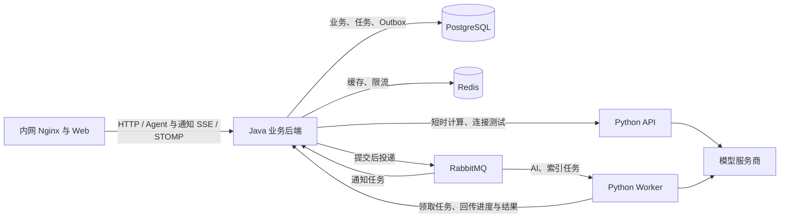

# 协奏 Concerto 项目技术框架 PRD

> v0.4 评审稿 · 2026-11-27 · 仓库基线 `feature@b6b1666`

协奏本期将 Concerto Agent 与排班计算迁到 Python，将 Agent 流式输出改为 SSE，将业务数据库迁到 PostgreSQL，引入 RabbitMQ 和 Redis，并用 GitHub Actions 跑通从代码检查到环境部署、验证和回滚的流程。用户从现有 Web 工作台操作，管理员可以按发布版本核对数据库迁移结果、查看异步任务状态和恢复服务。

目前 `feature` 分支运行于内网自部署服务器。部署、冒烟和回滚从内网验证，发布候选按明确的提交和镜像清单推进。

## 1. 当前架构与改造范围

| 范围 | 当前分支 | 本期目标 |
| --- | --- | --- |
| Web 与业务后端 | React、TypeScript、Vite 和 Nginx 提供工作台，Java 21、Spring Boot 4.0.2 承载 API、用户权限和业务事务。 [项目 README](../README.md) | Java 负责认证、租户授权、业务状态、审计和写入。工作台通过 HTTP API 操作，通过 SSE 接收 Agent 流式输出和通知，通过 STOMP 接收独立任务状态与授权变更事件。 |
| AI 与计算 | 模型调用、Agent 编排、知识库检索、无课表计算和活动排班算法在 Java 进程内。 [Agent 设计](项目知识沉淀/协奏Concerto%20Agent%20设计原理.md) · [业务操作手册](协奏PAMS-当前业务功能与使用流程说明.md) | Python 承担模型调用、推理编排、检索计算和排班候选生成。Java 保存对话、任务和成果，执行工具与发布操作。 |
| 数据库 | Compose 使用 MySQL 8.0，Flyway 迁移到 V74。常规后端测试使用 H2 的 MySQL 兼容模式，S5 专项使用 MySQL。 [应用配置](../pams-backend/src/main/resources/application.yml) · [V74](../pams-backend/src/main/resources/db/migration/V74__no_class_schedule_publication.sql) | PostgreSQL 覆盖空库部署和存量升级。迁移、约束、权限和并发验收使用真实 PostgreSQL。 |
| 后台任务与缓存 | 通知与 Agent 已有数据库 Outbox。登录、组织注册限流使用进程内 Caffeine，Agent 过程事件和连接订阅由 Java 进程管理。 [通知管线](design/PAMS-消息通知管线重设计-v1.md) · [接口清单](API-inventory.md) | RabbitMQ 投递后台任务，PostgreSQL 记录处理结果，Redis 提供共享缓存和限流。 |
| 交付 | `main` 的 GitHub Actions 测试通过后，按提交 SHA 推送 GHCR 与阿里云 ACR 的镜像。服务器侧由 `deploy.sh` 更新 Compose 并重启服务。 [现有工作流](../.github/workflows/build-push-images.yml) · [部署脚本](../deploy.sh) | PR 自动验收，合并后自动部署预发并验证，按已验证的版本清单发布生产。每次发布记录镜像、迁移、冒烟和回滚结果。 |

### Java 后端技术基线

版本以当前分支的 Maven 依赖树与容器配置为准。 [后端 POM](../pams-backend/pom.xml) · [Dockerfile](../pams-backend/Dockerfile) · [应用配置](../pams-backend/src/main/resources/application.yml)

| 层级 | 技术与用途 |
| --- | --- |
| 构建与运行 | Java 21、Maven 3.9、Spring Boot 4.0.2，容器用 Eclipse Temurin 21 JRE 运行可执行 JAR。 |
| Web 与序列化 | Spring MVC 7.0.3、内嵌 Tomcat 11.0.15、Hibernate Validator 9.0.1.Final。Web 配置引入 Jackson 3.0.4，部分业务代码使用 Jackson 2.20.2 API。 |
| 数据访问 | MySQL 8.0 服务端与 Connector/J 9.5.0，Spring Data JPA 4.0.2、Hibernate ORM 7.2.1.Final、HikariCP 7.0.2。JdbcTemplate 用于部分原生 SQL，Flyway 11.14.1 管理表结构。 |
| 身份与授权 | Spring Security 7.0.2、JJWT 0.12.6、BCrypt。后端维护租户、角色权限和业务授权。 |
| 推送与异步 | Spring WebSocket、STOMP、SockJS 和进程内 broker 推送 Agent 与授权事件，Spring MVC SSE 推送通知。Spring Scheduling 与数据库 Outbox 处理后台任务，Agent 使用 Java 线程池，Caffeine 3.2.3 用于进程内登录和注册限流。 |
| AI 与文档 | Java 编排 Concerto Agent，Apache HttpClient 5.5.2 调用兼容 Responses 和 Chat Completions 的模型服务。Apache POI 5.4.1 处理 Excel 和 Word，jsoup 1.18.3 净化 HTML。容器通过 LibreOffice 和 Poppler 支持文档渲染与文本核验。 |
| 工程与测试 | SLF4J、Logback、Lombok、JUnit Jupiter 6.0.2、Mockito 5.20.0、MockMvc。常规集成测试使用 H2 2.4.240，专项联调使用 MySQL 8.0。 |

## 2. 目标架构与选型

| 组件 | 首期基线 |
| --- | --- |
| Python | 最低支持 Python 3.12，部署镜像建议用 3.14 的受支持补丁版本。3.12 已进入安全修复阶段，CI 同时验证最低版本与部署版本。新增 `pams-ai/`，以 `pyproject.toml` 和锁文件管理依赖，使用 FastAPI 提供内部接口、pytest 验证契约和算法。API 与 Worker 复用同一镜像，各自配置资源和并发。 [Python 版本状态](https://devguide.python.org/versions/) |
| PostgreSQL | 首选 PostgreSQL 18，使用 PostgreSQL JDBC、Flyway 的 PostgreSQL 模块和独立迁移目录。预发确认驱动、连接池、扩展许可和现有 Spring Boot 依赖的兼容性，按通过验证的补丁版本部署。 [PostgreSQL 支持周期](https://www.postgresql.org/support/versioning/) · [Flyway PostgreSQL 支持](https://documentation.red-gate.com/flyway/reference/database-driver-reference/postgresql-database) |
| RabbitMQ | 首选 RabbitMQ 4.4，通过 AMQP 连接 Java 和 Python。持久化队列承载 AI 运行、知识库重建和通知分发，按任务类型配置并发、超时和死信队列。 [RabbitMQ 版本支持](https://www.rabbitmq.com/release-information) |
| Redis | 首选 Redis Open Source 8.2 扩展支持版本。用于可重建的读缓存和共享限流计数，配置内存上限、键过期及访问权限。 [Redis 版本管理](https://redis.io/docs/latest/operate/oss_and_stack/install/version-mgmt/) |
| 部署拓扑 | 以现有内网自管服务器为部署目标，按仓库的 Docker Compose 方式和单 Java 实例设计。Nginx 以浏览器信任的证书提供内网 HTTPS 入口，覆盖工作台、HTTP API、SSE 和 WSS。证书涵盖用户实际使用的内网域名或 IP。Python、PostgreSQL、RabbitMQ 和 Redis 仅在服务网络内开放。 [Bearer Token 传输规范](https://www.rfc-editor.org/rfc/rfc6750.html#section-5.3)预发与运行实例共用宿主机时，使用可区分的 Compose 项目、容器名、端口、凭据和数据卷。 |

当前 STOMP 订阅和通知 SSE 连接由接入的 Java 实例管理，Agent SSE 也采用该部署方式。需要扩展 Java 实例时，先验证跨实例投递、重连后读取事件缓存及定时任务互斥。Python Worker 可按队列积压独立扩展。 [接口清单](API-inventory.md)

## 3. AI 与算法迁移

| 能力 | Python 职责 | Java 职责与验收重点 |
| --- | --- | --- |
| 模型服务与 Agent | 实现 Responses 和 Chat Completions 协议、stub 模式、上下文筛选与摘要、推理、工具选择和多 Agent 编排。 | 保存组织服务商配置、会话、任务、记忆和成果。通过 SSE 提供回复及过程事件，通过 HTTP 提供聊天受理、取消、确认、补拉和回执。写操作由 Java 复核当前授权、确认内容和幂等键后执行。 [组织 AI 服务](design/ai-services/README.md) |
| 知识库 | 执行文档分块、关键词处理、召回结果排序和答案引用组织。长时间重建由 Worker 执行。 | Java 管理文件、索引版本和可见范围，由 PostgreSQL 在授权范围内召回候选。用户可打开引用来源，撤权后的资料在查询和回传环节均受当前授权约束。 |
| 课表与活动排班 | 迁移课程周次与空闲时段计算、候选人员匹配、冲突判断及班次候选生成。输入采用版本化约束和候选数据，输出包含候选方案、未分配原因与输入版本。 | Java 保管原始文件、导入与排班记录。持锁事务前完成 Python 计算。Java 在事务内复核输入版本、现有班次、权限和预览指纹后保存草稿或发布。覆盖重叠班次、同名成员、学期周次、导入部分失败和并发修改。 |

- 短时计算走有超时的内部 HTTP，模型长任务和批量重建走 RabbitMQ。用 OpenAPI 约定接口，用 JSON Schema 约定消息。滚动发布和回退期间，生产者与消费者兼容仍在队列中的消息版本。Java 由公共 API 受理任务，通过数据库恢复任务状态与最终结果。 [接口清单](API-inventory.md)
- Java 保存经校验的 `org_id`、`user_id`、`authz_version`、`request_id` 和任务输入版本。内部调用使用服务身份及加密传输，Worker 按任务领取所需的最小数据。Java 在读取业务资料、执行工具和提交结果时校验任务归属、当前授权和取消状态。
- Java 执行模型数据出站策略。用户输入、工具结果、检索片段、会话和记忆等业务上下文在进入模型请求前，由 Java 按组织与服务商执行 `PolicyGuard` 的敏感度判定与脱敏。`SENSITIVE` 内容脱敏后允许出站，`RESTRICTED` 内容在出站环节拦截。由 Python 生成的摘要或重组内容进入模型前同样接受判定。Python 使用为当前任务、授权版本和目标服务商批准的上下文发起请求。 [现有出站策略](../pams-backend/src/main/java/com/pams/module/agent/core/PolicyGuard.java)
- 现有服务商密钥由 Java 保管，Python 按任务通过受限的 TLS 接口领取，在单次执行中使用。队列、日志和追踪只包含引用、状态、耗时及错误码。Python 继承服务商地址和网络出口约束，按组织限制并发、超时和模型消耗。组织配置失效时返回明确状态或按该组织的配置进入 stub 模式。
- 按组织开启 Python 路由。每次运行固定引擎和输入版本，在同一引擎中处理确认、取消与恢复。异常时先关闭新任务到 Python 的入口，再按状态排空、取消或核对已有任务。操作结果存在不确定性时，先依据业务回执核对，再决定是否重试。

### Agent SSE 输出契约

- 工作台通过 `POST /api/agent/chat` 的后台模式受理请求并取得 `streamId`，再订阅拟新增的 `GET /api/agent/streams/{streamId}/events`。Java 使用 `SseEmitter` 返回 `text/event-stream`，统一承接 Java 和 Python 引擎的输出。前端复用通知流的 `fetch-event-source`，用 `Authorization` 请求头携带凭据。 [现有通知连接](../pams-web/src/hooks/useNotificationStream.ts) · [fetch-event-source](https://github.com/Azure/fetch-event-source)
- 回复片段、工具进度和本轮结果共用一条流。Java 在同一次原子操作内分配流内序号 `seq` 并按序入队，在锁外串行发送。`id` 对应 `seq`，`event` 对应事件类型，`data` 沿用现有事件结构。登记实时订阅与记录当时最大序号一并完成，先回放至该序号，再接续更大的序号。工作台显式管理重连游标，以最后成功应用的序号设置 `Last-Event-ID`，用 `streamId` 和 `seq` 去重。 [Agent 事件模型](../pams-backend/src/main/java/com/pams/module/agent/stream/AgentStreamEvent.java) · [SSE 续传规范](https://html.spec.whatwg.org/dev/server-sent-events.html#the-last-event-id-header)
- 使用有容量与时限的短期事件缓存。游标超出可回放范围或缓存丢失时，服务端校验归属后发送 `snapshot_required` 并结束订阅。工作台通过 `GET /api/agent/streams/{streamId}` 的 `requiresSnapshot` 语义及会话和任务查询恢复持久状态。仍在运行时，从授权请求状态接口取得可用流及游标。已回收的流如需继续输出，为原请求分配新的 `streamId`。用户主动停止时调用 `POST /api/agent/chat/{streamId}/abort`。本次输出完成、失败、取消或进入人工等待后，发送对应状态并关闭连接。 [Agent 控制器](../pams-backend/src/main/java/com/pams/module/agent/controller/AgentController.java)
- Java 在订阅、重连和连接存续期间检查流归属、组织、令牌有效期与授权版本。令牌失效或撤权时停止发送待推的业务事件，向已打开的流发送仅表明授权结束的 `authorization_ended` 控制事件并关闭连接。前端收到该事件或订阅鉴权失败时停止自动重连。 [Spring MVC 流式响应](https://docs.spring.io/spring-framework/docs/7.0.3/javadoc-api/org/springframework/web/servlet/mvc/method/annotation/ResponseBodyEmitter.html)
- 内网宿主机与容器内 Nginx 对 Agent SSE 路由关闭响应缓冲、缓存和压缩，代理读超时长于心跳间隔。服务以注释帧发送心跳。心跳和控制事件独立于业务序号。 [现有通知反代配置](../pams-web/nginx.conf) · [Nginx 响应缓冲](https://nginx.org/en/docs/http/ngx_http_proxy_module.html#proxy_buffering)

## 4. PostgreSQL 迁移与恢复

### 4.1 数据模型与查询适配

| 项目 | 迁移要求 |
| --- | --- |
| Flyway 基线 | 建立 `db/migration-postgresql`。用经核对的 V74 等价结构初始化空 PostgreSQL 库，后续版本自 V75 递增。原 MySQL 迁移链和历史随备份归档，导入前验证源库的实际 Flyway 版本。区分首次启用的基础种子与存量数据导入模式。 |
| 字段、约束和序列 | 保留主键、外键及关键业务唯一性。单独验证全局用户名、组织内复合键、软删索引、空值、大小写和中文排序等约束。保留历史本地日期与时间含义，按字段区分本地时间和绝对时刻。导入后校准标识列序列，抽测长文档、JSON 和密文。 [现有租户唯一键](../pams-backend/src/main/resources/db/migration-mysql/V34__tenant_unique_keys.sql) |
| 原生 SQL 与并发 | 盘点 JPA 原生查询、JdbcTemplate、Flyway 和演示种子。逐处移植 MySQL 的 upsert、时间函数、DDL、排序规则和行锁语义。在 PostgreSQL 上验证通知合并与去重、Agent 运行租约、排班发布、签到和考勤并发。 [Agent 运行租约](../pams-backend/src/main/java/com/pams/module/agent/orchestration/RuntimeLease.java) · [通知处理器](../pams-backend/src/main/java/com/pams/module/notification/service/NotificationOutboxWorker.java) |
| 中文知识库检索 | 为 MySQL ngram 全文检索提供 PostgreSQL 方案。预发验证 `pg_trgm` 索引和短词限范围匹配，覆盖一至两个汉字、组织内常用简称、排序及权限过滤。用同一批查询测召回率和延迟，再确定上线索引。 [现有检索初始化器](../pams-backend/src/main/java/com/pams/module/knowledge/service/KnowledgeIndexInitializer.java) · [PostgreSQL pg_trgm](https://www.postgresql.org/docs/18/pgtrgm.html) |
| 运行入口 | 同步 Compose、`.env.example`、Windows 启动脚本、S5 和通知验收、演示数据与建库指引。附件卷与 AI 密钥卷随迁移演练验证。 |

生产 PostgreSQL 由部署锁内的一次性迁移任务执行 Flyway。迁移任务持有独立数据库角色，并负责扩展与索引初始化。Java 运行时设置 `SPRING_FLYWAY_ENABLED=false`，以日常读写角色检查数据库连接和结构版本。部署任务核对实际迁移版本，应用就绪按发布清单声明的结构兼容范围判断。 [Spring Boot 数据库初始化](https://docs.spring.io/spring-boot/how-to/data-initialization.html)

### 4.2 迁移演练与生产切换

1. 盘点线上版本、表规模、待处理 Outbox、Agent 任务、附件和密钥。以受控环境中的脱敏副本做全量导入，记录批次进度、拒绝记录、校验结果和耗时。导入脚本按稳定主键和校验记录支持重跑。
2. 在预发完成两类演练，即空库建库初始化，以及从生产结构和代表性数据规模导入。按组织比对关键表行数、主键范围、规范化后的摘要、外键和业务汇总。抽检登录、权限、排班签到、通知已读、附件下载、Agent 历史与服务商密钥解密。
3. 首切前记录并演练开写前与开写后的恢复路径。开写前使用原 MySQL 和原发布清单回切。开写后的应用回滚清单须提前在同一 PostgreSQL 结构和消息契约下验收。首切只有待部署版本支持 PostgreSQL 时，演练并记录停写、保全数据库和前滚修复的步骤、工件及恢复耗时。
4. 维护窗口先停止 MySQL 的新写入和后台处理，排空或记录可恢复任务并确认在途事务结束。记录停写点，生成互相可核对的 MySQL、附件和密钥备份，再完成最终导入、序列校准与对账。候选应用使用只读数据库角色做冒烟，显式关闭候选侧的启动租约续期、业务初始化写入、定时任务和消费者。建库和导入由独立迁移任务完成。 [现有启动租约](../pams-backend/src/main/java/com/pams/module/agent/orchestration/RuntimeLease.java)
5. 对账、只读验证和恢复演练通过后，登记 PostgreSQL 开写时间，启用候选应用写入和后台处理，并验证首批业务操作与任务恢复。开写后以 PostgreSQL 为权威，应用故障按兼容清单回滚或按既定流程停写并前滚。数据故障先保全现状，再在独立实例演练修复或时间点恢复，核对开写后已提交的记录。需要回切 MySQL 时，先完成增量回灌及数据库、附件和密钥对账。

全量导入与对账超出可用维护窗口时，先在预发验证增量同步、切换点和对账结果，再安排生产切换。

### 4.3 备份与异机恢复

- 生产 PostgreSQL 向可达的异机存储写入加密的基础备份和连续 WAL。以低写入和常规负载实测事务提交到 WAL 可恢复的延迟，据此配置归档参数和告警阈值。保留 MySQL 只读备份至约定的回退期结束。 [PostgreSQL WAL 归档与时间点恢复](https://www.postgresql.org/docs/18/continuous-archiving.html)
- 用恢复清单关联数据库恢复点、附件快照、AI 密钥版本和发布清单。异机演练从原宿主机不可用开始，在预先确认的备用环境恢复镜像与配置、数据库、附件和密钥，再验证内网 HTTPS、登录、附件访问、模型密钥解密和当期后台任务。
- 暂定灾备 RPO ≤ 15 分钟，按故障时刻与最近可完整恢复的业务恢复点之间的差值计算。暂定 RTO ≤ 2 小时，按故障发生到核心业务恢复读写的耗时计算。验收记录包括 RPO、RTO 实测、数据库对账、附件存在性和密钥解密结果。

## 5. RabbitMQ 和 Redis 的故障处理

### 5.1 异步任务

- Java 将任务和 Outbox 在同一 PostgreSQL 事务内写入，复用通知去重、收件人及投递账本。发布器发送持久化消息，设置 `mandatory=true`，将 broker confirm 和不可路由退回关联到同一 `event_id`。收到确认且已成功路由时标记投递成功。RabbitMQ 不可用时将待投递记录留在 Outbox，恢复后补投。通知工作按任务选择唯一的处理入口，切换前排空或归并待处理记录。 [RabbitMQ 发布与消费确认](https://www.rabbitmq.com/docs/confirms)
- 队列投递可执行的阶段。Agent 进入 `WAITING_INPUT` 或 `WAITING_CONFIRM` 时，Worker 经 Java 持久化等待状态、续跑所需的上下文引用与输入版本，提交后 ACK 并释放执行资源。用户补充或确认后，Java 复核授权、当前状态和版本，在同一事务登记唯一的续跑任务与 Outbox。续跑需要输出时，为原请求关联新的 `streamId`，工作台从授权的请求状态接口取得该流。 [现有等待状态](../pams-backend/src/main/java/com/pams/module/agent/service/AgentOrchestrator.java)
- 投递采用至少一次语义。消息包含 `event_id`、`job_id`、派发版本、`org_id`、`type`、`schema_version` 和 `trace_id`。Worker 经 Java 原子领取执行权，在任务时限内续租。Java 校验派发版本、尝试号及租约后接受回写。执行结果、等待状态、重试计划或终态提交后再 ACK。业务写入以稳定幂等键及数据库约束防重复。 [RabbitMQ 消费者与超时](https://www.rabbitmq.com/docs/consumers)
- 已确认发布且尚未领取的正常积压触发告警和限流。Outbox 发布失败按退避重试，执行租约过期由 PostgreSQL 按尝试号原子恢复。确认发生队列数据丢失时，根据 PostgreSQL 账本选取未完成的派发，按任务和派发版本去重后恢复。
- 暂定执行失败最多重试三次，间隔 30 秒、2 分钟、10 分钟。输入无效、权限撤销和取消进入对应终态。超过上限时，Java 在同一事务写入失败原因和死信 Outbox，由发布器将任务引用投递到死信队列。授权重放时创建新的派发版本，保留业务幂等键及审计记录。
- 用户任务和批量索引使用独立队列和并发预算。按组织设置配额，核对任务时限、租期和队列类型支持的 ACK 超时。消费者退出时停止领取新任务，完成已领取工作或交给租约恢复。

### 5.2 缓存与限流

- 首期缓存可回源的组织读模型，例如组织展示配置和低敏统计。键按环境、业务域、组织、数据版本命名。用户相关结果纳入用户和授权版本，缓存命中仍经过授权校验。业务提交后失效，默认过期时间按场景在 60–300 秒内调优。
- 登录和组织注册通过 Redis 共享限流状态，计数和首次设置过期时间在同一个原子操作中完成。Java 在 Redis 健康期间也按相同规则维护 Caffeine 本地计数与锁定窗口。Redis 不可用时，缓存按并发上限回源，限流接续现有本地状态并告警。Redis 恢复后，在本地窗口到期前继续检查已有锁定。认证撤销、已提交任务和通知状态从 PostgreSQL 查询。 [Redis 限流示例](https://redis.io/docs/latest/commands/incr/)
- Redis 配置专用 ACL、内存上限和 `noeviction`。写入受限时走缓存与限流各自的降级逻辑。监控容量、错误率、键过期和命中率，并演练 Redis 重启、满载和冷缓存恢复。

## 6. CI/CD 与上线门禁

| 触发点 | 自动执行和产物 |
| --- | --- |
| `feature` 推送与 PR | 在 GitHub 托管 runner 上执行第 8 节当期 PR 必需检查。组件进入对应阶段的发布候选时纳入门禁。必需检查通过后方可合并。 |
| 构建发布候选 | 合并到 `main` 后构建。当前 `feature` 的内网联调通过默认分支上的受控工作流指定候选提交。托管 runner 构建当期交付的镜像并推送到指定仓库，生成含提交 SHA、镜像 digest、Compose 配置和适用的数据库及消息兼容版本的发布清单。 [GitHub 手动触发](https://docs.github.com/en/actions/reference/workflows-and-actions/events-that-trigger-workflows#workflow_dispatch) |
| 部署内网预发 | 内网发布节点按清单自动部署候选。在实际内网 HTTPS 地址验证证书和当期能力，记录存活、就绪和业务冒烟结果，通过后将清单标记为可推广。 |
| 更新内网运行实例 | 通过受保护的部署入口推广已通过预发的清单。使用环境级凭据和部署互斥锁，依次校验配置、拉取镜像、按当期方案执行迁移、启动服务和验证入口。首次 PostgreSQL 切换按第 4.2 节执行。业务冒烟使用专用测试组织和用户实际访问的内网 HTTPS 地址。 [GitHub 部署环境](https://docs.github.com/en/actions/reference/workflows-and-actions/deployments-and-environments) |
| 验证失败 | 停止推广并保留日志与报告，按已验证的兼容发布清单恢复。首次切库或涉及数据库时执行第 4.2 节的对应路径。发布记录包含候选版本、失败检查、恢复版本和业务复验结果。 |

具备出站条件时，在可访问目标服务器的内网发布节点使用专用自托管 runner，由私有部署仓库管理，专用于受保护的部署与回滚。发布节点需要出站 HTTPS 连接 GitHub，并能访问指定镜像源。内网无法直达外部镜像源时，将镜像和发布清单同步到内网镜像仓库。无 GitHub 出站链路时，镜像和发布清单通过受控通道导入内网，后续部署、冒烟和回滚由内网任务执行。 [自托管 runner 网络要求](https://docs.github.com/en/actions/reference/runners/self-hosted-runners#communication-between-self-hosted-runners-and-github) · [自托管 runner 仓库建议](https://docs.github.com/en/actions/how-tos/manage-runners/self-hosted-runners/add-runners)

`/api/ping` 用于 HTTP 存活检查。就绪检查核对真实数据库连接、适用的迁移版本和必要服务。队列进入范围后，用专用测试任务验证发布、领取与提交。Redis 降级按第 5.2 节验证本地限流和限并发回源，并报告缓存状态。业务冒烟覆盖当期的登录、附件、通知和 Agent 能力。 [当前存活接口](../pams-backend/src/main/java/com/pams/controller/PingController.java)

部署入口复用现有 Compose 和 `deploy.sh` 的职责，按发布清单拉取已验证的镜像与配置。数据库变更先扩展结构并保留兼容窗口，再于独立发布收缩旧结构。必需的集成测试使用临时凭据、固定数据和 stub 模型。真实模型的 S5 验收在受控环境中按需执行，保留耗时、用量与回归结果。工作流按任务分配仓库和镜像权限，生产凭据只进入生产发布步骤，镜像记录 SBOM 和扫描结果。

## 7. 可运维要求与验收标准

Java 与 Python 日志、内部请求和队列事件共用 `request_id`、`trace_id` 和适用的任务 ID。首期监控 HTTP 错误与延迟、Agent SSE 首段延迟与异常重连、队列积压与死信、数据库连接与锁等待、Redis 内存和降级、模型超时与用量、备份新鲜度。发布前验证告警能定位到环境、版本和处理入口。

下表为首期验收目标。阶段 0 用现网规模、预发负载和业务维护窗口确定定量基线，复验使用同配置同负载。

| 验收项 | 通过条件 |
| --- | --- |
| 跨租户与业务回归 | 登录与组织切换、活动排班与签到、通知已读、附件下载、Agent 确认与回执通过真实 PostgreSQL 回归。跨租户读取或写入、撤权后继续写入及重试产生的重复业务记录均为 0。 |
| Agent SSE | 经受信任的内网 HTTPS 入口验证运行中分片与空闲心跳。在有效回放窗口内测试并发产出、接入实时输出及断连后的续传，缺漏和重复均为 0。缓存缺失时通过快照恢复持久状态。完成、失败、取消、待确认和撤权后关闭流，令牌失效后停止重连。 |
| Python 路由与质量 | 工作台通过 SSE 使用 Python Agent，覆盖 stub、真实模型、取消与重启。用测试模型核对实际发出的 HTTP 请求，敏感内容已脱敏，受限内容被拦截。排班样例的硬约束违规为 0。固定中文查询集上的 Recall@5 达原基线的 95% 以上，引用来源均可由该用户访问。 |
| 数据准确性 | 空库初始化和历史数据导入均通过。关键表按组织的行数与约束核对无差异，显式数据转换有记录。旧库停写点之前已提交的业务记录均能在新库核对。 |
| 异步任务 | 注入 broker 断连、重复投递和 Worker 中途退出。正常积压触发告警，恢复时已受理任务可从数据库找回。长时间待输入或待确认释放 Worker，重复提交仅创建一次续跑，重复业务写入为 0。 |
| Redis 降级 | 并发计数与过期时间原子更新。Redis 不可用时，已累计的失败次数和锁定窗口有效，核心 API 通过冒烟。Redis 恢复后，已有本地锁定持续到期。 |
| 应用性能 | 同配置、同数据和同负载下，登录、活动列表、排班预览的 P95 为基线的 1.2 倍以内。异步任务受理延迟与模型执行时长分别记录，按组织统计失败率和用量。 |
| 发布与恢复 | 连续两次通过当期的自动预发部署和 HTTPS 冒烟，完成一次失败发布恢复。切库前验证开写前回切、开写后应用恢复和异机灾备。按第 4.3 节实测完整业务恢复的 RPO、RTO，按全量导入实测确定维护窗口。 |

## 8. 实施顺序与评审决策

| 阶段 | 交付内容 | 当期新增的 PR 必需检查 | 内网发布验收 |
| --- | --- | --- | --- |
| 0 · 基线与预发 | 以当前 Java、Web 和 MySQL 跑通 CI 及内网预发 CD。确认 GitHub 和镜像仓库可达性，记录数据量、性能与恢复基线。 | Maven 测试、Web 锁定依赖安装与单测、生产构建。 | MySQL 与现有业务冒烟、HTTPS 证书校验、失败发布恢复。 |
| 1 · PostgreSQL | 完成方言适配、V74 等价基线、可重跑导入和备份恢复手册，独立切换数据库。 | 空库迁移、历史导入、真实 PostgreSQL 并发回归。 | 独立迁移、只读冒烟、对账、开写前和开写后恢复路径的预发演练。 |
| 2 · RabbitMQ 和 Redis | 上线任务投递、恢复、限流与缓存，保留验证过的 PostgreSQL 兼容发布清单。 | PostgreSQL、RabbitMQ、Redis 集成，验证投递去重、租约、重放和限流。 | 验证通知投递、broker 断连恢复、Redis 降级及故障恢复。 |
| 3 · Agent SSE 与 Python 服务 | 先在 Java 引擎交付 SSE，再用同一契约接入 Python API 与 Worker，按组织上线模型调用、编排、知识库和排班计算。 | Java stub 的 SSE 端到端检查。接入 Python 后启用锁定依赖安装、静态检查、pytest、跨服务契约、人工等待续跑、出站策略与算法回归。 | 在内网验证 SSE、确认续跑和取消，通过模型用量与故障恢复验收。 |
| 4 · 生产放量 | 推广已完成预发验收的发布清单，稳定期后收敛临时路由与旧 Java 算法实现。 | 执行适用于候选版本的累计检查。 | 按组织跟踪质量与故障数据，复验升级、恢复与运维文档。 |

进入阶段 1 前确认迁移账号、数据规模、维护窗口、备用恢复环境与回退期。阶段 2 前确认中间件的维护负责人及备份位置。阶段 3 前确定模型出站策略、预算和参与灰度的组织。

后续容量规划以验收数据为依据。跨主机容灾需要验证 PostgreSQL 和 RabbitMQ 的故障切换。多个 Java 实例需要验证跨实例推送、定时任务协调和共享附件存储。向量检索按中文检索质量评估，可在 PostgreSQL 上验证 `pgvector` 的收益和成本。
