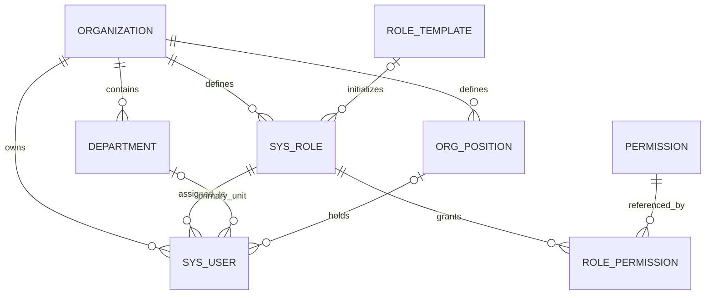
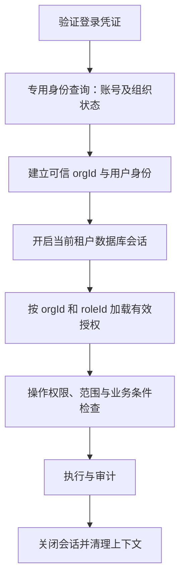

# PAMS 用户、角色权限与多租户管理设计方案 v1

> 日期：2026-10-15  
> 状态：方案已完成评审，已开始首版实施；目标设计不等同于全部已实现能力，具体交付与限制见[首版落地记录](PAMS-角色权限与租户管理-首版落地记录.md)。  
> 适用产品：协奏 / PAMS 高校学生组织智能工作台。  
> 核对基线：本地 `design@b19d521`，已于本文起草时执行 `git fetch origin design`，远端为 `origin/design@e3aff5d`，本地领先 2 个提交、落后 0 个提交；同时参考当前工作区未提交的 UI v6、组织管理与灵思设计资料。  
> 当前交付：在设计分支工作区实现首版代码及迁移；尚未在生产或真实 MySQL 数据库执行迁移。

> 2026-10-15 补充：管理员端的具体业务见 [管理员角色权限管理业务设计 v1](PAMS-管理员角色权限管理业务设计-v1.md)。管理员账号由所有者显式授予组织管理身份；其“可以向别人授予什么”与“自己可以访问什么业务数据”分别配置。该细则收敛了本稿原先将授权上限与管理员自身业务权限相交的表述。

> 2026-10-15 评审修订：修正 `activity:assign` 的现有语义；明确业务权限与治理能力的存储及认证来源、数据范围的前置字段、差量编辑与完整分配的校验区别、领域包重新授权和角色版本模型。首版交付及前置条件见 §1.2、§13；高级委派和历史恢复界面后置。

## 1. 设计结论与边界

采用既有的 **M2a：共享数据库、共享表、以 `org_id` 做行级租户隔离**。一个学生组织对应一个租户，组织内部通过架构节点、职务、角色、权限点和数据范围管理协作。

本期建议保留“一账号属于一个组织、一个主角色”的模型，优先完成组织级授权与数据隔离闭环。多组织任职、角色叠加、跨组织协作留到后续；本期不在页面提供没有后端模型支撑的“切换组织”。同一自然人需要参与两个组织时，暂时使用不同账号。

核心规则：

1. **组织是数据边界**。本组织任何角色均不能访问其他组织业务数据。
2. **角色定义做什么，数据范围定义对谁做**。角色级别、部门名称与页面可见性不能替代授权。
3. **全局共享权限目录与角色模板，组织独立保存实际角色和授权**。组织管理员不修改全平台共享授权。
4. **组织所有者、指导老师与平台运维身份分开**。教师职务不自动获得平台管理权，平台运维不默认读取租户业务内容。
5. **页面、接口、知识库、文件、通知和灵思遵守同一授权规则**。写入确认只表示用户同意，不能替代权限检查。
6. **没有可信租户上下文时拒绝业务访问**。默认组织 `1` 只作为历史数据迁移归属，不能作为匿名请求和异步任务的运行时兜底。

### 1.1 整体设计范围

| 整体设计覆盖，按 §1.2 分期 | 本设计不纳入 |
| --- | --- |
| 租户独立角色、自定义普通业务角色、权限与数据范围 | 一人多租户、单账号切换组织 |
| 组织所有者、管理员、角色分配与防提权 | 多角色合并、显式拒绝规则、角色继承 |
| 组织注册、邀请加入、账号导入、停用、交接 | 校级身份认证、学校组织目录对接 |
| 组织内架构树、岗位映射、部门子树范围 | 跨组织活动与共享资源授权 |
| 租户生命周期、领域包控制、关键操作审计 | 计费订阅、独立数据库、多区域部署 |
| HTTP、后台任务、匿名签到、WS、Agent 全链路约束 | 通用策略表达式编辑器 |

### 1.2 首版交付与后续增强

首版优先交付“本组织所有者/组织管理员 → 动态角色 → 操作权限与已具备数据基础的范围 → 单用户角色分配 → 审计”的可用闭环。管理员首版仅采用全组织普通对象管理；所有者通过显式业务权限清单限定其可授权内容。部门级管理边界、角色/账号管理员细分配置、批量迁移、有效权限对象诊断、历史恢复界面及平台管理界面后置，不是首版验收项。

自定义角色可分配之前，必须完成租户隔离、治理能力拆分、相关业务权限码与角色宏替换、敏感字段检查和必要的资源归属迁移。不具备数据基础的范围选项不开放；不能以“后续再补鉴权”为条件先上线自定义角色。首版仍须具备必要的租户状态检查、撤权检查和审计，不依赖平台管理界面才能正确拒绝访问。

单主角色是暂定的首版约束。兼任职责通过显式组合角色配置处理，不新增隐藏的用户权限；若仅为个人例外频繁复制角色，或出现不同职责需要不同节点范围，应重新评审多角色/任职模型，不能不断以复制角色代替该决策。

## 2. 设计依据与现状核对

### 2.1 设计意图的继承

| 资料 | 本方案继承的内容 |
| --- | --- |
| [通用化与多 Agent 协作改造策划](PAMS-通用化与多Agent协作改造策划.md) §2.3、§9 | 多组织、可配置架构、领域包、M2a 渐进落地；Agent 权限不放大 |
| [通用化阶段 1 实施清单](PAMS-通用化-阶段1实施清单.md) | 延续 `organization`、`sys_department`、`org_position`、`org_invitation`，避免并存两套部门模型 |
| [UI v6 设计方案](design/PAMS-UI-设计方案-v6-行业规范修订.md) | 明暗主题、蓝色主操作、表格工作面、明确反馈，沿用现有主题令牌 |
| [UI v6 组织宣传档案与党务台账设计说明](design/PAMS-UI-v6-组织宣传档案与党务台账设计说明.md) | 业务成员与系统账号分开、党务领域独立、原型与实际能力分开 |
| [Agent 业务设计方案](PAMS-Agent业务设计方案.md) D2、D3、D4、D11 | 写操作门禁、工具权限断言、出网闸口、权限变更同步登记 |
| [权限审计](permission-audit-2026-09-14.md)、[2026-10-14 代码审计](代码审计报告-2026-10-14.md) | 作为缺口线索；关键现状另外回到源码核对，不把旧审计结论直接当作当前实现 |

**本方案对早期设计的收敛**：保留“内置模板 + 组织自定义”的产品意图，将其落实为“全局模板 + 租户角色实例”，不让可变的运行时授权共享同一角色码。早期文档中“复用全局 `role_permission`”仅能解释阶段 1 过渡，不能作为组织自治的最终结构。

### 2.2 已实现能力与缺口

以下是起草时的静态源码核对，未在本轮执行运行时渗透或集成测试。

| 主题 | 当前实现 | 本期需要补齐 |
| --- | --- | --- |
| 用户 | `User.orgId`、单值 `User.role`；用户名全局唯一 | 所有账号写路径、关联角色和部门都验证组织归属；跨组织同名软删账号不能被复活 |
| 身份 | `JwtAuthenticationFilter` 每请求查用户，按数据库 `orgId` 建上下文 | 同步验证组织和角色状态；按组织与角色 ID 查授权 |
| 角色 | `Role.orgId` 已存在；`RoleController` 返回 `findAll()` | 区分模板与实例，列表、详情和分配均按组织限制 |
| 授权 | `role_permission` 主键为 `(role字符串, permission_id)`；服务固定枚举 7 个角色 | 改为租户角色 ID 关联；允许当前组织普通角色管理 |
| 恢复默认 | `PermissionService.restoreDefault()` 调用 `deleteAll()` | 仅恢复当前组织的单个角色，先展示差异 |
| 架构 | `sys_department` 已有树字段；注册生成岗位并引用全局角色码 | 节点与岗位、角色、用户关联统一检查；树移动与子树范围联动 |
| 组织注册 | 创建组织、架构、岗位、`DIRECTOR` 账号及 `ownerUserId` | 独立租户角色初始化、明确所有者能力、供给事务边界 |
| 邀请 | 已有创建接口，保存 `roleCode`、节点、期限 | 接受、撤销、一次消费、授权复核的完整闭环；不能将“生成邀请”视为“已支持加入” |
| 业务隔离 | 多个实体已接 `@TenantId`；已有结构表显式过滤与跨组织测试 | 覆盖直查 ID、原生 SQL、批量 DML、统计、文件与无上下文入口 |
| 异步 | `AgentExecutorConfig` 包装 `SecurityContext` | 同步传递并清理 `OrgContext`；执行前重查当前授权 |
| 租户缺失 | `OrgContext.getOrDefault()` 与租户解析器会返回组织 `1` | 改为业务入口必须有租户，注册/登录/能力令牌采用专用路径 |
| 前端 | `RequireRole`、`RequirePerm`、角色级别和菜单显隐混用 | 改为权限、领域包和后端可操作能力的统一展示 |

不能从“已存在 `org_id` 或 `@TenantId`”推导出“所有访问路径均完成隔离”。现有 `CrossOrgIsolationTest` 可作为扩展基础，但不足以验证本文全部要求。

## 3. 领域概念与关系

| 概念 | 业务含义 | 授权含义 |
| --- | --- | --- |
| 租户 / 组织 Organization | 党建办、学生会、社团、青协等独立工作空间 | 强制隔离边界 |
| 架构节点 Department / OrgUnit | 部门、中心、小组、分队 | 数据范围的结构依据；沿用 `sys_department` |
| 业务成员 Member | 花名册中的自然人、届别和任职记录 | 不因存在成员记录自动获得登录或权限 |
| 用户 User | 可以登录的组织账号 | 属于一个租户、绑定一个主角色 |
| 职务 Position | 主席、主任、部长、干事等业务称谓 | 提供角色分配建议；职务名称、级别不直接授权 |
| 角色 Role | 可分配的一组操作权限与范围规则 | 组织内独立保存，以 `roleId` 标识 |
| 权限 Permission | `activity:edit` 等稳定操作码 | 全局目录，由应用发布维护 |
| 所有者 Owner | 对组织管理与交接负责的账号 | `owner_user_id` 指定的受保护治理身份 |
| 平台运维身份 | 维护租户状态和全局模板的内部操作身份 | 独立管理边界，不作为租户角色参与授权 |



图中职位绑定是拟议扩展。现有成员与账号主要按学号查找匹配，`Member` / `User` 尚无直接的成员—账号关联字段；本设计要求保留“成员可以无账号”的业务关系，不能将其描述成已经存在的显式外键。若新增关联，应按组织及成员届别校验并另行迁移。停用账号不删除成员档案；成员转届、归档与账号停用分别处理，不自动跨租户搬迁账号。

## 4. 角色体系与治理边界

### 4.1 三类身份

| 身份 | 默认职责 | 限制 |
| --- | --- | --- |
| 平台运维 | 租户查询、暂停/恢复服务、维护模板版本、基础运维审计 | 不进入租户业务页，不继承租户全部权限，不提供默认代登录 |
| 组织所有者 | 管理本组织、授权、角色治理、所有者交接 | 只能管理本组织；不能修改全局目录或平台状态 |
| 组织业务用户 | 按角色参与活动、文书、排班、成员与领域业务 | 限于授权操作、范围及敏感字段 |

`TEACHER` 是组织内指导老师角色，`DIRECTOR` 是组织内负责人角色，二者都不代表平台超级管理员。注册人被设为所有者，其主角色建议为本组织 `DIRECTOR` 实例；所有者治理能力由受保护关系赋予，不依赖这个角色的可编辑权限列表。

所有者的保底能力限于组织配置、角色治理和交接，不自动绕过业务数据范围或获得党务敏感字段；业务访问仍使用主角色授权。界面必须分别展示“主角色”和“组织所有者”，避免出现隐藏身份。

### 4.2 内置模板与租户角色

全局模板只负责初始化、复制和人工恢复。注册组织时从版本化模板复制本组织角色与授权，之后独立修改。模板更新不自动覆盖存量组织，升级须展示新增、撤销和范围变更。

**模板集合不限制组织可创建的角色集合。** 下表中的 7 个角色码主要承接既有系统与迁移，不能成为角色创建白名单。用户可以不选模板，从空白创建“活动协调员”“档案管理员”等任意业务角色。权限来自应用维护的操作目录，角色负责组合这些操作与数据范围。

| 模板 | 建议定位 | 默认范围与说明 |
| --- | --- | --- |
| `TEACHER` | 指导与审核 | 本组织相应业务；敏感领域另授予；不自动成为所有者 |
| `DIRECTOR` | 组织日常负责人 | 组织级通用业务；角色治理由所有者或专项授权控制 |
| `ORG_LEADER` | 组织事务负责人 | 分配节点及其子树内的成员与组织事务 |
| `SECRETARY_LEADER` | 文秘事务负责人 | 对应范围内策划、文书、材料事务 |
| `MEDIA_LEADER` | 宣传事务负责人 | 对应范围内稿件、新闻及发布事务 |
| `TECH_LEADER` | 技术事务负责人 | 对应范围内技术支持、排班等事务 |
| `STAFF` | 普通成员 / 干事 | 组织公开业务、本部门获授权业务、本人任务与考勤 |

保留旧角色码用于迁移和模板标识，不以名称决定授权。学生会、社团可将角色显示名称改为“主席”“宣传负责人”“社员”等，也可复制普通业务角色。新建角色不会因名字包含“老师”“部长”获得能力。

旧角色宏未完成替换前，**不开放自定义角色的正式分配**；也不能通过给自定义角色注入 `ROLE_TEACHER` 来兼容旧判断。权限码、Service 校验、工具约束和脱敏适配完成后再放开。

### 4.3 默认能力矩阵

以下是目标模板建议，不表示现有种子权限已经如此配置。具体操作码以迁移后的显式清单为准，禁止采用“全部当前及未来权限”的通配默认。

| 能力 | 所有者治理身份 | 指导老师 | 组织负责人 | 部门业务负责人 | 普通成员 |
| --- | --- | --- | --- | --- | --- |
| 本组织信息、架构管理 | 是 | 专项授权 | 默认可管理架构 | 读本人可见结构 | 读本人可见结构 |
| 角色定义、授权上限管理 | 是 | 专项授权 | 专项授权 | 否 | 否 |
| 账号创建、分配角色、停用 | 是，受保护规则仍生效 | 专项授权 | 可管理允许范围内普通账号 | 可选委派，默认否 | 仅本人资料 |
| 活动与公开公告 | 按主角色 | 组织内 | 组织内 | 负责范围 | 已公开内容与本人任务 |
| 策划审核 / 稿件发布 | 按主角色 | 显式审核权限 | 显式审核权限 | 按职责授权 | 无默认审核权 |
| 排班、课表、考勤 | 按主角色 | 授权范围 | 授权范围 | 负责节点及子树 | 本人；组织公开值班信息另定义 |
| 成员名单与导出 | 按主角色 | 显式权限 | 显式权限 | 范围内管理；导出单独授予 | 无默认完整名单权 |
| 党务台账与敏感字段 | 按主角色 | `party` 包及专项权限 | 同左 | 同左 | 默认无 |
| 灵思 / 知识库 | 按主角色 | 继承本人可见资源 | 同左 | 同左 | 同左 |
| 其他组织业务 | 否 | 否 | 否 | 否 | 否 |

“组织公开”仅表示当前租户的在用账号可见，不是互联网公开，也不等于课表、考勤和党务数据公开。

组织所有者可在本组织授予“组织管理员、角色管理员、账号管理员”等管理身份。管理身份与业务主角色分开，管理能力来自所有者维护的委派记录，普通角色编辑器不能创建或扩展管理身份。完整组织管理员在明确的可授权目录和范围内，可以创建角色、调整权限、分配角色并维护生命周期；不要求其本人先取得相应业务读取权限。具体页面、操作流程和边界见 [管理员业务设计](PAMS-管理员角色权限管理业务设计-v1.md)。

### 4.4 自定义角色如何创建与管理权限

#### 4.4.1 管理对象分层

| 对象 | 谁维护 | 是否允许组织自定义 |
| --- | --- | --- |
| 权限点与执行语义 | 应用开发与发布流程，如现有 `activity:edit` 用于活动及任务写接口检查 | 组织可选择，不能自行编造尚无后端能力的操作码 |
| 角色模板 | 应用提供，带明确版本 | 可选的创建起点，不构成角色数量或种类限制 |
| 组织角色 | 所有者或获委派的角色管理员 | 可空白创建、复制、命名、配置授权、分配和停用 |
| 角色权限及数据范围 | 所有者或有 `role:grant` 且未超上限的管理员 | 在可用操作目录、已启用领域包及授权上限内配置 |

例如用户新增“活动协调员”是配置行为，不需要修改代码或发布系统；如果要求增加目前没有的“活动经费审批”能力，则需要实现该业务并在权限目录中注册对应操作，之后组织才能将它授权给任何角色。只增加一条权限名称不会产生实际访问控制能力。

#### 4.4.2 三种创建入口

1. **空白创建**：填写角色名称与说明，从空权限集开始选择操作和范围；`template_id` 可为空。
2. **从模板创建**：选择适用模板，复制指定版本的权限与默认范围，再进行调整。
3. **复制本组织角色**：以本组织已有普通角色为起点，复制操作者有权授予的配置，另存新角色；原角色不受影响。

三种方式最终均创建独立 `sys_role` 和 `role_permission` 记录，不存在运行时继承、自动追随模板或复制源变更。系统生成稳定的角色 ID 与组织内唯一编码，用户主要维护显示名称；不要求用户了解 `TEACHER` 等旧码或选择一个“最接近的内置身份”。

#### 4.4.3 授权与启用流程

```text
新建角色 → 选操作权限 → 为每个操作设置范围 → 校验依赖与授权上限
        → 预览生效配置 → 保存并启用 → 将角色分配给本组织用户
```

选择查看、创建、编辑、审核、发布、导出等具体操作，而不是仅勾选菜单名称。页面菜单按有效权限推导；数据范围单独设置。权限依赖缺失时显示需要补充的操作，不在用户不知情时扩大授权。

可保存未启用的草稿以分离维护与授权职责：只有 `role:manage` 的人能维护名称和草稿，只有通过 `role:grant` 检查的人能提交有效授权；将角色分配给用户还需 `role:assign`。草稿不可分配。所有者可在同一向导内完成这些步骤，无需额外人工审批。

#### 4.4.4 示例：新增“活动协调员”

组织管理员从空白新建角色，可配置：

| 权限点 | 数据范围 | 对用户的实际作用 |
| --- | --- | --- |
| `activity:view` | `ORG` | 查看本组织允许其查看的活动 |
| `activity:edit` | `UNIT_TREE` | 按现有接口语义编辑范围内活动及任务；并非仅获任务分配权 |
| `schedule:view` | `UNIT_TREE` | 查看负责节点范围内的排班 |
| `schedule:manage` | `UNIT_TREE` | 管理负责节点范围内的排班 |

该角色未获审核、用户管理、角色授权或党务权限，不能执行这些操作。将它分配给文秘部用户时，部门范围按该用户所在节点计算；分配给其他部门用户时按后者节点计算。角色不必为每个部门各复制一份；若以后需要跨指定节点任职，另扩展节点授权，本期不能用 `ORG` 暗中替代。

现有 `activity:assign` 在 V7 权限目录中表示“分配部门”，不能将其直接解释为任务管理；当前 `TaskController` 的写接口和 `generateActivityTasks` 工具检查 `activity:edit`。上述示例明确承认其授权粒度较大；若产品需要只管任务，必须新增独立权限、拆分对应 API/Service/工具校验并迁移，完成前不提供虚假的“仅任务分配”选项。

#### 4.4.5 日常维护与变更影响

- 编辑角色授权时，展示当前使用账号、增加/撤销的操作及范围变化。一次保存作用于本组织所有使用该角色的用户，更新授权版本并按 §12.2 生效。
- 复制角色后分别维护；删除或更新来源角色/模板不改变副本。空白角色不显示“恢复默认”，只提供“应用模板”并预览替换差异。
- 停用前展示被引用情况；仍有用户使用时要求先迁移到其他有效角色，或明确停用这些账号。既有令牌不能继续沿用停用角色权限。
- 新业务权限发布后默认未勾选，不自动加给全部自定义角色；权限下线需扫描使用角色，先撤销或迁移，再移除执行语义。
- 自定义角色与模板创建角色使用同一套 API、Service、范围规则及 Agent 检查，不维护独立的“自定义角色特例”。

## 5. 授权模型

### 5.1 统一判定

```text
允许执行 = 身份有效
       且 组织处于可访问状态
       且 当前角色有效并属于当前组织
       且 所需领域包已启用
       且 持有操作权限或满足专用的所有者治理规则
       且 资源属于当前组织或属于允许只读的全局资源
       且 资源满足该操作的数据范围
       且 满足负责人、状态流转、字段级别等业务约束
```

权限码继续采用 `module:action`。角色级别只用于展示与迁移，不作为最终授权依据；不要用 `level >= 3` 推导可看名单、可导出、可审核或可查看敏感信息。

上述公式适用于业务请求。治理请求不要求业务主角色持有管理权限，按账号、组织、所有者关系或有效委派、目标保护规则独立鉴权；业务角色失效时仍可使用受保护的治理恢复入口，但不能访问业务。平台请求走独立平台身份。三种入口均不得互相回退。

### 5.2 权限目录的增量收敛

| 类别 | 建议处理 |
| --- | --- |
| 已有业务码 | 复用 `activity:*`、`member:*`、`schedule:*`、`party:*`、`kb:*` 等；逐项核对实际入口，不无故改名 |
| 组织治理 | 新增 `org:manage`、`org:structure:manage`、`org:invite`、`org:audit:view`，配置组织状态的操作仍归平台 |
| 角色治理 | 新增 `role:view`、`role:manage`、`role:assign`、`role:grant`，分别控制查看、角色维护、分配与修改授权 |
| 账号操作 | 保留 `user:view`、`user:manage`；密码重置新增独立 `user:reset-password`，自助改密走本人路径 |
| 旧授权入口 | `user:permission` 是过渡码；迁移时显式转换为经核对的角色治理权限，最终删除旧写入口，不能长期提供第二套授权 |
| 敏感字段 | 拟新增 `party:sensitive:view` 等确有业务需要的字段权限；查看、导出和敏感字段权限分别校验 |
| 尚用角色宏的业务 | 为内容审核、新闻发布等补充明确权限码，待页面/API/工具同时适配后移除角色宏 |

新增/调整差量包含未知权限码或不可用领域包的授权时，直接拒绝并说明原因，不能像当前保存逻辑一样静默忽略。未修改的旧失效配置可以保留，但不产生有效权限，也不被本次保存重新激活。权限依赖由目录声明，例如“编辑依赖查看”，前端自动提示，后端验证一致性。新增权限点默认无人持有，经模板版本和组织授权流程启用。

### 5.2.1 权限分类、存储与认证来源

目录增加不可由租户修改的 `category`：`BUSINESS`、`ORG_GOVERNANCE`、`PLATFORM`。`activity:*`、业务成员档案的 `member:*`、`party:*` 等为业务权限；`user:view/manage/reset-password`、`role:*`、组织配置/架构/邀请/审计能力为组织治理；租户暂停及全局模板发布为平台能力。模块中不能简单按前缀猜分类，完整清单及各入口映射须随发布维护；未知分类默认拒绝。

| 类型 | 持久化来源 | 运行时来源与限制 |
| --- | --- | --- |
| 业务权限 | `role_permission`，仅允许 `BUSINESS` | 按租户主角色解析为 `businessPermissions`，再结合范围、领域包授权版本和资源条件 |
| 组织治理 | 所有者关系或 `org_role_delegation.management_capabilities` | 解析为 `managementCapabilities`，普通角色授权接口拒绝所有治理码 |
| 平台 | 独立平台身份及能力配置 | 仅在平台认证链使用，不注入租户账号 |

可为兼容现有 `hasAuthority` 将有效业务码和治理码投影到 Spring authorities，但服务端必须保留来源和分类；不得把两类投影重新写回角色表。`me` 分别返回两类集合及来源，治理接口同时检查有效委派、目标边界及保护规则，不能只检查一个客户端可缓存的码。旧 `user:permission` 及其他角色中治理码在迁移时显式转为核对后的委派，不能复制到新业务角色。

### 5.3 数据范围按操作绑定

数据范围建议保存在角色的权限关联上，而不是仅在角色上保存一个 `dataScope`。这样可表达“看全组织活动，管理本部门成员，只看本人考勤”。本期不引入用户级权限覆盖或多角色合并。

| 范围 | 精确定义 |
| --- | --- |
| `ORG` | 当前组织内，且满足资源可见性及业务条件的数据 |
| `UNIT` | 用户主架构节点的数据，不含后代 |
| `UNIT_TREE` | 用户主节点与其后代节点的数据 |
| `SELF` | 按业务明确归属本人，如本人考勤、本人课程、分配给本人的任务 |

每个权限点声明支持的范围。不适用部门概念的资源不能硬套 `UNIT_TREE`；无部门账号持有部门范围时取空集，不能扩大为组织范围。`SELF` 不统一等于 `created_by`，必须为各业务指定拥有者或参与者关系。

对角色定义、领域包配置等治理权限，`ORG` 表示配置对象只能属于本组织，不自动授予读取本组织全部业务数据的能力。

| 资源 | 范围归属建议 | 必须另查的业务条件 |
| --- | --- | --- |
| 活动 | 主办节点；组织公开状态；参与者/任务关系 | 草稿、公开、归档的可见规则；编辑人与审核状态 |
| 成员 | 所属节点、当前届别 | `member:export` 单独控制导出；历史届别仍须限域 |
| 考勤 / 个人课表 | 被考勤人 / 课表所属人及其节点 | 本人记录与部门管理路径分开；不公开个人课表 |
| 材料 / 稿件 | 所属节点、作者、关联活动 | 文件下载复核来源对象；草稿不能因活动公开而公开 |
| 党务档案 | 档案所属节点；敏感字段权限 | 不直接沿用普通成员可见性；领域包与导出另查 |
| 会话 / 待确认任务 | 发起用户 | 管理员不默认阅读他人对话；业务审计与内容阅读分开 |
| 通知 | 具体收件人 | 已读只能修改本人收件记录 |

子资源没有独立归属字段时，在查询中通过父资源关联判定，禁止“父对象已鉴权，任意子对象 ID 即可操作”。列表、详情、统计、搜索建议、批量处理和导出使用同一范围规则；必须在数据库分页、统计前过滤，不先全量查出再在 Java 内裁剪。

### 5.3.1 范围前置字段与迁移门槛

以下为必须新增或核实的模型，不是当前实体已具备的能力：

| 资源 | 已核对的现状 / 所需目标 | 迁移和未确定归属处理 |
| --- | --- | --- |
| 活动 | 现有 `organizer` 为文字；拟新增 `owner_unit_id`，保留文字用于展示 | 由组织管理员显式映射历史主办节点，禁止按同名自动认领；未映射记录不进入 UNIT/UNIT_TREE 结果 |
| 活动任务 | 现有 `dept_id` 可作节点依据，但 `assignee` 为姓名；拟新增 `assignee_user_id` | 以同组织账号 ID 绑定负责人；保留旧姓名展示；未确定账号的记录不匹配 SELF |
| 成员 | 已有 `dept_id`；账号主要按学号查找 | 验证节点同组织；不能用成员姓名或跨组织相同学号推导当前账号 |
| 考勤、课表、材料、稿件和党务 | 各模块逐项核实账号、节点和父资源关联 | 形成字段—谓词—迁移—测试清单后开放对应范围；不可自动扩大为 ORG |

活动未归属记录的补录通过单独治理入口进行，只暴露必要 ID、名称和原主办文字，不因此授予敏感正文读取。部门历史数据未映射完前保持相关功能关闭或明确受限；不能以可编辑任意旧数据作为修复手段。

每项操作注册唯一范围谓词。当前版本只支持一个范围类型；“参与者”和“负责人”仅在该操作登记的 SELF 关系中计算，参与身份不会自动绕过 UNIT 范围。父对象可见不代表其全部子对象可见；直接访问本人任务时最多返回该操作许可的最小父活动摘要。联合主办、多节点任职和范围并集不在首版自动推导，需明确扩展模型后再支持。

### 5.4 授权与防提权

- 所有者可管理本组织普通业务授权，但不能获得平台权限、绕过组织状态或解除必需的业务约束。
- 委派管理员只有被显式授予 `role:grant` 才能改权限。可授予内容取“应用可用目录、组织已启用能力、所有者明确委派的权限及范围上限”的交集，不以管理员本人的业务访问权限为前提。管理对象、角色与受影响账号还需满足委派边界。该上限只能由所有者调整，不能由被委派人自行扩展。
- 范围包含关系按节点集合和业务语义计算，不能用枚举大小比较。将角色从“本节点”改为“本节点子树”属于提权。
- 编辑角色时检查本次 SET/REVOKE 差量是否可编辑、范围是否可授予，并对合并后的有效配置检查依赖和受影响对象边界；超出编辑上限的原有授权保持只读，不能因整角色含只读项而拒绝所有合法编辑，也不能将其误清空。
- `role:assign` 检查目标角色的全部有效权限和范围是否落在操作者分配上限内，以及目标当前身份、节点和保护规则。角色内容变化后，原分配白名单不能代替这次完整检查；编辑授权与分配角色使用不同校验入口。
- 普通角色编辑器不能授予 `role:grant`、所有者交接等治理能力；治理授权使用所有者专用流程。普通管理员不能修改自己的角色或自己正在使用角色的授权以取得额外权力；所有者可在专用流程中明确调整自身业务权限。
- 改用户、降级、停用、删除、重置密码都先检查**目标当前身份**及拟变更后的身份。不能先降级受保护账号，再重置其密码。
- 所有者不能通过普通接口被停用、删除、重置密码、转出或替换成失效角色；恢复与交接走独立流程。组织必须始终保留一个有效所有者。
- 权限、范围、角色和身份缺失时默认拒绝，不保留生产路径中 `currentLevel=null` 即放行的行为。

管理员属于对被委派授权具有控制力的可信人员。“自身业务角色无读取权”只限制其当前身份直接访问，不承诺抵御其利用建号、授角或凭证控制间接访问。首版不提供管理员代登录；新账号密码由目标本人通过设置链接建立，重置不向操作者返回新密码。所有者仍需按信任程度限制敏感授权清单；如需抵御恶意授权管理员，必须另设计独立身份核验、职责分离或多人审批，不能依赖“禁止改自己角色”来承诺强隔离。

## 6. 租户管理与关键流程

### 6.1 注册与初始化

注册向导保留早期“四步”意图，具体内容收敛为：

1. 组织名称、类型、简称、标识与品牌信息。
2. 架构树与节点类型；支持从组织类型建议结构开始修改。
3. 启用实际已实现的领域包，预览并微调适用角色模板与默认范围。
4. 创建所有者账号、核对配置并提交；注册成功后再邀请成员。

当前已明确落地的领域包能力以代码实际注册清单为准；`volunteer`、`club` 等规划项不能仅因文档出现就视为可启用模块。注册时的权限微调同样必须通过服务端目录与安全约束校验。

供给流程：建立组织草稿 → 在明确的新租户上下文中创建角色、权限、节点、岗位和账号 → 绑定所有者 → 校验完整性 → 激活组织。新增稳定 `orgCode` 用作邀请、品牌地址与平台检索标识，组织名称可修改；本期用户名继续全局唯一，登录仍使用用户名与密码，组织品牌入口不作为鉴权依据。

**事务要求**：同一 Hibernate Session / EntityManager 不能先以组织 A 创建，再仅通过修改 ThreadLocal 切换为组织 B。供给采用独立控制事务与新租户事务，在租户上下文建立后才开启对应 EntityManager。两阶段失败将组织保持草稿并可幂等重试，不暴露半初始化账号；角色、节点与所有者等所有就绪条件满足后才激活。重试不能重复创建账号、重复授予权限或生成多个所有者。

匿名注册校验只接收创建新组织所需字段，不接受任意既有用户、部门或角色 ID。限流使用可信代理配置后的来源地址，不直接信任任意客户端 `X-Forwarded-For`。

### 6.2 邀请与批量建号

邀请创建时固定组织、目标角色、节点、可选职务及有效期，并校验这些对象同属当前组织及处于有效状态。本期采用单次邀请，默认 72 小时过期，可提前撤销。

邀请接受流程：验证高熵令牌 → 通过专用入口确定组织 → 检查组织、邀请和角色状态 → 重新验证邀请人当前授权 → 创建账号并分配预定角色 → 原子消费邀请 → 写审计。邀请令牌仅存哈希，创建时展示一次原值；无效、过期、已使用统一返回不可接受的邀请信息。

邀请人失去相关权限、目标角色授权超出其委派上限、节点被删除、组织暂停时，邀请不能继续兑现。并发接受只能成功一次，失败事务不消费令牌。已在其他组织的账号不能通过本期邀请直接迁入，也不能悄悄复用其身份。

成员导入账号先预览“新建、跳过、冲突、角色建议及原因”，提交时再次校验。职务与节点类型只给建议，不自动生效；允许分配的角色由服务器给出。使用随机临时凭证或一次性设置密码链接，首次使用必须设置密码，不再统一使用 `123456`。

### 6.3 架构、岗位与调岗

- 继续用 `sys_department` 存部门、中心和小组等树节点；接口可用 `unit` 术语，避免另建重复组织树。
- 同一父节点下名称唯一，跨分支可同名；设置最大深度与防环检查。根节点名称唯一也要由数据库实际约束，不能依赖含 `NULL parent_id` 的普通复合唯一键。
- 节点负责人必须是本组织有效账号；父节点、岗位和主角色必须属于同一组织。
- 新建节点只建议岗位和模板，不直接给负责人升成 `DIRECTOR`。岗位默认角色变化不自动重分配所有在岗用户，先列出影响再批量执行。
- 节点迁移需原子更新子树路径和层级，并使受影响账号的授权版本失效；后台任务也在执行前重算范围。
- 用户调岗改变其当前可访问节点集合。业务记录保存业务发生时的节点；不能因为创建人调岗就改变历史记录归属。
- 删除节点前处理子节点、账号、成员、邀请和业务引用；优先停用，保留历史解析能力。主节点停用后部门范围为空，不能向父级自动扩大。

### 6.4 所有者交接

当前所有者发起 → 验证目标为同组织有效账号且角色有效 → 双方按一次性凭证确认 → 在事务中锁定组织并检查版本 → 替换 `owner_user_id` → 增加授权版本、撤销原所有者治理权限 → 记录双向审计。

原所有者的主业务角色不自动改变，交接界面明确展示该结果并提供独立调整入口。交接凭证短期有效、单次消费；发起人变更、组织暂停、目标停用或重复提交时拒绝。原所有者账号不可用的恢复由平台专用身份核验流程处理，不向普通租户管理员开放“强制成为所有者”。

### 6.5 生命周期

建议新增明确状态字段并兼容迁移当前数值 `status`，不直接复用未知数值语义：

```text
DRAFT → ACTIVE ↔ SUSPENDED → ARCHIVED
              └────────────→ ARCHIVED
```

| 状态 | 允许行为 |
| --- | --- |
| `DRAFT` | 供给重试与平台维护；无业务登录 |
| `ACTIVE` | 正常登录、业务操作、后台任务和邀请 |
| `SUSPENDED` | 拒绝租户业务请求、签到、邀请接受和后台写入；仅平台恢复流程可用 |
| `ARCHIVED` | 停止业务访问和后台任务，保留数据与审计；本期不提供自助物理删除或恢复 |

平台处理暂停和恢复；所有者可发起归档申请，归档执行需明确核对影响。状态变更立即影响下一次请求，不能仅在登录时检查。执行中的流停止输出；尚未提交的写事务通过共享的组织写入门禁与状态变更串行化，确保暂停生效后无新写入提交。

停用用户仅影响登录与执行权限，保留其业务责任人历史。删除账号采用可审计的停用/软删除，不隐式删除其材料、通知、会话或成员履历。

## 7. 隔离与身份上下文

### 7.1 全局、租户与双层资源

| 类型 | 资源 | 访问方式 |
| --- | --- | --- |
| 全局控制数据 | 权限目录、角色模板、领域包注册目录、平台运维身份、注册供给记录 | 专用控制路径；不作为租户业务数据查询 |
| 租户专属 | 角色、授权、用户、节点、岗位、邀请、各业务数据、知识分块、会话、任务、运行记录及审计 | `org_id` 必填；所有查询及写入限制当前组织 |
| 双层只读共享 | 内置文件模板与组织自定义模板 | 读 `org_id IS NULL OR org_id=currentOrg`；普通用户只能写本组织项，复制内置项后才能编辑 |

租户角色实例不再使用 `org_id=NULL`。全局模板和租户角色分表，避免既有 `findByCode` 产生歧义，以及 `NULL` 唯一键不能表达预期唯一性的陷阱。

### 7.2 请求与数据库会话顺序



登录和身份回源可使用严格限制的全局账号查询服务，不能将这个仓储能力暴露为普通业务的跨租户查询。后续改用户名或重构 JWT 主体时优先使用稳定 `uid` 查身份，角色与组织仍以数据库当前值为准；本期不要求 JWT 快照承担授权。

当前 `application.yml` 已配置 `spring.jpa.open-in-view: false`，不是待新增的能力。仍须核对认证查询与 Service 事务的启动顺序，确保租户会话创建之前已设置可信组织，并将身份查询隔离到专用会话。不能只改 `OrgContext` 就认为已切换租户。

### 7.3 所有访问方式的要求

| 路径 | 约束 |
| --- | --- |
| JPA 实体查询 | 使用租户机制；对 `findById`、实体关联加载及实际 ORM 版本行为做隔离测试，Service 仍验证资源归属 |
| 原生 SQL / JdbcTemplate | 显式参数化 `org_id`，包括子查询、关联、计数和删除；不接收前端指定的可信租户 |
| JPQL / SQL 批量更新删除 | 显式租户谓词，双租户集成测试验证受影响行；不得以普通查询隔离推断 bulk DML 安全 |
| 跨对象引用 | 用户的部门和角色、活动参与者、邀请节点、文件关联对象等全部验证同租户 |
| 缓存 / 幂等 / 锁 | 键包含组织、身份或资源及必要的授权版本；禁止仅按角色码、关键词或业务名共享 |
| 文件 | 下载与预览先检查文件和来源业务对象；历史 `/uploads` 直链同样校验，不依赖路径难猜 |
| 通知 | 事件显式携带组织；先展开本组织具体收件人，再独立保存已读状态 |
| 日志与指标 | 业务审计带组织；平台指标仅默认聚合；租户面板只读本组织指标 |

### 7.4 异步、定时与事件

统一传递 `{orgId, actorId, authzVersion, traceId}` 及所需 `SecurityContext`。线程装饰器在开始时建立上下文，在 `finally` 清理或恢复；未携带组织的业务任务拒绝执行并记录故障，不能写到组织 `1`。

传递的授权快照只用于追踪，执行前从当前身份重新解析权限、组织状态和范围。定时任务从控制面列出有效租户，为每个组织创建独立事务及数据库会话。系统任务使用明确的服务身份和能力白名单，不复用某个管理员的永久登录上下文。

领域事件携带来源组织，不从消费线程的默认值推断。需要可靠处理的事件使用可持久化任务记录、组织内幂等键与失败重试；重复通知和索引重建不影响其他租户。

### 7.5 匿名签到与其他能力令牌

匿名签到使用绑定 `{orgId, activityId, purpose, expiresAt}` 的高熵能力令牌。专用全局定位记录仅保存令牌哈希、组织、目标、用途、期限和状态；只允许精确哈希定位，不提供租户业务列表查询。

先验证令牌、签发用途、撤销及组织状态，再建立对应租户会话并读取活动和签到配置。前端提交的 `orgId`、学号或活动 ID 不能替代这一步。签到记录仍按活动要求验证应签身份、时间窗和重复提交；匿名能力仅覆盖该签到动作，不允许读取成员名单、任意活动或通用接口。

### 7.6 WebSocket 与长连接

连接验证当前账号、组织与吊销水位；订阅和推送同时绑定组织及用户/会话归属。连接 ID 或 `streamId` 不是授权凭证。

角色、数据范围、用户状态或组织状态变化后，撤销相关订阅或断开连接，并使旧流输出停止。后端发送敏感片段前检查最新授权版本；不能只在 WS 握手时验证一次。轮询补拉与历史读取执行相同检查。

## 8. 灵思与知识库的一致授权

继续复用现有 `ToolRegistry`、`TaskGate`、`PolicyGuard` 和知识源复核机制，不另建一套 AI 角色权限。

| 阶段 | 必须复核的内容 |
| --- | --- |
| 组装专家与工具 | 当前组织领域包、用户有效权限、运行模式；专家名称不构成授权 |
| 工具派发 | 当前权限、资源组织、数据范围和业务约束；参数中的角色或组织不可覆盖上下文 |
| 写操作预览 | 只查询当前范围资源，保存组织、发起人和授权版本；预览不越权读数据 |
| 确认写入 | 重新读取当前身份和范围；校验任务所有者、组织、状态及一次性凭证；角色被撤权后不能执行旧预览 |
| 知识检索 | 组织谓词与粗筛 → 回源复核 → 再进入提示词和引用；目录、分块列表、详情接口同样复核 |
| 会话历史 | 校验本人及同租户；历史引用重查，失效引用只显示不可访问提示；敏感产物原文也需隐藏或重脱敏 |
| 黑板、运行与实验 | 以组织和发起用户隔离；跨组织产物不能合并，实验列表与统计按组织限域 |

`ToolContext.isStaff()`、`requiresLeader()`、知识可见性枚举和源适配器中基于固定角色的判断必须列入迁移清单。自定义角色不能因没有旧角色码而被误判为普通成员，也不能因“不是 STAFF”就获得完整敏感字段。

领域包停用后，菜单、API、工具、知识源、旧会话引用及后台重建共同失效。保留业务数据与旧授权配置；重新启用仍须重新授权。具体机制：新增 `org_domain_pack(org_id, pack_code, enabled, activation_version)`，每次从停用改为启用时递增授权版本；角色领域权限及管理员可授权清单均保存授予时的 `pack_activation_version`。有效授权必须满足“领域包已启用且授权版本等于当前版本”。旧配置显示“待重新确认”，不能因重新勾选领域包自动恢复。

重新授权通过明确的 SET 操作或重新发布所选权限，重新检查当前委派及依赖并写入当前领域包版本；普通编辑未选中的旧失效项保持失效。历史恢复和模板应用也不能继承旧授权版本或静默重激活。通用业务权限不绑定领域包版本。用户不能靠手改浏览器缓存或直接调用接口使用停用包。

## 9. 数据模型建议

以下为逻辑模型，不指定 Flyway 版本号。当前工作区迁移已延伸到 V35/V36，实施时应按实际最新迁移链分配新版本，不改历史迁移。

| 表 | 新增或调整字段 / 约束 |
| --- | --- |
| `organization` | `org_code` 全局唯一且稳定；明确生命周期；`owner_user_id`、`authz_version`、乐观锁 `version` |
| `sys_user` | 保留 `org_id`、`role_id`、`dept_id`；新增可选 `position_id`、`authz_version`、`must_change_password`；用户名继续全局唯一 |
| `role_template`（新） | `id, code, name, template_version, status`；唯一 `(code, template_version)` |
| `role_template_permission`（新） | 模板、权限及默认范围、依赖版本；只供初始化与差异恢复 |
| `sys_role` | `org_id NOT NULL`，保留实例 `code/name`；`template_id` 可空、`status`（草稿/启用/停用/归档）、`version`；名称组织内唯一，编码唯一 `(org_id, code)` 且停用后不复用 |
| `role_permission` | 改为 `(org_id, role_id, permission_id)` 主键；`scope_type`；以 `role_id` 替代原角色字符串 |
| `permission` | 保留全局唯一 `code`；补领域包、支持范围、依赖及敏感/治理分类元数据；由发布流程维护 |
| `org_role_delegation`（新） | 委派对象用户、组织、管理能力、管理节点、可维护/分配角色列表、是否允许新建、可授权权限及范围上限、有效期、状态和版本；仅所有者管理 |
| `org_authorization_change`（新） | 管理员授权变更预览，含操作者、动作、拟变更内容、基线版本、影响摘要、期限、应用状态及幂等键；应用时重新鉴权 |
| `org_position` | `default_role_id` 替代可歧义的 `role_code`；岗位不是用户实际授权来源 |
| `org_invitation` | `role_id`、`org_unit_id`、可选 `position_id`、`token_hash`、`status`、`created_by`、期限、消费信息和版本 |
| `tenant_capability`（新） | 匿名能力令牌哈希定位，含 `org_id, target_id, purpose, expires_at, revoked_at`；全局精确定位专用 |
| `org_audit_log`（新或扩展统一审计） | 组织、操作者、目标、动作、结果、变更差异、来源、原因、请求追踪和时间 |
| 平台身份 / 供给记录 | 独立表与接口；供给记录含幂等键、阶段、失败原因，避免复用 `sys_user` 的空组织表示平台用户 |

本次评审补充的必要结构：

- `permission.category` 强制区分业务、组织治理与平台；角色关联表只接受业务权限。
- `activity.owner_unit_id`、`task.assignee_user_id` 及其同组织关联、索引和历史迁移；其他模块按 §5.3.1 核实后追加。
- `org_domain_pack` 及角色授权/委派清单中的领域包授权版本，实现停用后重新确认。
- `role_revision` 保存 `org_id, role_id, revision_no, state, base_revision_id, snapshot_json, draft_version, created_by, published_at`。快照包含完整权限码、范围、领域包授权版本及目录语义版本；已发布快照不可变。
- `sys_role.current_revision_id` 指向已发布版本，`draft_revision_id` 指向可选工作稿；每角色最多一个工作稿，使用 `draft_version` 防覆盖。新角色仅有草稿；启用及停用角色均可保存工作稿，不改变当前发布版本。
- `role_permission` 是当前已发布配置的可查询投影；发布时与 `current_revision_id`、角色/组织授权版本和审计原子更新，不能从工作稿加载业务权限。停用由角色状态屏蔽，不销毁发布快照。
- 临时变更预览指向确定工作稿及基线版本，允许过期清理；已发布历史不依赖预览存活。历史恢复如后续开放，复制快照为新工作稿，经当前权限、领域包与依赖检查后发布新版本，不修改原历史。

重要约束：

- 对用户角色、部门、岗位、授权关联建立同组织约束。可采用父表 `UNIQUE(org_id,id)` 与复合外键；暂无法建外键的历史表须在 Service 中强制检查并增加脏数据扫描，不能只靠前端选项。
- `role_permission` 的 `org_id` 必须与 `sys_role.org_id` 一致，授权唯一性使用角色 ID；权限目录本身保持全局。
- 迁移租户角色实例前先解除旧 `sys_role.code` 的全局唯一约束，建立组织内编码唯一约束并处理角色查码仓储；否则复制同码角色会失败。先验证映射，再切换旧外键和查询，不凭列存在即视为迁移完成。
- 部门同父名称唯一可使用规范化父键，例如将根的父键映射为稳定值后建立唯一索引；MySQL 与 H2 各有对应迁移和验证。
- 用户名软删后重新建号优先要求新用户名；若支持复活，仅允许同租户显式恢复，推进凭证吊销水位并重审角色和范围。不能跨租户复活全局同名旧账号。
- 令牌原文、密码、Cookie、JWT 不进入审计；密码只存现有编码器输出，前端 DTO 不返回实体敏感字段。
- 角色删除优先停用；仍被用户、岗位、邀请引用时禁止物理删除。角色被停用的用户不能继续访问业务，可由有权管理员重新分配。

## 10. 接口契约草案

复用现有 `/api/orgs/current`、`/api/users`、`/api/roles` 与 `/api/auth/me` 的边界。以下是目标接口，标注“新增/调整”不表示已实现。成功响应继续使用项目 `Result<T>`，分页使用 `PageResult<T>`。

| 接口 | 处理 | 权限 / 边界 |
| --- | --- | --- |
| `GET /api/auth/me` | 调整：返回有效权限、范围摘要、主角色、`isOwner`、组织状态、授权版本 | 本人；不返回可任意修改的授权来源 |
| `GET /api/roles` | 调整：当前组织角色及有效状态 | `role:view`；普通选人使用专用的可分配选项接口 |
| `GET /api/roles/assignable` | 新增：按操作者、目标用户、节点计算候选角色 | `role:assign`，服务器计算上限 |
| `GET /api/roles/{id}` | 新增：角色详情与授权 | 当前组织，`role:view` |
| `POST /api/roles` | 新增：空白、从模板或本组织角色复制；来源为可选 | `role:manage`，有效授权内容仍须 `role:grant`；可只保存不可分配的草稿 |
| `PUT /api/roles/{id}` | 新增：改名称、说明；不直接改状态或有效授权 | `role:manage`，版本冲突返回 409 |
| `PUT /api/roles/{id}/draft` | 新增：保存新建、启用或停用角色的工作稿 | `role:manage`；`draftVersion` 校验，工作稿内容不等于获准发布 |
| `POST /api/roles/{id}/change-previews` | 新增：预览授权、启用、停用、归档或模板应用；历史恢复后续开放 | 按动作验证管理权；不会改变生效配置 |
| `POST /api/orgs/current/authorization-changes/{id}/apply` | 新增：应用当前管理员的有效预览 | 重查身份、管理上限和基线版本；事务与幂等控制 |
| `GET/PUT /api/orgs/current/role-delegations/{userId}` | 新增：查看/维护管理员的分配名单、授权上限及有效期 | 仅当前所有者；校验同组织及版本 |
| `GET /api/permissions/catalog` | 调整/新增：返回组织可用权限及依赖、范围选项 | 角色治理权限；按启用领域包过滤 |
| `POST /api/users/role-change-previews` | 新增：专用角色分配预览，应用仍走统一变更入口 | `role:assign`，检查整个目标角色及目标身份 |
| `POST /api/users/{id}/reset-password` | 调整：一次性设置凭证 | `user:reset-password`，保护所有者与受保护账号 |
| `POST /api/orgs/current/invitations` | 调整：按角色 ID 创建邀请 | `org:invite` 与角色分配权 |
| `POST /api/orgs/current/invitations/{id}/revoke` | 新增：撤销邀请 | 同组织有权管理员 |
| `POST /api/orgs/invitations/accept` | 新增：消费邀请并建号 | 匿名能力入口；令牌限定用途 |
| `GET/PUT /api/orgs/current` | 调整：本组织资料 | 读需有效身份；写需 `org:manage` |
| `POST/PUT/DELETE /api/orgs/current/units/...` | 调整：架构操作 | `org:structure:manage`，完整树约束 |
| `POST /api/orgs/current/owner-transfer` | 新增：发起交接 | 当前所有者、重新验证凭证 |
| `POST /api/orgs/current/owner-transfer/accept` | 新增：目标接受 | 目标本人、有效一次性凭证 |
| `GET /api/orgs/current/audit-logs` | 新增：本组织治理审计 | `org:audit:view`，敏感内容字段隐藏 |
| `/api/platform/organizations/...` | 新增：租户生命周期管理 | 独立平台身份；普通 JWT 不被接受 |

旧 `PUT /api/permissions/roles/{roleCode}` 与全局恢复入口应停止写入；过渡适配必须先按当前组织解析唯一角色 ID 并执行新规则，不能继续访问旧全局写服务。

管理员业务细则以“工作稿/拟变更 → 服务端预览 → 应用变更”作为有效授权和角色生命周期的正式写入流程。上一稿提出的直接 `PUT /api/roles/{id}/permissions`、直接更换用户角色及独立恢复默认写入口不再作为目标 API；旧接口迁移期只读或停用，不同时实现两套写契约。模板和后续历史恢复均生成新工作稿及预览；详情见管理员业务设计 §8。

权限变更预览提交示例（管理员业务细则将原先整体覆盖收敛为明确差量）：

```json
{
  "version": 3,
  "action": "UPDATE_GRANTS",
  "permissionChanges": [
    { "operation": "SET", "permission": "activity:view", "scope": "ORG" },
    { "operation": "SET", "permission": "member:manage", "scope": "UNIT_TREE" },
    { "operation": "REVOKE", "permission": "attendance:manage" }
  ],
  "reason": "本届宣传部职责调整"
}
```

省略权限表示不修改，`REVOKE` 才表示明确撤销；空数组表示无变更，不能解释为清空或恢复模板。清空配置须明确列出可编辑项的撤销，在预览中说明仍保留的只读权限。未知权限、不支持的范围、依赖缺失为参数错误；过期 `version` 为 409，不能覆盖他人新配置。

状态语义：未认证/凭证失效为 401；已认证但无操作权限、组织暂停等为 403；跨租户或不可见对象统一按 404 处理，避免暴露对象存在性；并发版本冲突为 409。实施时同步异常处理器和前端，不仅在 `Result.code` 中模拟 HTTP 状态。错误详情对用户保持最小，对审计记录完整拒绝原因。

## 11. 管理页面与交互

将当前“用户管理、权限管理、组织架构、设置”收敛为清楚的组织设置入口，保留旧路由重定向。普通成员只见本人账号设置，治理页按能力开放。

```text
组织设置
├─ 组织资料与领域包
├─ 组织架构与职务
├─ 用户与邀请
├─ 角色与权限
└─ 操作记录与所有者交接

平台管理（独立身份与导航）
├─ 组织列表与服务状态
├─ 模板版本
└─ 平台操作记录
```

### 11.1 用户与邀请

顶部显示当前组织，用户表展示姓名、账号、主节点、职务、主角色、所有者标记、状态和账号来源。筛选按节点子树、角色、状态；创建、批量建号、邀请加入是不同操作。成员档案入口与账号入口分开。

编辑用户时，后端返回可编辑字段和可分配角色。停用、重置密码、角色替换弹窗说明目标和影响；批量操作逐项返回成功、跳过、拒绝及原因，不因一个有权目标而操作整批。

### 11.2 角色与权限

管理员端的详细信息结构、权限编辑器、有效权限查询、停用迁移和验收要求以 [管理员角色权限管理业务设计 v1](PAMS-管理员角色权限管理业务设计-v1.md) 为准；此处保留全局概览。

角色列表提供“新建角色”，支持空白创建、从模板创建、复制本组织角色。默认不强制选模板；用户输入角色名称和说明即可开始配置。详情展示来源类型与可选模板版本，来源不决定后续权限。按模块列出操作，逐项设置范围；新建与编辑共用该面板，完整流程见 §4.4。

```text
角色列表                 角色详情 / 权限与范围 / 使用账号
模板来源与状态           名称、说明、模板版本、受影响人数
                         模块       权限点      数据范围
                         活动       查看        全组织
                         成员       管理        本节点及下级
                         考勤       查看        本人
                         [预览差异]               [保存]
```

保存前展示新增、撤销、范围扩大与缩小，以及受影响用户数。范围控件只展示该权限支持的选项。被上限或领域包禁用的项说明原因；恢复模板先预览，确认时核对版本与依赖。无修改权时提供只读详情。

### 11.3 架构、组织状态与领域包

架构页保持树与详情并列；调整节点或岗位建议时显示受影响范围。移动节点前说明哪些用户的 `UNIT_TREE` 范围改变。关闭领域包前展示受影响模块、角色授权、待确认任务与后台任务。

组织状态在当前组织信息中明确显示。前端 `me/current` 加载失败不回退为“所有包启用”或缓存中的旧权限；在身份确认期间显示加载态，不能提前渲染敏感内容。403 提供可理解原因，404 不显示其他组织名称。

页面沿用 UI v6 现有主题令牌、表格密度、明暗主题和移动端布局，不另起视觉体系。敏感操作使用文字说明及状态标签，不只靠颜色提示。

## 12. 后端职责与实时生效

### 12.1 复用现有结构的职责划分

| 组件 | 职责 |
| --- | --- |
| 身份查询 / 认证过滤器 | 解析凭证、查用户与组织状态、建立可信上下文 |
| `OrgContext` / 租户会话 | 提供必须存在的组织值，控制会话建立顺序与清理 |
| `PermissionService` | 按 `(orgId, roleId)` 解析有效权限；模板只参与显式复制 |
| 拟增 `AuthorizationService` | 操作、领域包、治理身份与授权上限的统一判断 |
| 拟增 `DataScopeResolver` | 生成业务可组合的查询谓词和同源对象检查 |
| 业务 Service | HTTP、Agent、任务共用的资源与状态校验；避免只在 Controller 挂注解 |
| Controller / 工具注册表 | 入口权限早检查、参数校验与响应；不替代 Service 的对象检查 |
| 审计服务 | 记录授权变化、账号操作、所有者交接、跨租户拒绝与执行结果 |

这是一组职责边界，不要求把所有逻辑集中到一个巨型权限类；各业务定义自身的资源归属，公共服务统一组合规则。

### 12.2 权限变化的生效语义

本期优先保留每请求回源查询，不引入必须额外部署的权限缓存。增加组织/用户授权版本，用于前端刷新、WS 和长任务撤权检查。

角色授权改变时，在同一事务中更新角色与组织授权版本；用户角色、部门或状态变化更新用户版本；架构和领域包变化更新组织版本。新请求使用最新值，已打开页面通过事件或下一次请求刷新 `me`，但前端未刷新不能使后端继续放行。

有效性包含当前服务端时间：每次请求、变更应用及后台执行均检查委派 `expires_at`，不能等待某个版本号被定时更新才拒绝过期授权。长流在每次受保护输出及任务动作前重查有效性；到期事件用于主动断开和刷新界面，但不是唯一安全条件。已发送给客户端的内容无法通过撤权收回；“生效”明确指撤权提交或期限到达后的新请求、受保护动作及后续输出。

敏感读流在分段输出前检查版本。高风险治理写入和 Agent 确认在提交事务中复核；组织写入门禁、角色/用户版本检查与授权变更按一致锁顺序串行化。已完成并提交的业务不因随后撤权自动回滚；撤权提交后的新操作与未提交高风险操作必须拒绝或重新验证。实现中不得只把旧 `SecurityContext` 复制到线程池就认为满足实时撤权。

## 13. 迁移与分期实施

### P0：封住全局授权与组织边界缺口

1. 旧角色授权和全局恢复接口临时只读；不在旧模型上继续开放组织权限编辑。
2. 用户修改、删除、重置、软删恢复以及角色/节点引用统一检查组织与目标当前身份。
3. 业务租户缺失改为拒绝；补齐异步传播、匿名签到令牌和后台任务入口。
4. 明确核对全局/双层资源写路径、知识分块与历史内容读取、文件与 WS 归属。

验收：A 组织管理员不能操作 B 组织账号、角色和资源；B 组织的签到、后台任务不会误入组织 `1`。本阶段仅封堵，不宣布完成角色自治。

### P1：租户独立角色与安全切换

1. 盘点旧授权、内置角色、每组织所有者、脏关联、存量权限差异并备份；所有者无效或归属不明的组织先修复。
2. 新增模板、租户角色、版本和授权结构；解除旧角色码全局唯一约束并核对仓储/外键。为每组织复制其使用的旧角色业务授权，保留有效快照；治理码另转为明确委派。不要拿当前 `restoreDefault()` 的硬编码列表覆盖现有授权。
3. 生成 `(orgId, legacyRoleId) → tenantRoleId` 映射，迁移用户、岗位、邀请；旧字符串角色引用按组织映射到 ID。存量无邀请人的邀请撤销后重发，无法恢复可信创建者的待确认任务作废后重建。
4. 已存在组织角色与全局同码角色冲突时停止该组织迁移并输出报告，不自动选一条。保留角色码兼容现有业务宏，暂不开放自定义分配。
5. 切换认证、登录响应、`me`、角色列表、权限编辑、恢复模板与工具上下文。授权模块维护窗口中冻结写入，全部生产实例统一切换，避免新旧进程同时修改两套授权。
6. 切换后旧授权只读；对所有组织核对用户、角色、权限数量与映射。显式迁移治理权限，所有者获得保底治理能力；普通老师的旧 `user:permission` 不自动变成平台权。

验收：A 修改本组织 `DIRECTOR` 的权限，B 同码角色完全不变；清空、恢复、角色停用与并发保存语义准确。

### P2：统一数据范围与产品闭环

1. 先补活动主办节点、任务负责人账号等关联及历史映射，形成各权限范围谓词；数据基础未就绪的范围不开放。影子比对后按模块切换，禁止姓名匹配或默认 ORG 代替迁移。
2. 模板建议中“部长只管本部门”“普通成员不读党务”等属于权限收紧，要输出影响清单并确认模板升级，不隐式混入 P1 的等价复制。
3. 替换角色宏、`roleLevel`、`isStaff`、`requiresLeader` 等业务判断，覆盖 API、菜单、路由、知识源与工具。
4. 完成前三项并通过页面/API/工具一致性验证后，才开放自定义角色创建、发布、单用户分配与审计闭环。首版采用所有者/全组织管理员及明确可授权清单。
5. 邀请接受、账号导入和架构调岗按实际涉及的既有入口同步改造；多种受限管理员预设、批量迁移、诊断和历史恢复界面后续增强。领域包版本门禁先实现，所有者交接和平台界面可后置。

验收：同一操作在页面、API、灵思和导出中结果一致，普通角色不会从其他入口获得被限制的数据。

### P3：租户运维与验收收尾

实现独立平台身份、租户暂停/恢复/归档、模板升级差异、异常任务重试和运维审计。完成 MySQL 真实迁移及端到端矩阵验证。

**回退原则**：P1 切换前可回退到备份与旧只读模型；切换后若已产生自定义租户授权，不能回退到按全局角色码授权的旧版本，否则会重新引入跨组织授权。准备支持新 schema 的修复版本或完整恢复备份，不能简单切换分支回滚。

## 14. 验收矩阵

准备两个有效组织 A/B，各有所有者、指导老师、组织负责人、部门负责人、普通成员；A 再建两个兄弟节点、一个子节点及无主节点账号。使用 MySQL 验证生产 DDL 与 SQL，H2 负责快速逻辑回归，不能以 H2 通过替代 MySQL 验收。

| 编号 | 场景 | 预期 |
| --- | --- | --- |
| T01 | A/B 都存在 `DIRECTOR`，A 改授权、恢复或清空 | 仅影响 A 指定角色；B 授权与版本不变 |
| T02 | A 请求 B 的用户、角色、节点、文件与任务 ID | 不可见/404，无越权写入；审计记录拒绝 |
| T03 | A 建用户或邀请时引用 B 的角色、节点、职务 | 拒绝；数据库无跨组织引用 |
| T04 | 低权限人改自己角色、先降级高权账号后重置密码 | 两条路径都被目标当前身份与委派规则拒绝 |
| T05 | 同角色按不同权限配置 ORG / UNIT_TREE / SELF | 操作范围分别正确；无节点的部门范围为空 |
| T06 | 子树迁移、调岗、节点停用后访问原范围 | 下一请求及异步执行按新范围；历史业务归属不漂移 |
| T07 | 无上下文的业务线程 / 复用线程 / 事件重试 | 拒绝或按明确组织执行；不落组织 `1`、不串上下文 |
| T08 | B 匿名签到；篡改用途、组织、过期令牌 | B 正常签到；篡改拒绝；不能访问通用业务数据 |
| T09 | 原生 SQL、bulk DML、重建索引、设置当前届别 | 只影响当前组织的预期行，B 数据不变 |
| T10 | 邀请过期、撤销、并发接受、邀请人被撤权 | 仅有效且仍获授权的邀请成功一次，其他不建号 |
| T11 | 全局同名软删账号属于 B，A 尝试建号 | 冲突或使用新用户名，不复活/改写 B 账号 |
| T12 | 关闭 `party`，手改前端缓存、直调接口、问灵思 | 页面、API、检索、引用、工具均不可用 |
| T13 | 用户降权后读知识分块、旧引用、旧产物和文件 | 不泄露已失权内容；列表总数和统计同样限域 |
| T14 | Agent 预览后撤销权限、调岗、停用组织再确认 | 拒绝且零业务写入；令牌不可重复执行 |
| T15 | WS 已连接后停用用户或组织、撤销数据范围 | 停止后续推送，补拉同样拒绝；其他组织连接不受影响 |
| T16 | A 标记通知已读、导出成员、查询统计 | 只修改本人收件记录；导出和统计与授权列表一致 |
| T17 | 两管理员并发保存；委派角色授权后再扩权 | 旧版本 409；扩权超过上限则拒绝，不能绕过角色分配控制 |
| T18 | 组织初始化失败重试、旧角色同码冲突 | 不暴露半初始化组织；无重复角色/所有者；冲突生成报告 |
| T19 | 所有者交接、并发交接、直接删除/重置所有者 | 有效交接原子成功；无双重治理身份或无所有者状态 |
| T20 | 内置模板、A 自定义模板的读写 | 内置只读；A 可复制；B 不能看到或改 A 自定义项 |
| T21 | 组织暂停与已进入写事务并发 | 暂停生效后不再提交新的业务写入；无旧任务继续执行 |
| T22 | P1 新旧权限快照对比与 MySQL/H2 迁移 | 映射无丢失；根节点重名被约束；P2 收紧有独立影响清单 |
| T23 | 不选模板，空白创建并分配“活动协调员” | 无需代码变更；按配置操作与范围生效；页面、API 和灵思结果一致 |
| T24 | 复制本组织角色后修改来源或模板；使用越权内容创建 | 副本授权不漂移；超上限内容不能启用；无授权权的草稿不可分配 |
| T25 | 普通角色保存 `role:grant` / `user:manage` 等治理码 | 明确拒绝；治理能力只来自所有者或有效委派 |
| T26 | 活动未映射主办节点或任务仅有同名负责人 | 不匹配部门/本人范围，不扩大为 ORG；可通过独立补录流程修复 |
| T27 | 领域包停用后再启用，读取旧角色和委派 | 旧授权版本无效，明确重新确认前不能使用或再授出 |
| T28 | 编辑启用/停用角色工作稿、预览过期、读取发布历史 | 工作稿不影响执行，发布原子更新，快照不随预览删除 |

验收还应覆盖无结果、分页末页、批量部分失败、模板缺失、权限依赖、版本冲突以及明暗主题和移动端。以上为完整验收要求；当前已通过的子集见首版落地记录，不能将局部测试通过视为完整验收。

## 15. 评审决策清单

为便于直接评审，本文已给出默认建议；这些事项无需阻塞文档起草，实施前需形成明确决策。

| 议题 | 本稿建议 | 影响 |
| --- | --- | --- |
| 身份模型 | 本期单账号、单租户、单主角色；用户名全局唯一 | 成本可控，后续多组织需引入账号与成员关系层 |
| 所有者与老师 | 所有者为受保护关系，教师仅业务角色；治理保底与业务权限分开 | 解决新组织无老师时无法管理授权的问题 |
| 角色归属 | 模板全局，运行角色与授权全部租户化 | 需要迁移角色字符串和既有引用 |
| 数据范围 | 按权限点配置 ORG / UNIT / UNIT_TREE / SELF | 需要逐业务明确归属，不能仅新增一个字段 |
| 部长默认范围 | 本节点及下级；旧组织先等价迁移再显式收紧 | 避免突然改变旧组织工作方式 |
| 党务与敏感字段 | 普通成员默认无，领域包 + 操作 + 字段权限共同控制 | 必须同步处理知识源、旧会话、导出与文件 |
| 自助注册 | 保留，完成供给原子性与可信来源限流 | 若部署要求审核，可加待审核状态，不能只在 UI 拦截 |
| 平台权限 | 独立运维身份，只管理生命周期与模板，默认无租户业务读取 | 不沿用 `TEACHER` 作为超级管理员 |
| 管理员账号 | 所有者显式委派，管理身份与业务主角色分别配置；按委派上限授权 | 管理员能够调整角色权限，无需先读取相关业务数据 |
| 组织切换与跨组织协作 | 本期不提供 | 后续另立账号成员关系及资源共享设计 |
| 发布门槛 | P0 边界修复和 P1 租户授权隔离必须完成，完整功能按 P2/P3 验收 | 不以“页面已改”替代授权链路完成 |

## 16. 实施时优先阅读的代码

以下作为变更定位索引。后端 Java 路径省略共同前缀 `pams-backend/src/main/java/com/pams/`，测试路径省略 `pams-backend/src/test/java/com/pams/`；前端和迁移路径从仓库根目录列出。

- 身份与租户：`security/JwtAuthenticationFilter.java`、`security/LoginUser.java`、`security/WebSocketAuthInterceptor.java`、`controller/AuthController.java`、`common/OrgContext.java`、`common/TenantFillListener.java`、`config/OrgTenantIdentifierResolver.java`。
- 角色与授权：`entity/User.java`、`entity/Role.java`、`repository/RoleRepository.java`、`module/user/UserService.java`、`module/user/RoleController.java`、`module/permission/**`。
- 组织：`module/org/service/OrgService.java`、`module/org/controller/OrgController.java`、`module/org/entity/**`、`repository/DepartmentRepository.java`。
- 智能链路：`module/agent/config/AgentExecutorConfig.java`、`module/agent/core/ToolRegistry.java`、`module/agent/core/ToolContext.java`、`module/agent/service/TaskGate.java`、`module/knowledge/service/PermissionResolver.java`、知识源与索引事件监听器。
- 既有迁移：`pams-backend/src/main/resources/db/migration/V30*`、同目录 `V31*`，以及 `pams-backend/src/main/resources/db/migration-mysql/V34__tenant_unique_keys.sql`、`pams-backend/src/main/resources/db/migration-h2/V34__tenant_unique_keys.sql`；新迁移需同时验证两套数据库。
- 前端：`pams-web/src/pages/admin/PermissionManage.tsx`、`pages/admin/UserList.tsx`、`pages/org/**`、`stores/auth.ts`、`stores/org.ts`、`router/index.tsx`、`layouts/MainLayout.tsx`、`components/glass/RequireRole.tsx`。
- 回归基础：`module/org/CrossOrgIsolationTest.java`、`module/org/OrgServiceRegisterTest.java`、`security/PermissionGuardIntegrationTest.java` 与 Agent 隔离相关测试。

实施中发生权限码、范围或敏感字段语义变化时，按 Agent 契约登记要求同步更新相关文档和验收矩阵。
