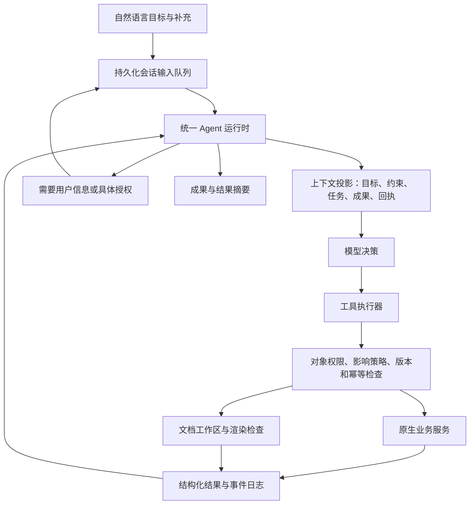

# 自然对话业务 Agent：共用架构与工具链重构

目标是用户提出业务目标、补充确实缺失的信息、审阅最终成果；执行策略、查找数据、参数绑定、草稿修改与过程检查由 Agent 完成。验收单位是完整业务任务，而不是工具数量或协作面板是否丰富。用户已明确：各业务都重要，优先共用架构和工具链。

## 现状诊断

代码核查范围：AgentOrchestrator、SpecialistAgent、ToolOutcomeHandler、TaskGate、ContextAssembler、ToolRegistry、ControlledToolGuard、PlanRevisionService、BudgetDocxRevision、DraftPlanSectionsTool 及前端会话 store。

| 已确认的问题 | 对用户的影响 | 根因 |
|---|---|---|
| 主循环遇到 FORM / PLAN 就中断，返回固定文案 | 用户被带去操作表单和确认卡 | 内部准备结果直接成为交互阻塞条件 |
| 上轮缺参任务没有自然语言接续工具 | 用户补充一句话可能又创建新任务 | 表单提交 API 没有对应模型能力 |
| 所有写类工具统一 PREPARE + TOKEN | 起草和对外发送承担相似交互负担 | 能力只区分读写，没有区分草稿、提交、发布的影响 |
| Word 修订由特定句式正则授权，仅替换预算数字 | 普通润色、改章节、改表格无法完成 | 业务示例变成了通用工具能力上限 |
| DOCX 修改只支持段落内单一 text run，限制包内元素 | 常见 Word 文档会被拒绝或无法编辑 | 没有面向文档结构的操作模型 |
| 系统已有大量工具和专家作用域，但缺少按需工作方法加载 | 模型知道接口名，不一定知道怎样完成并检查任务 | 工具说明承担了流程知识、授权和排版规则多个职责 |

这些不是换一个模型或增加角色名称就能消除的问题。模型仍需具备足够能力，但工作环境必须让它能查、能改、能验证、能继续。

## pi 的可借鉴部分

核查日期：2026-11-11。Git 克隆网络未完成；以下依据是实际读取的上游 README、实现文件及文档，不假称已运行 pi。上游 main 会变化，实施迁移前应固定版本和提交。

1. **持续循环与明确停止边界。** agent-loop 把工具结果送回上下文，支持 steering、follow-up、turn finalization；业务适配层决定是否真正需要停止。参考 [agent-loop.ts](https://github.com/earendil-works/pi/blob/main/packages/agent/src/agent-loop.ts)、[agent-core README](https://github.com/earendil-works/pi/blob/main/packages/agent/README.md)。
2. **按需加载工作方法。** skills 首先展示名称和用途，相关时再读完整说明。可借鉴为业务工作流目录，减少所有规范常驻提示词。参考 [skills](https://github.com/earendil-works/pi/blob/main/packages/coding-agent/docs/skills.md)。
3. **精确修改与可核验差异。** edit 工具针对唯一匹配的原文做定向替换，批量变更针对同一原始基线，产生 diff。Word 应借鉴这种契约，但不能把 DOCX 当文本文件直接替换。参考 [edit.ts](https://github.com/earendil-works/pi/blob/main/packages/coding-agent/src/core/tools/edit.ts)。
4. **内核与扩展分离。** 生命周期、工具注册、上下文处理和渲染有扩展边界。PAMS 的权限、审计、业务 API 应作为服务端适配层，不散落在每个角色提示词中。参考 [extensions](https://github.com/earendil-works/pi/blob/main/packages/coding-agent/docs/extensions.md)。
5. **持久化后呈现。** 上游 durable 模块强调存储提交与恢复，但仍明确标为 Experimental。借鉴事务与恢复原则，暂不把现有业务迁入其变化中的运行时。参考 [durable README](https://github.com/earendil-works/pi/blob/main/packages/durable/README.md)。

pi 主项目没有默认以多 Agent 和计划模式为中心，也不内置完整操作系统权限隔离。PAMS 应复用其运行逻辑，保留自己的租户、对象权限和业务事务，不能照搬开放 shell 权限。[项目 README](https://github.com/earendil-works/pi)

## 目标架构

### 统一运行时，而不是两套行为

主 Agent 和专家共享一个执行器，区别仅是工作方法、上下文与工具范围。子 Agent 是按需创建的任务，不是要求用户挑选的模式。先由主 Agent 完成可连贯处理的任务；只有独立分支确实能并行时委派。审查不能只有形式上的 PASS，应返回具体证据、问题位置及可执行修订建议。

会话输入、模型轮次、工具调用和业务任务分别建模：`conversationId` 管持续工作，`requestId` 管每条用户输入，`turnId/toolCallId` 管执行事件，`taskId/artifactVersion` 管业务对象。不再把“本轮回复结束”视为“业务完成”。

运行状态应包括 RUNNING、WAITING_USER_INPUT、WAITING_AUTHORIZATION、BLOCKED、COMPLETED、FAILED、CANCELLED。缺参、确认、故障是不同停止原因；工具准备了草稿不等于必须中断。前端从同一快照和事件流生成视图，不重新猜测状态。

### 输入与接续

- 用户正在执行时补充的要求进入持久化队列，在工具边界处理；不能静默丢弃，也不能把旧指令的写操作继续排到新指令之后。
- 用户说“地点改为会议室”时，先解析当前任务和已知值，更新同一任务；多个候选有歧义时才提问。
- 信息可从授权业务源查到时先查，日期、收件人、金额等不能随意填默认值。
- 恢复不能重放不确定的提交。先查 operation receipt，再决定继续、失败或要求核对。

### 影响策略取代统一读写门禁

| 操作类型 | 目标默认行为 | 执行前硬条件 |
|---|---|---|
| 授权查询、解析、计算 | 自动推进 | 当前对象权限、数据出网策略 |
| 私有草稿准备与版本修改 | 在明确委托范围内自动推进 | 明确目标、独立草稿、基线、可恢复版本 |
| 已获授权的业务内部更新 | 按具体对象与范围执行 | 授权范围记录、版本、幂等键 |
| 对外发布、群发、不可逆或范围扩大 | 展示完整影响后取得一次具体授权 | 对象集合、内容版本和影响范围绑定 |
| 缺失/含糊/结果未知 | 聚焦问询或核对 | 不把推测当授权，不重复提交 |

授权应记录目标、对象范围、允许操作、限制和有效期，而不是一个全局“全部自动”开关。自然语言确认要解析到已有的具体提案和版本，不能把孤立的“好的”通配为任何操作。后台仍负责校验，模型不能自己签发授权。草稿与发布必须分开。

### 工具协议

工具描述增加 operationKind、effect、inputSchema、outputSchema、idempotency、verification、interaction、sourceCoverage。结果统一包含 status、data、artifacts、receipt、missingInputs、nextActions、retryability。内部工具结果不能直接决定弹几个表单。

错误分类使用稳定代码：INVALID_ARGUMENT、AMBIGUOUS_TARGET、STALE_BASELINE、MISSING_SOURCE、PERMISSION_DENIED、TRANSIENT、RESULT_UNKNOWN。可以修正的参数错误回到模型；真正需要用户决策的才问。所有 tool_call 都有配对结果；提前暂停的剩余调用也记录未执行原因，避免跨模型协议不完整。

按需工作流建议：活动筹备、策划书、宣传稿、排班、材料归档。每个工作流包含查询路线、领域约束、产物标准、检查方法和可用工具清单；不得携带扩大用户权限的能力。新增业务优先扩展工具适配器和工作流，不增加硬编码关键词分支。

## Word 工具链

Word 是一类可编辑成果，不是聊天 HTML 的下载包装。目标工具：

1. `document.inspect`：结构树、章节、段落、表格、样式、页眉页脚、批注与版本；返回明确覆盖范围。
2. `document.read`：按稳定块 ID/范围读取，标出缺失、截断和来源；允许长文分段。
3. `document.createDraft`：从模板及样式约束建立独立工作版本。
4. `document.applyEdits`：replace/insert/delete/move 段落、表格单元格和样式操作；绑定 baseVersion、blockId、expectedHash；原子应用、不重写未授权区域。
5. `document.render`：生成每页预览及布局检查；版本和渲染产物严格对应。
6. `document.verify`：数值勾稽、必需章节、依据、占位符、溢出、分页；可修问题返回模型修改。
7. `document.saveVersion`：保存新版本和变更摘要；原稿保留；提交审批另走业务工具。

流程是读取要求和业务材料 → 形成完整草稿 → 结构检查 → 渲染 → 定向修复 → 保存版本。用户说“压缩背景、预算改成表格，其余保留”应转换为具体块变更；不能匹配不到预算正则就转交编辑器，也不能用全文重新生成冒充局部修订。

先保留现有 PlanService、附件权限与版本 CAS，新增文档结构适配器；复杂 OOXML 可由隔离的文档 worker 执行，固定模板/字体/渲染器版本。worker 仅获得当前任务授权文件，不持有平台数据库或用户凭据。没有渲染检查不得声称已完成版式验收。

## 本次实际落地及未完成项

已实施共用接续适配层：

- `queryConversationActions` 查询当前用户、组织、会话的待处理任务，返回声明字段，剔除确认令牌及内部参数。
- `supplyTaskInput` 将对话补充值交回已有 TaskGate.submitInput，保留 taskId，不另建同类任务，不提交业务。
- `PersistedInteractionTool` 区分接续已有任务与创建新准备清单；共用 outcome handler 不重复落库。
- 缺参回复只列缺失的必填信息，并允许直接聊天补充；已有值不要求重填。
- 前端退休同一 taskId 的旧表单，避免新轮接续后仍出现两个可操作入口。
- 输入字段白名单、归属/权限重验、只读模式和状态检查；当前对话适配仅开放 NORMAL 数据，敏感工具需另做符合原出网策略的适配。

首批验证：后端 ConversationActionsTest、ToolInventoryTest、ToolResultTextTest、PromptBundleTest 共 15 项通过；前端会话生命周期 20 项通过，TypeScript 检查通过。包含同一任务继续、禁止重复建任务/提交、跨会话/跨组织/撤权拒绝、字段白名单、敏感数据隔离、缺参话术及旧表单退休。测试采用确定性 mock，不代表已完成真实模型在生产业务中的端到端验收。后端代码需部署或重启对应服务后生效。

**尚未实现上文全部目标。** 当前仍保留业务提交确认门禁；Word 通用结构编辑、渲染闭环、持久化 steering 队列、按需工作流加载和统一主/子 Agent 循环还需要后续迁移。没有把“减少文案提示”算作自动执行业务，也没有宣称 Word 质量已改善。

## 迁移顺序与验收

1. 共用接续与任务身份：已有缺参场景可以聊天补齐；同一 taskId，不重复创建、提交或跨会话串入。本次完成基础适配。
2. 统一循环、输入队列与工具结果协议：运行中纠正可以影响下一个工具边界；断线恢复不重复写；每次工具调用有结果。
3. 草稿与业务提交分层：明确委托的可恢复草稿操作无需逐次点击；对外动作按具体提案授权；验证只读和权限撤销不被绕过。
4. Word 原子编辑和渲染检查：覆盖长文、表格、图片、页眉页脚、分页、局部修改及并发编辑冲突；逐页图像检查与原文件保留。
5. 工作流目录与可选协作：业务知识按需加载；同一任务在单 Agent/协作下有一致的事实、权限和结果状态。

评估用真实端到端任务集：创建活动并准备策划；连续三轮修改同一 Word；生成排班后修改日期；准备通知但尚未发送；中途停止/断线恢复；执行时用户纠正范围；另一用户或另一会话的任务不可见。统计完成率、非必要点击数、重复询问次数、重复写次数、Word 未授权区域保真与可视版式质量。数值需要实测，不预填所谓提升比例。

## 第二批落地

主助手与专家共用工具派发和交互结果处理。普通单份策划书走主助手，协作路由仍支持跨领域任务和发布审查。模型可调用 `loadBusinessWorkflow` 读取策划书、排班和公告工作方法。

主助手可在用户委托保存时，通过 `saveDraft` 保存策划书新版本并继续处理同轮后续步骤。工具先准备草稿，随后复用任务认领、对象权限、版本校验和回执。自动保存适用于声明该能力的策划书工具及主助手路径。审查拦截、人工预览和外部业务提交继续走现有门禁。

新稿使用原生 DOCX 保存标题、段落、列表和简单表格。已有 Word 可按已读块及指纹批量替换段落或简单单元格中的文本，原版本与非正文部件保留。当前支持同一文本格式内的替换。跨格式、跨段落编辑、插入和重排结构仍需后续扩展。

待完成的主要部分包括持久化运行中指令队列、完整统一模型循环、逐页渲染与自动修复，以及真实模型和浏览器的业务端到端验收。

## 第三批落地

- 主助手运行中可在原输入框补充指令。服务端按请求和输入 ID 持久化、去重，并检查用户、租户、权限和运行状态。下一执行边界读取更新，跳过尚未派发的旧调用。历史会话保留补充内容并区分是否已进入模型。协作任务和知识库回答尚未接入此队列。
- 新生成的 Word 草稿保存前可渲染为 PDF，逐页检查空白页、文字越界和无法识别的字符。检测到版面问题时尝试调整段落间距和分页设置，重新渲染，只有检查发现的问题减少时才保存调整版。保存回执记录页数、页码、问题和调整结果。已有 Word 局部修订继续使用结构和基线检查。
- 后端容器镜像安装 LibreOffice Writer、Poppler 和中文字体，默认启用检查。本地运行时，可设置 `PAMS_AGENT_WORD_RENDERER` 为 LibreOffice 的 `soffice` 可执行文件路径，并将 `PAMS_AGENT_WORD_PDF_TEXT` 指向支持 `-bbox` 的 Poppler `pdftotext`。未配置、渲染失败及检查繁忙均有明确状态。
- 运行中指令经过编排器及数据库集成测试，前端经过浏览器发送及重试验证。逐页判定经过测试，容器渲染、模型驱动的复杂版式修复和真实模型业务验收仍待验证。

## 第四批落地和验收

- 普通多 Agent 协作可在原任务中接收纠正并替换未提交的步骤，失效预览无法确认。已经进入提交的动作通过回执核对。知识库问答在收到补充指令后重新检索，并使用新结果更新引用。
- 明确委托的本人报道草稿和限日期、时段、部门及人数的未发布排班草稿可在本轮直接保存。服务端核对原始用户消息和实际准备的范围，并记入授权来源。发布、发送和送审继续执行各自的确认流程。
- Word 支持跨格式精确替换、连续正文段落修改及段落插入和删除。修订版仍由原文指纹、文档版本和实际回执约束。通过导入包检查的修订稿逐页渲染，检查结果随版本回执保存。
- 真实模型浏览器场景在隔离 MySQL 中通过。用户自然语言创建一版 Word 草稿，修改预算，刷新会话后再修改负责部门。三个版本均由真实工具保存，全程无需点击确认，原始文件字节保持不变。三个版本均通过实际 LibreOffice 和 Poppler 的逐页检查。
- 本地容器验证覆盖生产镜像启动、MySQL 迁移到 V70、Nginx 前端加载、登录和鉴权后的工具调用入口。全量后端测试执行 964 项，944 项通过，20 项按既有条件跳过。前端类型检查、构建、25 项会话与概览测试及 7 项浏览器回归通过。另有 10 项隔离 MySQL 浏览器回归通过，覆盖版本、确认、受控重规划和越权防护。
- 已批准的受控执行计划仍使用原有结构化修订，主助手与专家保留各自的模型循环。复杂对象和含外链的导入 Word 依然有检查限制。线上服务尚未更新。
