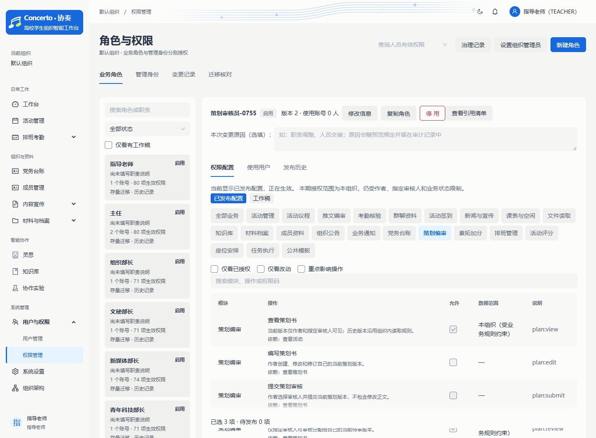
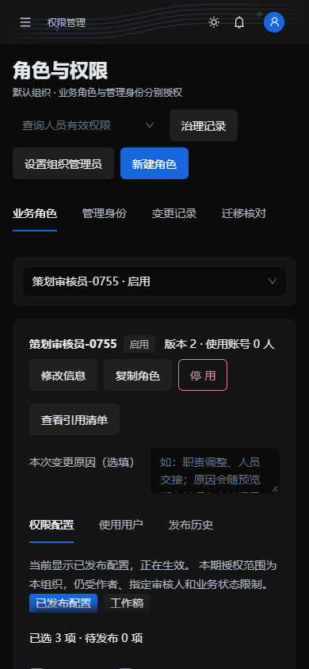

# 协奏权限管理 v2：一期落地记录

日期：2026-10-26。依据已确认的[业务方案](PAMS-权限管理更新方案-v2-待评审.md)实施。本文描述实际交付及验证边界；方案中的二期内容不属于已实现功能。

## 本次一期补齐（2026-10-26）

| 原缺口 | 现已实现 |
| --- | --- |
| 升级启动先切换、之后再核对 | 升级前只读报告与授权影子对比，记录各组织所有者确认和逐角色考勤决策；源数据或目录变化后拒绝切换 |
| 缺少可执行回退路径 | 授权快照回退工具、切换后指纹保护、旧发布历史保留、新版启动回退保护；另提供完整备份／应用回退手册 |
| 角色替换预览不展示权限变化 | 展示实际生效权限的增加、撤销、范围及高影响标记，保留版本／预览失效校验 |
| 停用只报“有引用” | 可分页查看账号、岗位和有效邀请的名称、编号及处理要求；不返回邀请令牌 |
| 工作稿无法真正放弃或删除 | 放弃服务器工作稿、删除未发布角色均校验角色与工作稿版本；删除还阻止停用账号引用，旧预览失效 |
| 只读账号默认看到工作稿 | 只读或受保护角色默认显示已发布配置，并如实说明角色停用时不生效 |
| 角色及关联数据不完整 | 角色有效权限数、来源、最近更新信息；用户部门、状态、治理身份；角色、用户、历史、引用服务端分页 |
| 原因和治理依据不足 | 预览绑定原因，审计与发布历史保存原因／操作人／变更编号；必要 403／409 拒绝独立落库，委派展示期限、版本与最近调整 |
| 旧权限依赖仍靠模块名称推测 | 全量业务目录显式声明说明、依赖与风险，加载时校验缺失和循环，发布与迁移共用声明 |
| 常规排班仍立即生效 | 常规排班保存草稿，单独发布／取消，草稿不进入个人排班；已发布修改仍需发布权 |
| 管理员旧 PUT 可直接变更 | 旧写入口返回须预览的冲突提示，委派统一走预览—确认—应用 |

部署工具及完整操作边界见[迁移与回退操作手册](PAMS-权限一期-迁移与回退操作手册.md)。此处的“已实现”指代码与隔离验证，正式业务库切换仍未执行。

## 已实现的管理流程

入口保持 `/admin/permissions`，页面由“业务角色、管理身份、变更记录、迁移核对”组成。

- 角色支持名称／职责搜索、状态与工作稿筛选、空白创建、复制和组合职责模板创建。新增九个职责模板；组合后仍生成一个独立业务角色，不引入多角色叠加。
- 权限按业务中文分组，显示操作说明、必要依赖、重点影响标记及不可授权原因。支持搜索、仅看已授权、仅看改动、重点影响筛选。
- 添加操作会明确确认所需依赖；撤销依赖时明确确认连带撤销项。任何依赖超出管理员授权上限，整次本地调整被拒绝，不能偷偷扩权或删除只读授权。
- 区分本地修改、服务器工作稿与已发布配置；保留未保存改动保护。支持真正放弃服务器工作稿、删除未发布角色，均核对最新版本；只读默认显示已发布配置。
- 发布预览展示中文操作差异、有效期限和账号／岗位／有效邀请影响。重复应用沿用幂等处理；发生网络错误后按变更 ID 查询实际结果，避免盲目重复执行。
- 管理身份与本人业务访问权分开展示；所有者在新页面中先预览再确认管理员委派及撤销。管理能力仍使用首版的组织管理员预设。
- 治理记录支持操作人／对象搜索、动作和日期筛选、服务端分页及差异详情；新记录保存操作人和对象名称快照。旧记录没有名称快照时如实显示历史编号。
- 角色详情可比较历史配置与当前生效配置，历史只读。页面工具区和用户详情均可查看有效授权及来源，并对策划审核、排班发布、人工考勤修正、文件读取进行对象级权限解释；解释接口不返回业务正文，也不执行操作。
- 手机端使用可搜索的角色选择框，避免长角色列表占满页面；权限模块导航可横向滚动。

## 业务权限与执行入口

升级映射与九个职责模板保存在 `permission-catalog-v2.json`，新增 29 个业务权限点；全量显式业务说明、依赖及风险保存在 `permission-catalog-v3.json`。升级报告把两个资源的内容共同绑定到目录指纹，迁移与发布使用相同的显式依赖。发布后的资源应保持不可变，后续演进须新增版本。

| 场景 | 当前权限边界 | REST／页面／工具接入 |
| --- | --- | --- |
| 活动基础信息与阶段 | `activity:edit` 与 `activity:transition` 分开 | 活动编辑、列表与详情的阶段按钮、活动状态接口 |
| 任务 | `task:view/manage/progress` 分开 | `/api/tasks`、甘特图、进度入口、工作台任务摘要、`queryActivityTasks`、`queryMyPendingWork`、`generateActivityTasks` |
| 议程与评分 | `agenda:view/manage`、`score:view/manage` | 议程、评分接口与活动详情页；聚合结果按各子模块权限裁剪 |
| 策划 | `plan:view/edit/submit/review` | 策划读取、编写、提交、审核、版本与附件规则；`draftPlanSections`；策划知识来源 |
| 排班 | `schedule:manage/generate/publish/export` 分开 | 活动排班生成、草稿维护、发布／取消、组织排班导出；`generateActivitySchedule` 只生成草稿 |
| 已发布班次修改 | 还需 `schedule:publish` | 活动排班编辑、删除、重新生成，以及常规班次的修改／删除；常规班次创建为草稿，发布和取消另有受保护入口 |
| 本人排班／课表 | `schedule:self:view`、`course:self:manage` | 个人排班、个人课表接口；本人排班仅按账号 ID 关联 |
| 课表管理／无课信息 | `course:manage`、`schedule:free_table` | 批量课表导入、学期参数与组织无课结果；个人录入不扩大为组织管理权 |
| 本人考勤／打卡 | `attendance:self:view`、`schedule:check` | 仅本人记录；本人打卡由服务端确定身份、班次及状态，校验发布状态、日期和时间窗口 |
| 组织考勤／人工修正 | `attendance:view/manage` | 组织考勤列表、统计、审计、修正、补签和删除；不再接受打卡权或活动签到管理权作为人工修正条件；`queryAttendance` 区分本人和组织范围 |
| 活动签到导出 | `checkin:export` | 新增受保护的 `/api/signins/export`；CSV 导出从该接口读取数据，不能只靠按钮隐藏 |
| 推文 | `article:create/edit/submit/review/publish/stats/delete` | 推文列表及活动内推文面板、对应写接口；`draftArticleFromActivity`；`searchArticles` 使用 `content:view` |
| 他人推文 | 额外的 `article:manage` | 仅解除作者限制；编辑、提交、审核、发布等对应操作仍单独校验，业务状态继续生效 |
| 新闻稿 | `news:manage` 与 `news:publish` 分开 | 新闻草稿维护与发布接口及页面 |
| 知识维护 | `kb:document:manage` 与 `kb:index:manage` 分开 | 文档维护、重建索引、刷新快照接口与页面；来源访问规则继续独立执行 |
| 通知 | 个人读取／偏好作为基础能力，`notification:send` 仍是业务授权 | 业务通知正文按当前来源资格裁剪；广播审核通知按业务权限选择接收人，避免只认固定职位 |
| 党务、成员、文件及其他档案 | 保留既有细分权限和领域包／脱敏／来源约束 | 继续复用当前业务鉴权；党务工具使用明确 `party:view`，不再依赖固定职位门禁 |

活动详情聚合、路由、菜单、灵思提示及工具入口已同步调整。策划当前版本的作者／指定审核人、推文作者、文件归属与敏感级别限制继续生效，`ORG` 不表示越过这些规则。

组织授权变化在事务提交后向当前组织账号推送版本信号，前端重新读取自己的授权；窗口重新聚焦和可见页面的定时刷新作为兜底。服务端仍逐请求重新鉴权，前端刷新不是授权依据。旧灵思任务继续受原授权上限及当前权限共同限制。

## 与方案相比的明确取舍

1. 旧 `activity:assign` 没有可对应的独立承办部门分配业务入口，本次退出可授权目录，待可信组织节点归属接入后再开放。
2. 推文保留作者限制，另加 `article:manage` 表达“可以维护他人稿件”；不会仅因拥有编辑／审核资格就解除全部作者约束。
3. 仍不开放可配置的节点／本人／指派范围；一期采用 ORG 以及业务内已有对象规则。常规排班、分页与委派兼容写入口的早期取舍已在本次补齐。

## 存量授权升级

新增 Java Flyway 迁移 `V47__business_permission_catalog_v2`，不修改历史迁移。

- 新权限按旧职责映射，补齐依赖，同步转换系统模板、角色当前配置、工作稿和管理员可授权清单。
- 旧发布快照保留原内容；为当前配置生成新的发布快照，保留组织内历史追溯。
- 每个存量角色写入 `authorization_migration_review`，保存变更前后授权及核对状态；旧待确认授权变更失效，组织授权版本增加。
- `activity:review`、`content:manage`、`kb:manage` 等聚合码退出运行授权目录；个人通知旧勾选项改为基础能力，不继续显示为可任意配置的业务权限。
- **存量考勤角色先确认、再切换。** 升级前报告列出原能力、候选及作者隐式能力核对项；所有者明确 KEEP／REVOKE 后才允许迁移。未批准、源快照与投影不一致、批准后人员或授权变化均阻断。旧工作稿转换后仍是工作稿，不自动发布。
- 新组织的普通干事模板不再默认授予组织考勤查看和人工修正。本人打卡／考勤与管理他人记录分开。
- 本人排班与考勤不再按同名自动认领。没有账号 ID 的历史记录需先核对并关联；不能把相同姓名当作身份凭据。

V48 增加角色／委派更新人、发布原因与目录版本、审计结果／原因／变更编号等字段，并把旧常规排班的空状态明确为已发布。升级真实业务库前须完成备份、所有者确认、目标版本副本演练和停写窗口；此次未向现有业务库执行迁移，也未部署线上服务。

## 验证结果

| 验证 | 结果 |
| --- | --- |
| 后端全量测试 | 118 个测试类、672 项；664 通过、8 项因环境条件跳过；无失败或错误 |
| 前端全量测试 | 28 个文件、197 项全部通过 |
| 前端类型检查和生产构建 | 通过；保留现有大包体积提示 |
| Ant Design 5.24 页面检查 | 管理目录 0 个问题 |
| 模拟 API 浏览器流程 | 创建—工作稿—预览—发布通过 |
| 真实服务浏览器联调 | 独立 MySQL／独立端口、打包应用、stub 模型；验证目录、依赖、原因、发布历史、工作稿放弃、引用清单、角色替换差异、治理页和响应式；无页面异常或接口 5xx |
| MySQL 存量升级与回退 | 独立库 V46 → V48，覆盖升级前阻断、只读报告、批准后变化阻断、考勤保留与撤销、旧未发布工作稿、历史不改写、后续变化拒绝回退和授权恢复 |

后端新增安全场景验证了任务权不能修改活动、活动编辑权不能维护任务、本人考勤不能读取组织列表或人工修正、同名记录不能冒领、打卡不能伪造目标人员／结果、生成权不能发布、宣传编辑不能审核、文档维护不能重建索引、跨模块依赖、模板组合及诊断接口的组织边界。全量回归后针对 MySQL 引用清单排序规则兼容修复，另行运行 16 项角色治理回归及真实服务浏览器验收，均通过。

真实联调及 MySQL 演练只使用以 `pams_permission_validation_` 命名的独立测试库。截图来自该验收环境；示例账号和业务数据不代表用户现有组织数据。MySQL 9.5 的验证不替代目标生产版本及真实存量数据验收。

## 页面验收截图

桌面浅色：

手机深色：

## 后续边界

本期仍为一个业务主角色、独立管理身份和 ORG 授权范围；本人入口及指定审核人由各业务服务约束，不等于已提供通用 SELF／ASSIGNED 范围编辑器。节点范围、多角色合并、个人额外授权、受限管理员预设、批量角色迁移、所有者交接、历史恢复和审计导出属于后续范围。

正式库切换、目标版本与真实数据副本验收、完整备份恢复演练、存量账号与姓名记录关联、所有者实际确认尚需在部署流程中完成。自动化测试中的确认记录仅属于测试数据，不替代实际业务确认。

## 主要代码入口

- 前端：[权限工作区](../../pams-web/src/pages/admin/PermissionManage.tsx)、[管理身份与审计](../../pams-web/src/pages/admin/PermissionGovernance.tsx)、[对象级解释](../../pams-web/src/pages/admin/PermissionExplanation.tsx)、[依赖编辑逻辑](../../pams-web/src/pages/admin/permissionEditing.ts)。
- 后端：[权限目录](../../pams-backend/src/main/java/com/pams/module/permission/service/PermissionCatalog.java)、[授权服务](../../pams-backend/src/main/java/com/pams/module/permission/service/TenantAuthorizationService.java)、[解释服务](../../pams-backend/src/main/java/com/pams/module/permission/service/PermissionExplanationService.java)、[V47 迁移](../../pams-backend/src/main/java/db/migration/V47__business_permission_catalog_v2.java)。
- 运维：[预检／批准／回退工具](../../pams-backend/src/main/java/com/pams/module/permission/service/PermissionMigrationCli.java)、[迁移与回退操作手册](PAMS-权限一期-迁移与回退操作手册.md)。
- 验证：[新权限安全回归](../../pams-backend/src/test/java/com/pams/security/BusinessPermissionV2Test.java)、[存量迁移回归](../../pams-backend/src/test/java/com/pams/security/PermissionCatalogMigrationTest.java)、[真实服务浏览器验收](../../pams-web/e2e/permission-v2-live.spec.ts)。
