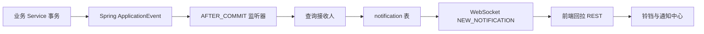
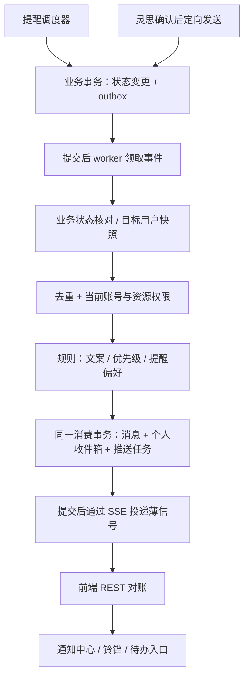

# 协奏 PAMS 消息通知管线重设计 v1

日期：2026-10-28  
状态：v1 设计评审通过，第一、二阶段核心及第三阶段首批（治理告知、公告确认、管线运维）已落地；其余业务接入待补齐  
评审记录：2026-10-28，用户确认“消息通知管线重设计 v1 评审通过”，并要求补入技术方案。  
技术调整：2026-10-28，用户要求将消息通知从 WebSocket 迁移到 SSE；本版据此修订通知实时通道，灵思和权限同步继续使用现有 WebSocket。  
依据：当前工作区代码，包含尚未提交的策划书、任务计划、权限治理变更。旧版 2026-08-05 通知方案仅作历史参考。

## 1. 设计结论

保留现有 Spring Boot、MySQL，通知实时通道从 WebSocket 迁移为 SSE；灵思过程、执行回执和权限同步保留 STOMP/SockJS。将通知升级为“业务事实 → 持久化事件 → 接收人规则 → 个人收件箱 → SSE 唤醒 → 权限校验后查看”的管线。首期不引入消息中间件，不接短信、邮件、企业微信。

需要分别管理四类消息：

| 类别 | 用途 | 是否进通知中心 | 是否形成待办 |
| --- | --- | --- | --- |
| 业务通知 | 指派、发布、变更、审核结果、定向提醒 | 是 | 由业务状态决定 |
| 待办提醒 | 待审核、待完成、临期、逾期 | 是，且关联办理事项 | 是 |
| 状态同步 | 权限刷新、灵思过程、页面数据失效 | 否 | 否 |
| 运维告警 | 扫描失败、投递积压、索引故障 | 管理视图；必要时向指定维护人生成摘要 | 不混入普通业务待办 |

通知表示“发生过什么”；待办表示“现在需要做什么”。已读不代表完成，业务完成也不自动把历史通知标成已读。

## 2. 当前链路与覆盖范围

### 2.1 主链路

`NotificationEventListener` 同时负责接收人规则、文案、落库与 WebSocket 推送；`NotificationService` 提供列表、分页、未读数和已读操作。推送通常只有类型与未读数，正文通过 REST 获取，已有这一方向可继续沿用。

### 2.2 已接入的业务

| 业务触发 | 当前接收对象与行为 | 主要边界 |
| --- | --- | --- |
| 创建活动任务 | 任务部门成员，排除操作者 | 仅有部门才发事件；负责人为姓名文本；修改、改派、级联改期、撤销未接入 |
| 策划书提交 | 此版本明确选中的审核人 | 已适配版本私有与选人审核，不能恢复成全体老师/主任广播 |
| 策划书审核 | 全部通过或任一退回时告知提交人 | 部分审核通过不广播；撤回、重新修订尚无对应通知闭环 |
| 策划书编辑 | 有事件，通知监听器明确不广播 | 私有草稿保存保持安静；该事件同时服务知识索引 |
| 新闻稿上传 | 经广播辅助方法选择接收人 | 文案写“请审核”，但不能据此假设已存在独立审核任务 |
| 签到名单上传、全部签到完成 | 活动创建者，加广播选出的用户 | 同一创建者也可能进入广播集合，缺少统一去重 |
| 推文任务指派 | 指定作者 | 已有定向通知 |
| 推文提交、审核、发布 | 审核候选、作者、发布告知对象 | 接收人策略混合旧角色集合与当前权限查询 |
| 推文截止提醒 | 作者；每天 08:30 扫描 | 每日提醒时间写在推文本体；没有通用提醒任务与补偿机制 |
| 公告创建 | 发布事件，经广播辅助方法生成通知 | 当前事件在创建入口发出；广播受众与“所有角色”注释并不一致 |
| 灵思定向发通知 | 直接调用 `createAndSave` | 工具文案承诺即时推送，但该调用本身只落库，没有经过监听器的推送逻辑 |
| 截止扫描异常 | 直接写 SYSTEM，固定 TEACHER 角色 | 无统一告警管线，也没有实时推送 |

广播辅助方法在注入授权服务时，按权限筛选组织用户并逐人生成通知；此时传入的旧角色集合实际上不决定受众。例如推文待审按 `article:review`，签到按 `checkin:view`，公告按 `notice:view`，其他类型默认 `activity:view`。应以实际分支为准，不能照搬注释。

### 2.3 独立实时通道

| 通道 | 当前职责 | 本方案处理 |
| --- | --- | --- |
| `/user/queue/notifications` | 通知失效信号，前端刷新列表 | 迁移至 `GET /api/notifications/stream` SSE，完成切换后停止通知队列的发布与订阅 |
| `/user/queue/authorization` | 组织授权版本变化，触发权限刷新 | 保留；权限变更的个人告知另生成业务通知 |
| `/user/queue/agent/stream` | 灵思工具、专家、审查过程 | 保留过程流，不逐条进铃铛 |
| `/user/queue/agent` | 灵思执行回执和持久任务更新 | 保留；仅离开会话后的重要结果考虑生成收件箱提醒 |

灵思已有 `AgentRunOutbox` 与事件序号、领取租约、恢复扫描。通用通知可借鉴它的恢复机制，但不复用其任务唤醒和编排职责，也不把两套事件表强行合并。

第 2 节记录迁移前现状；下文描述目标方案。当前已开始第一阶段实现，实际完成范围与验证结果见[消息通知第一阶段落地记录](PAMS-消息通知管线-v1-第一阶段落地记录.md)。

## 3. 现状问题及处理优先级

| 优先级 | 代码事实或风险 | 设计处理 |
| --- | --- | --- |
| P0 | `markAsRead(id,userId)` 读取通知后没有校验接收归属，`userId` 未参与判定 | 已读更新必须包含组织、当前用户和收件箱 ID 条件 |
| P0 | 历史角色/部门通知与直接发送工具仍可创建共享行，共享 `isRead` | 每个接收人独立收件箱；角色/部门只用于发送时展开 |
| P0 | 业务提交后才创建通知，事件不持久化 | 业务事务同时写 outbox，提交后 worker 可靠生成通知 |
| P0 | AFTER_COMMIT 回调调用默认 REQUIRED 的写入方法 | 存在提交后沿用原事务资源的持久化风险；需集成测试证实。新方案使用独立消费事务，禁止依赖该写法 |
| P1 | 推送失败只记录日志，无补偿；进程退出可能丢失待处理事件 | outbox、重试、租约与人工重放；推送失败不影响收件箱落库 |
| P1 | 权限广播把“能查看”近似为“需要提醒”，部分路径仍用固定角色 | 按业务关系确定目标，再取当前权限交集 |
| P1 | 通知偏好是用户级内存 Map，发送逻辑未读取 | 偏好持久化并进入管线；区分保留记录与是否打扰 |
| P1 | WebSocket 连接成功未统一刷新通知，中心页与铃铛各管状态 | 连接、重连、窗口回前台均对账；同一个查询缓存管理列表和计数 |
| P1 | 通知断线期间没有通用补拉；现有 STOMP 重连延迟把函数强转 number | 通知改用独立 SSE 重连与 REST 对账；其余 WebSocket 的重连问题单独修复 |
| P1 | 铃铛仅 TASK/PLAN 跳活动列表，中心页没有业务办理入口 | 结构化业务引用与统一路由解析，定位活动 Tab/具体条目 |
| P1 | 排班、考勤修正、任务变更等缺少通知 | 按第 5 节补齐，不以增加枚举代替完整闭环 |
| P2 | 优先级固定 NORMAL；读操作与未读数刷新分散 | 服务端确定优先级，已读幂等，批量合并失效信号 |
| P2 | 通知事件未带明确租户，定时扫描未显式逐组织执行 | 事件强制携带 orgId；在建立事务/EntityManager 前设置租户，结束后清理 |

静态分析不能证明生产环境已经发生漏投或跨用户读操作。本节把确定的代码缺口与需要集成验证的运行时风险分开处理。

## 4. 接收人模型

### 4.1 统一规则

有效接收人 = 业务关系目标 ∩ 同组织有效账号 ∩ 当前资源可见范围。

办理型提醒还需满足该用户对该资源的办理资格；不能只判断菜单权限。无有效办理人时生成“待分配”异常给业务负责人，不能静默丢弃，也不能自动扩大到全组织。

优先使用明确关系：指定审核人、明确负责人、排班人员、活动负责人、资料提交人。部门兜底只适用于确实没有个人负责人的任务；具备权限的候选池可用于没有明确审核人模型的推文审核。

### 4.2 当前数据前置条件

| 关系 | 当前情况 | 落地要求 |
| --- | --- | --- |
| 任务负责人 | `Task.assignee` 是字符串，首页也按姓名匹配 | 补稳定 userId 关系，可采用独立负责人关系表；显示文本保留。姓名不得作为自动精确投递依据 |
| 活动负责人 | leader、host 等为文本，创建人为账号 ID | 补活动责任人关系；迁移前只把创建者作为管理兜底，不能假定他等于业务负责人 |
| 排班人员 | `SchedulePerson.userId` 可为空 | 仅绑定有效账号者可站内投递；未绑定人员计入管理摘要，不猜测同名账号 |
| 推文 | 已有 authorId | 改派、临期、结果可定向；待审候选依据现有审核授权，不凭空新增指定审核人流程 |
| 党务成员 | 业务成员不必然有登录账号 | 敏感事项先通知授权经办人；只有建立成员账号关系且有本人访问接口后才考虑本人提醒 |

### 4.3 通用约束

- 同一事件内按 `(orgId,userId)` 去重，直接接收与广播接收合并。
- 默认排除操作者；排班变更等直接影响其个人安排时，即使自己操作也保留个人记录。
- 发送时固定接收人快照；后来加入角色/部门的人不自动继承历史通知。公告正文可单独按当前权限浏览。
- 消费前、读取时、办理时分别校验当前资格。失去权限不再展示敏感正文；过期办理事项关闭，不继续催办。
- 权限治理告知使用治理身份和授权规则，不要求组织管理员拥有业务资料查看权限。
- 接收人规则由后端代码注册，组织可配置有边界的候选组、提醒时点和摘要偏好；首期不做任意脚本规则引擎。

## 5. 按系统业务重排通知目录

“即时”表示保存记录并尝试在线唤醒；“静默”表示只进通知中心；“摘要”表示按接收人和业务批次合并。下列是目标方案，不代表已实现。

### 5.1 活动与任务（首期核心）

| 事件 | 接收对象 | 形式 | 办理/收敛规则 |
| --- | --- | --- | --- |
| 任务首次指派、改派 | 新负责人；原负责人收到解除告知 | 即时 | 新负责人待办；旧待办关闭；无人绑定时通知负责部门的指定任务协调人 |
| 任务截止、前置依赖、关键内容变化 | 受影响任务负责人 | 即时或批次合并 | 保存变更摘要；甘特级联一次操作对同一个人合并一条 |
| 任务临期、首次逾期 | 负责人 | 待办提醒 | 默认提前 1 天、逾期首次各一次；每日逾期摘要；活动责任人收到一次升级摘要 |
| 任务完成、重新打开 | 指派人/活动责任人；重新打开通知负责人 | 静默/即时 | 仅状态跨越完成边界触发，不对每次进度微调发通知 |
| 删除、撤销创建、撤销改期 | 先前受影响的负责人 | 即时，短时连续变更合并 | 取消关联提醒；还原也是新的业务修订，不删除已经送达的历史事实 |
| 活动时间、地点重要变化 | 当前参与任务/排班的账号及责任人 | 即时 | 草稿编辑不广播；活动只有日期时不编造具体开场时间 |
| 活动结束/归档 | 责任人、仍有未结事项的负责人 | 摘要 | 关闭不再适用的提醒；是否允许未结任务归档由业务规则决定 |

### 5.2 策划书（保留当前选人、版本模型）

| 事件 | 接收对象 | 形式 | 办理/收敛规则 |
| --- | --- | --- | --- |
| 当前版本提交 | 所选且仍有资格的审核人 | 即时 + 待办 | 待办键绑定 planId/版本及审核人 |
| 单个审核人通过 | 仅更新审核进度 | 状态同步 | 关闭此人的审核待办，不向全员发通过通知 |
| 全部审核通过 | 提交人，必要时明确的活动责任人 | 即时 | 关闭本版本剩余提醒；不广播私有策划书正文 |
| 任一审核退回 | 提交人；其他审核人静默告知本轮结束 | 即时/静默 | 关闭本轮所有审核待办；修改意见只在有权限时展示 |
| 撤回并修订 | 原版本尚未处理的审核人 | 静默，已打开审核页则即时失效提示 | 旧版只读，不可继续审核；新版提交创建新一轮待办 |
| 草稿保存 | 无 | 无 | 不发送业务通知 |

当前没有策划书审核截止字段，首期不擅自生成逾期通知；后续引入明确期限后复用提醒引擎。

### 5.3 宣传、签到与排班考勤

| 事件 | 接收对象 | 形式 | 办理/收敛规则 |
| --- | --- | --- | --- |
| 推文创建指派/改派 | 作者、新旧责任人 | 即时 | 与任务改派同样处理 |
| 推文提交审核 | 有 `article:review` 且可访问此稿的有效候选人 | 即时 + 共享候选办理项 | 任何人完成审核后，其他人的同轮候选办理项统一收敛；以后业务若改为会签，再采用多人逐一完成模型 |
| 推文通过/退回 | 作者；通过后另匹配具备发布资格的责任人 | 即时 | 只有作者具备发布资格时才显示“请发布”；不再固定把发布责任交给作者 |
| 推文发布 | 作者、活动责任人、明确关注人 | 静默 | 不默认通知全部可查看者 |
| 推文临期/逾期 | 作者 | 提醒 | 将现有每日扫描迁到通用引擎；已提交待审时不催作者撰写，按当前责任阶段提醒 |
| 新闻稿上传/更新 | 明确的内容经办人、活动责任人 | 静默/摘要 | 当前无明确审核流程时不写“待审核”，也不制造审核待办 |
| 签到名单上传/替换 | 签到经办人、活动责任人 | 静默/摘要 | 仅替换名单属于重要变更时即时；同一人去重 |
| 单人签到成功 | 当前扫码界面 | 原地反馈 | 不进普通铃铛；不对每个签到广播 |
| 签到完成、活动结束仍有缺签 | 签到经办人、活动责任人 | 摘要 | 按活动和名单版本去重；缺签需核对，不宣称每次签到即形成新任务 |
| 活动排班发布 | 本次排班绑定账号的人员 | 即时 | 自动生成和草稿预览不通知；一键发布按人合并 |
| 已发布排班换人、改时间地点、取消 | 新旧受影响人员；经办人收到摘要 | 即时，重要变更高优先级 | 差异比较前后人员与时间；旧提醒取消，新提醒重建 |
| 活动排班开始前 | 当前有效排班人员 | 默认提前 30 分钟一次 | 没有准确日期时间则不排程；不延续已取消班次 |
| 考勤被自动标缺勤 | 本人若有本人查询能力；考勤经办人 | 静默 + 批次摘要 | 明确“待核对”；无本人查看接口时只发经办人 |
| 考勤人工修正/补签 | 被影响且可查看结果的账号 | 静默 | 原操作者原地回执；不新增尚不存在的申诉审核流程 |

常规排班当前创建为草稿，不能直接把“保存”视为“发布”。第一步明确常规排班的生效动作和每周实例日期，再接发布通知与班前提醒。没有可靠生效语义前，不自动催签到。

### 5.4 公告、档案、成员党务、治理与智能协作

| 模块/事件 | 接收对象 | 默认策略与边界 |
| --- | --- | --- |
| 公告正式发布、重要更正 | 发布时选择的组织/部门/人员，与 `notice:view` 可见性取交集 | 普通公告静默，重要公告即时；创建即发布的现有行为可兼容。全员受众须明确选择 |
| 公告阅读确认 | 明确要求确认的受众 | 后续增强，独立确认时间；普通“已读”不能充当签收回执 |
| 素拓记录增加、调整、批次回滚 | 绑定账号且可查看本人记录的成员；操作人收到摘要 | 不默认发全员；当前只有组织级 `quality:view` 时先面向授权经办人，个人提醒依赖本人可读接口 |
| 材料、模板、座位表、评分、议程普通保存 | 当前操作人 | 原地反馈/状态同步，不自动产生铃铛通知；已有任务可据业务条件收敛 |
| 成员导入、开户、资料更新 | 发起人、明确的授权经办人 | 同步操作原地显示结果；长批次若异步则完成/失败摘要。通知正文不携带密码、开户令牌和凭据 |
| 党务阶段变化、转入转出、考察记录 | 对应授权经办人 | 仅党务领域开启时启用；正文最小化，敏感内容回源查看；不凭记录日期推定未来考察期限 |
| 角色生效、个人角色调整、管理员委派与撤销 | 被影响用户；所有者/有权治理者收到摘要 | 个人重要告知 + 独立权限刷新信号。权限工作稿保存不广播；不把组织全部用户都变成治理通知受众 |
| 账号禁用 | 授权管理人 | 审计与管理摘要；被禁用用户会话失效，不依赖其继续读取站内通知 |
| 灵思等待确认/补充信息、长任务完成/失败 | 会话所有人 | 会话内原地更新；离开会话后才即时提醒，绑定 request/run 状态版本去重；不对工具过程逐条通知 |
| 灵思代发通知 | 明确选定的人员/角色/部门 | 使用同一通知管线与投递审计；确认时展示实际受众数量，分类为人工协作提醒，不冒用 SYSTEM |
| 知识库索引、截止扫描、投递故障 | 配置的维护责任人 | 运维视图 + 聚合告警；不使用固定 TEACHER 角色，不把堆栈或密钥放正文 |
| 群聊资料管理 | 当前操作人 | 目前不是即时聊天系统，不为群聊资料 CRUD 虚构消息会话管线 |

## 6. 目标技术管线

### 6.1 事件契约与一致性

事件至少携带 `eventId、orgId、eventType、schemaVersion、aggregateType、aggregateId、aggregateRevision、actorId、occurredAt、correlationId`，以及最小业务快照。相关活动 ID、批次 ID、审核轮次、前后受影响人员均为结构化字段。

- 事件必须与业务变更在同一个数据库事务提交；回滚不产生通知。
- 来源业务如已有审核人或负责人 ID，写入事件快照；角色/部门受众在发送事务或首次消费时展开并持久保存，重试不得重新扩大名单。
- 一次业务操作的稳定 ID/实体修订用于生产去重，不能每次请求重试都随机创建新的业务事件。
- 默认至少一次处理，以唯一约束实现业务效果幂等，不宣称端到端恰好一次。
- worker 用独立事务领取租约；消费事务将消息、收件箱、推送任务、事件完成状态一起提交。失败回滚后由独立失败处理事务记录重试时间。
- 同一聚合的重要状态变化按修订顺序处理；遇到滞后的办理提醒，记录 `SUPERSEDED` 并关闭待办，仍保留必要的历史变更告知。
- SSE 只能在收件箱提交后投递。服务端完成一次流写入不等于浏览器已处理，更不等于用户已看到。

业务事实记录完成即可将事件标记消费完成，SSE 唤醒重试由独立投递任务处理，不因离线反复生成收件箱。

### 6.2 最小数据模型

| 表/对象（建议名） | 关键字段与约束 | 职责 |
| --- | --- | --- |
| `notification_outbox` | eventId、orgId、聚合修订、payload、status、attempts、nextAttemptAt、leaseToken、leaseUntil、lastError；来源修订+事件类型唯一 | 持久化业务事件，支持恢复与重放 |
| `notification_message` | orgId、eventId、kind、category、priority、templateKey/version、资源引用、activityId、createdAt、expiresAt；orgId+eventId+消息变体唯一 | 保存一份消息事实与最小模板参数，不保存越权可直接展示的敏感副本 |
| `notification_inbox` | orgId、messageId、recipientUserId、readAt、archivedAt、actionKey、actionState；orgId+messageId+userId 唯一 | 个人阅读状态与办理状态投影；索引 orgId+userId+readAt+createdAt+id |
| `notification_delivery` | orgId、inbox/批次引用、channel、status、attempts、nextAttemptAt、lease、lastError；幂等投递键唯一 | SSE 唤醒重试；未来扩展外部渠道 |
| `notification_preference` | orgId、userId、category/eventType、channel、mode、quietHours；对应配置键唯一 | 持久偏好，组织默认与个人覆盖 |
| `notification_reminder`（第二阶段） | orgId、资源修订、recipientId、ruleKey、dueAt、status；资源修订+人+规则+时窗唯一 | 可取消、可补跑的延迟提醒，替代在各业务表堆提醒字段 |

首期复用业务状态查询生成待办，`actionState` 只是可重建投影，不另造第二套业务状态机。后续独立“我的待办”服务向工作台、通知中心和灵思提供同一查询口径。

已读状态 `unread/read` 与办理状态 `open/completed/cancelled/superseded` 分开。通知没有待办时 `actionState` 为空。归档只是个人整理动作，不等于完成；业务删除或失去权限时，入口返回明确不可用状态。

### 6.3 提醒与降噪

- 首期模式：必达记录、普通即时、静默、摘要。必达只保证创建个人记录与对账可见，不表示强制弹窗。
- 任务/审核办理、排班取消、个人治理身份变化保留记录；普通资讯可关闭即时提醒或转摘要。
- 普通即时通知遵守免打扰；临近开始的排班取消可作为组织明确配置的例外。
- 批量导入、排班批量发布、任务级联调整按“业务批次+接收人”合并，正文描述数量与主要变化。
- 临期提醒在执行时重新检查状态和截止日期；完成、撤回、改派、改期、取消会使旧提醒失效。
- 统一使用明确时区，当前默认 Asia/Shanghai；定时器显式配置 zone。逾期摘要建议工作日 09:00、普通摘要建议 18:00，均为可调默认值。
- 扫描按组织执行，在设置 OrgContext 后开启事务，禁止未知租户默认落到组织 1。跨租户扫描只能读必要调度元数据，每个业务租户独立处理。

### 6.4 失败与观测

建议重试间隔 5 秒、30 秒、2 分钟、10 分钟、30 分钟，含随机抖动；连续失败进入待人工检查状态，可按 eventId 重放且不重复收件。离线不是失败，REST 收件箱是对账来源。

必须区分：无接收对象、账号无效、权限不足、偏好抑制、过时事件、重复事件、业务事件消费失败、实时唤醒失败。后台展示分类计数和积压年龄，不能把这些情况统一计为“发送成功”。

建议首期验收目标：正常负载下，业务提交到个人收件箱可见 p95 小于 5 秒；进程恢复后自动处理未完成事件；跨用户/跨组织读写越权为零。具体吞吐指标在掌握实际组织人数和批量发布规模后确定。

### 6.5 技术选型决策

本版确定采用 **Spring Boot + MySQL 事务 Outbox + 后台 worker + 个人收件箱 + SSE 唤醒 + REST 对账**。这是事件驱动通知架构在当前单体部署下的实现，不新增独立消息基础设施。SSE 适用于通知的服务端单向唤醒；通知已读、偏好和办理操作继续使用 REST。

| 层次 | 本版选择 | 理由与边界 |
| --- | --- | --- |
| 应用与事务 | 现有 Java 21、Spring Boot、Spring Data JPA；调度元数据和原子领取可用 JdbcTemplate | 沿用项目事务和授权体系，业务写入与 outbox 必须使用同一数据库、同一事务管理器 |
| 事件持久化 | MySQL `notification_outbox`，通过 Flyway 建表 | 解决业务提交与通知事件产生的一致性，支持重启恢复 |
| 后台执行 | Spring `@Scheduled` 扫描 + 有界 worker；数据库租约领取 | 无新增部署服务；并发度、批次与扫描间隔可配置 |
| 事件分发 | 后端注册的类型化处理器 | Spring ApplicationEvent 可作提交后加速唤醒，但不再承担唯一可靠存储与投递职责 |
| 个人消息 | message + inbox 分表，唯一约束保证幂等 | 消息事实复用，阅读和办理投影按人隔离 |
| 通知实时通道 | Spring MVC `SseEmitter` + 基于 Fetch 的 SSE 客户端 | 复用 JWT Bearer 鉴权，薄信号唤醒后回拉 REST；不引入 WebFlux |
| 其他实时通道 | 保留现有 STOMP/SockJS、单实例 Simple Broker | 只继续承载灵思和权限同步，不承载迁移后的通知 |
| 前端状态 | 现有 Zustand，集中维护失效、请求身份与刷新逻辑 | 首期不为通知单独增加状态框架；列表、计数和已读操作共享刷新契约 |
| 延迟提醒 | 第二阶段新增 MySQL reminder 表，扫描到期任务 | 可修改、取消与补跑，不使用进程内定时器保存长期提醒 |
| 迁移与验证 | Flyway、JUnit/Spring 集成测试、MySQL 验证及关键 Playwright 用例 | 沿用现有工程工具；租约竞争、真实提交和重启恢复必须验证 |

首期不引入 RabbitMQ、Kafka、Redis 队列、Spring Modulith 或外部通知平台。当前通知迁移到 SSE，可靠性仍由 Outbox、个人收件箱与对账机制保证；SSE 本身不提供消息持久化。该选择不限制后续外接消息队列。

Spring Modulith 的 Event Publication Registry 是可替代自建事件持久化部分的成熟选项，但不是本版同时运行的第二套事件日志。若未来统一全系统跨模块可靠事件，应单独评估版本兼容、租户上下文、事件序列化及 Flyway 接管；通过迁移设计后再替换底层实现。

### 6.6 组件职责与项目接入

建议在现有 `module/notification` 内按职责拆分，类名可在实施时调整，职责边界固定：

| 组件 | 输入与输出 | 不承担的职责 |
| --- | --- | --- |
| `NotificationEventRecorder` | 接收业务事件，在调用方业务事务中写 outbox | 不在线发送，不另开事务绕过业务回滚 |
| `NotificationOutboxWorker` | 扫描、领取、恢复、调用事件处理器 | 不编写各业务接收人规则 |
| `NotificationRecipientResolver` | 业务关系、目标账号快照、资格及去重结果 | 不以查看权限替代业务关系 |
| `NotificationPolicyRegistry` | 事件类型对应模板、优先级、降噪和渠道策略 | 不接受任意脚本或模型生成的授权规则 |
| `NotificationInboxWriter` | 在消费事务中保存消息、个人收件箱及发送任务 | 不在事务内写 SSE 流或调用未来外部供应商 |
| `NotificationDeliveryWorker` | 消费已提交的发送任务，通过渠道适配器投递 | 不因实时信号失败回滚已有收件箱 |
| `NotificationChannel` | 首期实现 SSE 唤醒适配器 | 不解释审核是否完成等业务状态 |
| `NotificationStreamRegistry` | 按 orgId、userId、connectionId 管理本机 SSE 连接、心跳与清理 | 不作为通知历史库，不用 HTTP 请求线程的 ThreadLocal 代替用户归属 |
| `NotificationReminderScheduler` | 第二阶段处理到期提醒并再次核对业务状态 | 不绕过事件记录和收件箱管线直接发送 |

现有 `NotificationService` 逐步收敛为当前用户的收件箱查询、偏好和已读服务。业务 Service、公告发布、灵思代发及扫描告警都走统一事件入口；禁止新增直接写通知表的业务路径。灵思“已发送”回执应区分“已受理进入可靠管线”和“已生成个人收件箱”，不能承诺用户已阅读。

借鉴现有 `AgentRunOutbox` 的租约、恢复与当前权限校验思路，通用通知拥有自己的事件、消费状态和投递记录。首期不修改灵思编排状态机，也不为了复用而合并表结构。

### 6.7 事务、租约与处理协议

按以下事务边界落地，数据库事务内不进行网络发送：

1. **业务事务 T1**：保存业务实体及修订，记录目标关系、eventId、orgId 和 outbox；一起提交或回滚。
2. **领取事务 T2**：worker 短事务以条件更新原子领取事件，写入唯一 leaseToken、leaseUntil。提交后才开始业务处理，避免长时间持有扫描锁。
3. **消费事务 T3**：在进入租户事务前设置 OrgContext，校验租约和事件次序，固定受众快照，重新核对业务状态、有效账号及权限，保存消息、收件箱、发送任务和完成状态，一起提交。
4. **失败事务 T4**：T3 回滚后，独立事务以 eventId+leaseToken 条件更新 attempts、nextAttemptAt 和脱敏错误摘要。旧 worker 不得覆盖新租约持有者的状态。
5. **投递事务及网络阶段**：独立领取 delivery，提交后发送薄信号，再以租约条件记录结果。发送后进程中断允许重复唤醒，前端通过回拉及通知 ID 去重收敛。

租约时长必须覆盖处理耗时；预计超时则续租或拆小批次。过期租约允许重新领取，所有副作用仍由唯一约束保护。消费者对同一聚合修订顺序处理，后续事件遇到前序未完成时延后，不能只凭并发线程调度假设有序。

受众快照一旦提交则不可扩大。直接选择的审核人等关系在 T1 固定；角色/部门受众若在首次消费展开，应与首次生成结果一起提交，已提交后的任何重试都复用该快照。账号与权限校验可以缩小实际投递范围，不重新扩大到替补人群。

当次事件因无目标或权限不足没有生成收件箱时，也保存可审计的处理结果，避免无限重试。确有办理责任却无有效办理人的场景，按业务规则产生“待分配”异常，而不是把普通无目标事件升级成系统故障。

不要只给现有 AFTER_COMMIT 方法加异步注解，也不要单独将通知写库改成 REQUIRES_NEW 后就视为可靠投递完成：这两种改动都不能填补业务提交后进程退出、事件尚未持久化的窗口。

### 6.8 调度、配置与运行维护

建议实施初始配置如下，均需在集成验证后定值，不作为当前已达到的性能指标：

| 配置 | 初始建议 |
| --- | --- |
| 事件及投递扫描间隔 | 1 秒，可按空闲退避；启动后立即恢复待处理项 |
| 单次领取批次 | 上限 50 条，按组织公平分配，避免一个大批次占满处理能力 |
| worker 并发 | 初始 2，线程池及等待队列有界，同聚合按序 |
| 租约 | 初始 60 秒，支持续租与过期恢复 |
| 失败重试 | 沿用 6.4 的 5 档退避；耗尽后转待人工检查，保留重放入口 |
| 提醒扫描 | 第二阶段按分钟扫描到期项；时间基准统一，显式 Asia/Shanghai |
| 数据清理 | 完成事件、成功投递与消息保留周期分别配置；首期不启用未经确认的不可逆清理 |

跨租户扫描只能通过显式受控的 JDBC 元数据查询获取 eventId、orgId、状态和租约等调度信息，不在无租户上下文时加载业务实体。实际消费、发送资格查询和收件箱访问进入各租户事务后执行，并在 finally 恢复或清理上下文。

运维指标至少包含：待消费数、最老事件年龄、消费延迟、投递重试数、待人工检查数、无有效办理人数、去重命中数。日志以 eventId、correlationId、orgId、批次 ID 串联，敏感正文不写日志。通知管线自身故障必须先写日志和独立监控，不能只依赖同一故障管线发送告警。

浏览器离线不触发无期限失败重试。本机没有在线 SSE 连接时将该唤醒任务记为 `OFFLINE_SKIPPED`，收件箱保持可查；已有连接的写入失败才进行有界重试。向 SSE 流写入成功仅记录 `STREAM_WRITTEN`，不记为用户已送达或已读；用户重新连接或回到前台仍通过 REST 对账。账号禁用与权限撤销以业务鉴权和会话刷新为准，不以通知是否送到为准。

### 6.9 后续升级边界

| 出现的实际需求 | 后续技术动作 | 保留的契约 |
| --- | --- | --- |
| 通知后端多实例，需要跨实例 SSE 唤醒 | 增加向所有 SSE 实例广播失效信号的共享通道，各实例向本机匹配连接发送；不能将“本机无连接”视为用户全局离线，也不能只依赖粘性会话 | 个人收件箱、薄信号、REST 对账；共享唤醒丢失由周期对账补偿 |
| 保留的 WebSocket 通道需要多实例路由 | 单独评估外部 STOMP broker + broker relay 及跨节点用户目的地传播 | 只影响灵思和权限同步，不作为 SSE 通知的前置依赖 |
| 通知消费者独立部署，需隔离业务线程和扩展吞吐 | 在 outbox 后增加消息队列；确认发布、消费成功后确认、失败重试及幂等仍需实现 | eventId、租户、来源修订、接收人及收件箱语义 |
| 增加邮件、短信、企业微信或移动推送 | 增加独立渠道适配器、渠道偏好、供应商回执与限流 | 同一消息事实，各渠道独立投递状态；接受/送达/已读分别定义 |
| 多个模块要统一可靠事件 | 评估 Spring Modulith 或共享事件基础设施，单独迁移底层事件日志 | 不同时为同一业务源维护两套正式事件发送路径 |
| 出现跨系统长期事件回放和大量独立订阅者 | 再评估 Kafka 等事件流基础设施 | 消费幂等、通知权限与个人状态仍由应用负责 |

MQ 承担异步传输，不代替业务与事件同事务提交、个人状态、权限判断及端到端对账。先通过实际积压、延迟和部署需求触发升级，不以组织数量或未验证的理论吞吐量设置拍脑袋门槛。

### 6.10 技术依据

- [AWS：Transactional outbox pattern](https://docs.aws.amazon.com/prescriptive-guidance/latest/cloud-design-patterns/transactional-outbox.html)：数据库业务写入与消息事件双写的一致性模式。
- [Spring Framework：External Broker](https://docs.spring.io/spring-framework/reference/web/websocket/stomp/handle-broker-relay.html)：Simple Broker 的集群边界与 STOMP broker relay 接入方式。
- [Spring Framework：User Destinations](https://docs.spring.io/spring-framework/reference/web/websocket/stomp/user-destination.html)：多应用服务器部署时的用户目的地解析和跨节点广播配置；作为多实例阶段实施核对项。
- [RabbitMQ：Consumer Acknowledgements and Publisher Confirms](https://www.rabbitmq.com/docs/confirms)：发布确认与消费确认分别覆盖各自阶段，不等于用户已阅读。
- [Spring Modulith：Working with Application Events](https://docs.spring.io/spring-modulith/reference/events.html)：事件持久化、失败恢复与重投能力，列作后续替代方案依据。
- [Spring Framework：Asynchronous Requests](https://docs.spring.io/spring-framework/reference/web/webmvc/mvc-ann-async.html)：Spring MVC `SseEmitter`、异步请求生命周期与断连清理。
- [MDN：Using server-sent events](https://developer.mozilla.org/en-US/docs/Web/API/Server-sent_events/Using_server-sent_events)：事件格式、心跳及 HTTP/1.1 多连接限制。
- [Azure：fetch-event-source](https://github.com/Azure/fetch-event-source)：支持自定义请求头、响应校验、取消和重试的 Fetch SSE 客户端。
- [NGINX：proxy 模块](https://nginx.org/en/docs/http/ngx_http_proxy_module.html)：代理缓冲开关、`X-Accel-Buffering` 与读超时配置。

以上资料用于说明技术模式和升级边界。具体依赖版本在实施时按当前项目兼容矩阵锁定，不因文档示例直接升级 Spring Boot 或引入预览版本。

### 6.11 SSE 连接、鉴权与切换方案

#### 6.11.1 范围与客户端选型

本次只迁移通知，不拆除全系统 WebSocket。后端使用现有 Spring MVC 的 `SseEmitter`，不增加 WebFlux。前端新增 `useNotificationStream` 或等价单例连接管理器，在已登录应用根部挂载；铃铛、通知中心不各自建流。

前端采用基于 Fetch 的 SSE，首选封装 `@microsoft/fetch-event-source`，实施时审查并锁定依赖版本。原生 EventSource 构造接口不能直接设置 Authorization 请求头；当前项目 Axios 使用 Bearer Token，文件直链 Cookie 兜底仅限文件路径，因此不能直接用 `new EventSource(url)` 假设已有通用 Cookie 鉴权。

SSE 请求显式从当前 auth store 获取 Token，携带 `Authorization: Bearer …` 和 `Accept: text/event-stream`。不复用 Axios 的 30 秒普通请求超时，不把长期 JWT 放入 URL，不扩大文件 Cookie 的认证范围。Fetch 流的 401、403、网络错误处理与现有登录态保持同一口径，不依赖 Axios 拦截器自动覆盖。

#### 6.11.2 接口与事件契约

接口：`GET /api/notifications/stream`，同源访问，通过现有 JWT 过滤链鉴权。服务端从已认证 LoginUser 固定 orgId、userId，不允许客户端传用户 ID 或组织 ID 选择订阅对象。返回 `Content-Type: text/event-stream`、`Cache-Control: no-cache, no-transform`、`X-Accel-Buffering: no`，不套普通 Result JSON 响应。

| SSE event | data 示例 | 客户端行为 |
| --- | --- | --- |
| `ready` | `{"protocolVersion":1}` | 已完成服务端连接注册，立即回拉列表和计数，关闭建立连接前后的遗漏窗口 |
| `inbox.changed` | `{"type":"INBOX_CHANGED","protocolVersion":1}` | 合并去抖后刷新通知列表、未读数和相关待办查询，不直接递增未读数 |
| `heartbeat` | `{"protocolVersion":1}` | 更新连接存活时间，不生成通知、不刷新业务查询 |

首期不提供事件历史重放，不设置具有业务补流含义的 SSE `id`，也不把 `Last-Event-ID` 或数据库自增 ID 解释为可靠断点。SSE 是失效信号流，通知历史和漏消息恢复来自 REST 收件箱。事件包含协议版本但不包含标题、正文、审核意见或具体业务 ID，未支持的协议触发安全降级与可观测日志。

在线连接按 orgId+userId 匹配，发送至该用户所有有效标签页和设备连接；重复信号无害。已读及全部已读事务也产生合并唤醒，使其他标签页更新。无读取回执时不宣称浏览器已收到某条消息。

#### 6.11.3 生命周期与权限

- 连接使用 AbortController；Token、账号或组织身份变化先终止旧连接，再建立新连接，并通过身份代次丢弃旧响应。退出登录主动断流、清空通知缓存和重连计时器。
- 401 停止重试并按现有会话失效流程退出；403 停止当前流并触发一次身份/权限核对；429 遵守 Retry-After；网络异常、5xx 和非主动 EOF 使用 1、2、4、8 秒至最多 30 秒的退避与抖动，成功稳定连接后重置。
- 由应用连接管理器统一处理页面隐藏断流、前台重连与对账；客户端库设 `openWhenHidden: true` 关闭其内置可见性管理，避免应用与库同时拥有生命周期和重连逻辑。
- 心跳初始每 15 秒；客户端约 45 秒无任何有效事件则中断并重连。REST 对账失败单独处理，不将普通 API 错误混作 SSE 协议错误。
- 初始连接寿命建议 15 分钟且不超过 JWT 剩余有效期，到期主动结束，重新连接重新鉴权。每 30 秒及发送前核对账号有效性、Token 吊销水位和组织归属，失效即关闭；权限正文始终经 REST 当前鉴权读取。
- 服务端在 completion、timeout、error、写异常和应用关闭时幂等删除 connectionId；单连接发送串行化、缓冲有界。慢客户端关闭后自行对账，不得阻塞业务线程或同一用户其他连接。
- 心跳和 worker 在线程池上运行时使用保存的身份元数据，在设置租户后开启短事务并 finally 清理。不能假设初始 HTTP 请求的 SecurityContext、OrgContext 会自动保留到整个异步生命周期。
- 检查 Servlet 异步支持、Spring Security 的 ASYNC/ERROR 再分派及异常处理，确保合法流不会在结束时误报 401，已提交的 SSE 响应不混入普通 JSON 错误体；只按必要范围配置异步分派，不开放匿名 stream 入口。

#### 6.11.4 代理、连接数与降级

现有 Nginx 普通 `/api/` 配置未显式关闭代理缓冲。新增优先匹配的 `location = /api/notifications/stream`：沿用 backend 目标及现有代理头，设置 `proxy_http_version 1.1`、`proxy_set_header Connection ""`、`proxy_buffering off`、`proxy_cache off`、`gzip off`、`proxy_read_timeout 75s`，实际值须大于心跳间隔。SSE 不设置 WebSocket Upgrade 头。

开发环境继续使用现有 Vite `/api` 代理，验证它逐段透传 SSE；生产验证完整外部代理链，而非只验证直连后端。流端点不能因重连被缓存，也不能经过普通 JSON 包装或压缩聚合后延迟到连接关闭才输出。

每个应用标签页最多一条通知流，服务端设置可配置的用户/实例连接上限，超限返回 429；不假定 HTTP/1.1 支持无限并行长连接。上线检查 HTTP/2 终止位置和多标签页表现；首期不增加 SharedWorker 复杂度。已有其他 WebSocket 因职责独立仍会同时存在，不承诺总连接数量减少。

SSE 持续不可用时，前台以约 60 秒低频 REST 对账作为降级，隐藏页停止轮询；恢复后停止降级定时器。网络完全离线时暂停请求，online 后立即对账。SSE 连接状态与业务通知错误分开显示，不按每次心跳失败反复弹错误 Toast。

#### 6.11.5 灰度与验证

先部署 SSE 接口和代理支持，再由通知 transport 配置切换前端至 SSE。SSE 与旧通知 WebSocket 订阅互斥；影子验证不得触发用户 Toast。完成切换后删除 `useWebSocket` 中的通知订阅与通知专用发布调用，保留灵思和权限队列，不卸载 STOMP/SockJS 依赖或删除 `/ws` 代理。

回退只切换通知 transport，复用同一 outbox、个人收件箱和失效事件，不生成第二份业务消息。支持旧客户端的过渡期必须限制和记录；最终配置只启用 SSE 通知通道。传输配置由部署控制，不能由任意订阅参数扩大消息范围。

实施验证增加：携带 Bearer 的建流与匿名拒绝；三类事件的流格式；代理实时 flush；断线重连与前台恢复对账；Token 到期/吊销/换账号断流；心跳及慢客户端资源回收；多标签页已读同步；REST 降级与恢复；旧通知 WebSocket 不再双发；灵思和权限通道无回归。真实网络 SSE 测试与 Nginx 场景补充 MockMvc，测试通过前不标记迁移完成。

## 7. 前端和 API 收敛

本节只规定交互契约，不实施视觉重设计。

- 铃铛展示未读消息，办理页和工作台展示待办数量，两种数字分别呈现。
- 通知中心支持未读、待处理、业务类别、优先级筛选；按类别展示中文名称，避免同一“策划书”标签对应多个难以区分的筛选项。
- 每条通知可查看资源、标记已读；有资格时显示“去审核/去处理”。已处理、已取消、版本已替代明确标识。
- 统一资源引用格式：`resourceType/resourceId/activityId/tab/itemId/actionKind`。后端返回结构化引用，前端只用受控路由注册表解析，不接受任意跳转 URL。
- 活动相关通知定位到现有 `/activities/:id` 对应工作面；推文、公告、排班等定位到现有列表并聚焦条目。未实现的详情路由先补齐能力，不能发送不存在的地址。
- 读/全部已读成功后统一失效个人列表和未读计数；重复标记不重复减数。注销、换账号清空通知缓存，忽略旧身份未完成请求的响应。
- SSE 连接成功、重连、窗口恢复焦点主动刷新计数与当前列表；SSE 信号先合并去抖，再回拉。中心页与铃铛同时订阅统一数据失效源。
- 首期用 REST 全量对账当前分页，历史通过稳定 `(createdAt,id)` 排序分页；不把数据库自增 ID 当成提交顺序，暂不承诺按 ID 游标完整补流。
- 薄信号建议 `{type: INBOX_CHANGED, protocolVersion: 1}`，不携带业务正文；计数以回拉值为准。Toast 从已鉴权 REST 新记录生成，补拉历史不集中弹窗。
- 灵思会话正在展示相同 request/run 时，完成结果原地呈现；不重复弹角落消息。跨页提醒和多标签页按 notificationId 去重。

建议保留 `/api/notifications`、`/page`、`/unread-count`、`/{id}/read`、`/read-all`、`/preferences` 兼容入口，内部改为收件箱服务；对外 ID 需有明确版本/映射，避免新旧 ID 混用。新增待办聚合与办理入口解析 API，返回当前资格，不允许用通知参数绕过业务鉴权。

## 8. 实施分期与迁移

### 阶段一：可靠基础与核心闭环

1. 补归属检查、个人收件箱、持久偏好、租户事件、outbox 和投递重试。
2. 接入现有通知源与灵思代发；去掉固定角色兜底发送和“写库即送达”的回执。
3. 优先补活动排班发布/变更/取消、策划书本轮待办收敛、任务改派/改期。任务精准个人提醒依赖稳定负责人关系。
4. 前端统一缓存、重连对账、已读幂等和准确业务定位。
5. 按 6.11 将通知专用通道切到 SSE，完成 Bearer 鉴权、代理禁缓冲、心跳、断流回收与降级对账；灵思和权限同步保留 WebSocket。

验收：业务提交后可恢复生成个人通知，操作者与多路径接收去重；两个人互不影响已读；审核撤回与排班取消不留下可办理旧入口。

### 阶段二：时间与待办统一

已实现的规则、默认时间窗口、验证与常规排班边界见[第二阶段落地记录](PAMS-消息通知管线-v1-第二阶段落地记录.md)。

1. 通用提醒表与调度，迁移推文每日扫描。
2. 任务临期逾期、班前提醒、考勤核对摘要；明确常规排班生效语义后接入。
3. 工作台与灵思共用“我的待办”查询，替代仅按姓名聚合任务的口径。

### 阶段三：扩展与治理

补治理个人告知、公告受众与确认、素拓/党务受控提醒、知识库和导入批次结果、维护告警视图。外部渠道有明确需求后再接入，复用投递接口；多后端实例部署时增加 SSE 共享唤醒和对账补偿，收件箱正确性始终不依赖在线推送。

### 存量迁移原则

- 新通知只生成个人收件箱，不再新建 recipientRole/recipientDeptId 共享状态行。
- 旧定向用户行按原已读状态转换；旧角色/部门行只能按迁移时符合条件的成员展开。原共享行无法还原每个人真实阅读历史，必须在迁移报告中标记该限制。
- 历史共享通知建议作为已归档历史导入，保留原始共享状态供查阅，不计入新未读角标；上线时不重新推送历史消息。
- 新旧 API 用明确映射兼容；新事件按业务源灰度开关切换，一个业务源同一时刻只有一个正式发送入口，避免双发。
- 灰度先做影子接收人比对，再启用真实投递。回退停止新消费但保留 outbox 和已生成数据，不删消息，不清空租约历史。

## 9. 验收场景

| 场景 | 通过条件 |
| --- | --- |
| 业务事务回滚 | 无 outbox、无通知、无 Toast |
| 提交后进程中断、消费中断、推送中断 | 重启可恢复；每人收件箱只有一份；推送失败不丢通知 |
| 同一事件多次消费、多人候选重复命中 | 唯一约束生效，不重复落收件箱、不重复累计未读 |
| 用户 A 标记用户 B 或其他组织的通知 | 拒绝，不修改任何记录；列表与计数只读本人组织 |
| 两人收到同一部门消息 | A 已读后 B 保持未读 |
| 审核退回、撤回、部分通过、全体通过 | 与当前版本和选中审核人一致；旧轮待办关闭；私有版本不广播 |
| 批量排班、换人、取消、重新发布 | 按人合并；新旧人员收到对应变化；旧班前提醒失效；重复发布无变化不重发 |
| 任务改期、依赖级联、撤销 | 同一操作合并；按修订去重；旧期限提醒不会在撤销后误发 |
| 用户停用、权限撤销、加入新部门 | 停用无新投递；无权限不显示正文；新成员不继承旧收件箱 |
| 修改偏好、服务重启、免打扰 | 偏好不丢；必须记录仍保留；普通 Toast 按模式抑制 |
| 断网重连、多标签页、账号切换 | 未读与列表最终一致；旧账号数据不闪现；历史补拉不刷屏 |
| SSE Bearer 建流、心跳、代理、长连接到期 | 匿名拒绝；代理不聚合缓冲；资源可回收；过期身份不持续收信号 |
| 通知 SSE 切换、降级与回退 | 通知无双 Toast；故障可通过 REST 对账；灵思和权限 WebSocket 功能保留 |
| 推文作者无发布权、考勤本人无查看入口 | 提醒实际可办理的人；不提供必定被拒的按钮 |
| 组织 A/B 同时扫描截止提醒 | 相互隔离，无默认组织兜底串写；故障只影响对应组织批次 |
| 灵思会话内完成/跨页完成/工具代发 | 会话内不重复 Toast；跨页重要结果可追踪；代发经过同一可靠管线 |

以上场景在实现阶段通过真实 Spring 事务 + H2/MySQL 集成测试、权限用例与关键前端端到端用例验证。单纯 mock 监听器测试不能证明 AFTER_COMMIT 落库可靠。本轮仅进行设计审阅，未执行或宣称通过这些测试。

## 10. 评审结论与实施配置项

v1 已评审通过，实施边界为：站内通知与 SSE 在线唤醒；选人审核沿用现有业务；任务补账号关系后精确投递；首批补排班三件事（发布、重要变更、取消）；普通保存不通知；党务与素拓个人提醒等待本人访问能力；外部渠道与通用规则编辑器暂缓。按用户后续调整，通知从 WebSocket 迁移 SSE，灵思和权限通道保留 WebSocket。技术路线按 6.5—6.11 执行，分期与迁移按第 8 节执行。

实施时需落实的组织配置或后续业务参数是：任务逾期升级接收人、组织摘要与免打扰时段、常规排班的正式生效动作、公告是否需要独立确认。当前已有默认值沿用本方案；缺少可靠业务语义的能力按分期接入，不阻碍先实施通知可靠性基础，也不因此重新打开整个 v1 评审。

## 11. 代码核对入口

- `pams-backend/src/main/java/com/pams/module/notification/`：事件监听、实体、查询、归属、可见性与偏好。
- `pams-backend/src/main/java/com/pams/module/activity/service/{TaskService,PlanService,ActivityService,SigninService,SigninRosterService}.java`：活动任务、版本审核与签到事件。
- `pams-backend/src/main/java/com/pams/module/content/service/{ArticleService,NewsService}.java`、`content/task/ArticleDeadlineTask.java`：稿件与每日提醒。
- `pams-backend/src/main/java/com/pams/module/routine/service/`：排班发布、人员变更、取消、自动考勤与人工核对。
- `pams-backend/src/main/java/com/pams/module/agent/stream/AgentRunOutbox.java`、`agent/tool/{SendNotificationTool,QueryMyPendingWorkTool}.java`：已有持久事件、直接发通知入口与待办口径。
- `pams-backend/src/main/java/com/pams/module/permission/service/AuthorizationChangeListener.java`：权限同步通道。
- `pams-backend/src/main/java/com/pams/module/dashboard/DashboardService.java`：工作台任务聚合。
- `pams-web/src/hooks/useWebSocket.ts`、`stores/notification.ts`、`components/notification/NotificationBell.tsx`、`pages/notification/NotificationList.tsx`、`router/index.tsx`：连接、状态与跳转。
- `pams-backend/src/main/java/com/pams/security/JwtAuthenticationFilter.java`、`config/SecurityConfig.java`、`pams-web/src/api/http.ts`、`stores/auth.ts`：Bearer 与文件 Cookie 边界、登录退出和异步鉴权核对。
- `pams-web/nginx.conf`、`pams-web/vite.config.ts`：SSE 流式代理与保留的 WebSocket 代理。`useNotificationStream`、SSE controller 和连接注册表是待新增组件。

这些路径是设计依据；实际已修改范围以第一阶段落地记录及当前代码为准，未在落地记录中完成的业务与阶段仍属后续计划。
