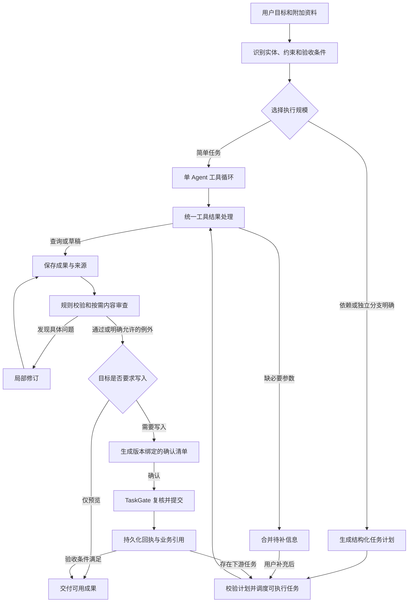

# 灵思 Agent 升级优化方案

版本：v1.0  
日期：2026-10-24  
状态：首批 S0/S1 能力闭环已开始落地，实际范围及验证见[升级落地记录](PAMS-灵思Agent升级落地记录.md)；本文其余条目仍为待实施设计。  
适用范围：PAMS 当前灵思入口、单 Agent、知识库问答、多 Agent 协作及其前后端能力管线。

## 1. 升级结论与目标

灵思下一阶段应升级为能够持续完成组织事务的工作台：用户提出目标，系统组织资料与任务，交付可检查的成果，在需要时请求补充信息或确认写入，并能在修改、失败和断连后接续工作。

核心方向是 **按任务依赖执行，按工作成果组织界面，以真实业务结果判断完成**。

实施顺序为：

1. 打通现有能力的预览、补参、确认、写入、回执与业务跳转。
2. 统一单 Agent 与多 Agent 的结果契约、状态和执行门禁。
3. 建立具备上下文承接、有限重规划和局部恢复的任务调度。
4. 将界面重点从专家名单推进到任务进展、工作成果与待处理事项。
5. 用同一组业务任务评估完成率、质量、时延、成本及人工介入情况。

沿用 React、Ant Design、Zustand、Spring Boot、现有业务 Service、工具注册表和权限体系。优先在现有编排层演进；本期不以切换 Agent 框架、引入消息中间件或增加专家数量作为升级目标。

### 1.1 文档依据与事实口径

| 材料 | 本文用途 |
|---|---|
| [2026-10-24 能力管线审查](../audits/agent-pipeline-2026-10-24/README.md) | F01–F12 问题编号、工具清单、测试证据与验证边界 |
| [2026-10-23 灵思审计](Lingsi-Agent-audit-2026-10-23.md) | 已修复的会话、引用、任务竞态问题，以及尚未解决的流缓存、取消和并发边界 |
| [V6 灵思界面设计](PAMS-UI-v6-灵思Agent设计说明.md) | 三栏工作区、业务入口、确认位置、窄屏适配等既有产品方向 |
| [Agent 业务设计方案](../PAMS-Agent业务设计方案.md) | 工具复用、dry-run/commit、权限、数据分级与业务边界 |
| [通用化与多 Agent 协作策划](../PAMS-通用化与多Agent协作改造策划.md) | 专家分工、黑板、P1–P4 和对比实验基础 |

历史文档中的计划工具数、完成状态和原型行为不能替代当前审计结论。本文涉及的新模型、状态、事件、界面行为及指标目标均为拟实施设计。

### 1.2 当前基线

当前实际发现 21 个工具实现，11 个查询类、10 个操作类；专家默认目录还引用 3 个未实现工具。单 Agent 的工具循环和任务门禁已有基础，多 Agent 的工具结果传递、审查、状态聚合与业务提交尚未形成完整闭环。

| 本轮已执行验证 | 结果 | 适用边界 |
|---|---|---|
| 后端全量测试 | 570 通过、1 跳过，共 571 项 | H2、stub 与现有断言；含 Agent/知识库专项测试，不重复计数 |
| 前端全量测试 | 原环境 145 通过、14 失败 | Node 26 环境下的实际基线 |
| 关闭实验性 Web Storage 后复测 | 154 通过、5 失败 | 剩余为样式规范检查，尚未修复 |
| 灵思浏览器回归 | 选取的 5 项通过 | 模拟 API，不能证明真实业务提交 |
| 前端生产构建 | 通过 | 仍有现有文档编辑器大包提示 |
| 缺陷与路由探针 | 3 项缺陷确认；20 处链接声明中 18 处不匹配 | 独立 mock 探针与路由匹配，非完整真实环境验收 |

不得将以上结果表述为“21 项能力已全部跑通”。

## 2. 产品原则与本期边界

### 2.1 产品原则

- 用户围绕活动、文稿、排班和事务提出要求，系统自行决定是否需要专家协作。
- 只有确认缺少必要信息时才打断；独立且不受影响的任务继续执行。
- 草稿、预览、已写入、已提交审核和已发布分别展示，状态由真实业务结果决定。
- 每次确认对应明确的对象、内容版本、影响范围和数量；版本变化后重新生成确认清单。
- 部分成功时保留已完成成果，明确失败项与剩余工作，允许有针对性地继续。
- 过程默认简洁，依据可追溯；展示任务摘要、工具事实与审查问题，不依靠展示模型内部推理建立可信度。
- 查询、生成、写入、对外发布的权限及风险边界沿用业务系统；任何新调度方式都必须经过现有权限与 PolicyGuard 链路。

### 2.2 本期覆盖

本期覆盖 21 项现有能力的可靠闭环、现有三种运行模式、自动协作、任务恢复、成果查看与历史回放。缺失的新闻稿、公告草稿、策划转议程能力先从“可用”声明中移除，保留明确的后续扩展入口。

独立新闻稿、公告草稿及策划转议程的完整业务实现列入后续能力扩展批次；只有具备业务落点、工具实现与端到端验收后才能重新标为可用。现有推文模板不能替代独立新闻稿能力，发布公告也不能替代公告草稿。

不在本期展开开放式 Agent 自由互聊、无限递归委派、全自动外部发布、跨组织知识共享和通用长期记忆。持续任务上下文可以在当前会话及授权范围内保存。

## 3. 目标工作流与核心场景

### 3.1 统一工作流



图中返回调度器代表恢复未完成任务；简单任务也可直接在原工具循环内续接。单 Agent 与多 Agent 使用同一工具结果处理和确认门禁，避免复制两套写入逻辑。

### 3.2 代表性场景

| 场景 | 预期工作流 | 完成判定 |
|---|---|---|
| 查询待办或活动进度 | 单 Agent 查询、组织结果和来源 | 答案与权限一致，业务入口可定位对象 |
| 查历史策划并准备本期初稿 | 检索、识别事实与待补项、起草、核验、预览；保存时确认 | 事实有来源，未知内容明确，确认后得到真实草稿 ID |
| 准备方案、推文和排班 | 共享活动约束；有依赖的步骤串行，独立分支并行 | 每份成果可查看，跨成果事实一致，各写入动作有真实回执 |
| 批量素拓加分 | 名单与分值核对、跳过项、确认、提交、台账回执 | 成功/失败/跳过数量可核对，重试不会重复加分 |
| 修改活动地点 | 定位发生变化的事实及受影响成果，只刷新相关分支 | 旧预览与确认令牌失效，未受影响成果保留 |
| 资料问答 | 检索、逐片权限复核、统一截断、答案与引用映射 | 仅引用本轮实际输入片段；无法支撑时明确资料不足 |

一个请求可以跨多个用户交互轮次持续推进。待补信息与待确认属于等待状态，不能当作执行失败或整体完成。

## 4. 智能编排设计

### 4.1 职责分层

| 层级 | 职责 | 主要约束 |
|---|---|---|
| 意图与实体解析 | 提取目标、活动、对象、输出形式、期限和约束 | 优先使用用户明确关联的对象；歧义时追问，不硬填 ID |
| 规划器 | 生成有依赖、输入和验收条件的任务计划 | 输出必须结构化；不得添加未经用户要求的写入或发布目标 |
| 计划校验器 | 检查工具存在性、权限、依赖环、预算和产物类型 | 不合格计划修正一次或回落可解释的简单路径 |
| 确定性调度器 | 执行就绪节点、并发限制、等待、恢复和终态聚合 | 模型不能绕过权限、门禁、预算和提交顺序 |
| 专家执行器 | 在限定工具与上下文内完成子任务 | 具备有界工具循环；返回结构化结果与实际来源 |
| 成果校验与审查 | 规则检查、事实与业务一致性、按需语义审查 | 问题绑定具体成果版本；不得仅凭“有产物”判通过 |
| 结果与会话层 | 汇总真实状态、成果和待处理项 | 不将工具调用次数或专家结束等同于用户目标完成 |

保留协调者角色，但其规划、调度记录、结果汇总应分开实现，便于测试和独立度量。

### 4.2 自动决定执行规模

默认采用最小足够团队。简单查询和单一产出可由一个 Agent 完成；独立资料源较多、存在可并行分支或确需独立质量审查时再启用协作。

路由输入包含当前目标、已确认实体、会话待办、可用能力、依赖关系和剩余预算。关键词规则保留用于简单且高确定性的判断，复杂复合目标交由结构化规划；最终仍由计划校验器约束。

P1 串行、P2 并行、P3 修订与复审、P4 委派作为内部可组合执行方式保留，不再为整个复杂任务固定选择唯一模式。论文或管理端仍可用固定模式进行受控对比。

自动协作开关继续保留用户否决权。关闭后使用单 Agent 路径；只读与资料问答继续遵循当前模式边界，写工具不会因切换调度策略重新开放。

### 4.3 上下文按任务装配

每个专家收到以下内容：原始目标的必要部分、本任务描述、已确认实体和约束、依赖成果指定版本、相关来源、待修问题、输出要求与剩余预算。

不将完整聊天记录、所有工具日志与所有专家输出复制给每个专家。共享事实以结构化记录保存，长正文通过产物引用按需加载。模型生成的概括不能替代时间、分值、人数等需保持精确的字段。

上下文装配必须复核当前用户和组织权限，并使用 PolicyGuard 净化后的结果。串行、并行、修订和恢复都执行同一规则；不能因为内容已经存入黑板就视为始终可见。

### 4.4 专家内部工具循环

专家可以读取、调用工具、观察结果、修正参数并生成成果。循环必须有工具轮次、时长和 token 上限，遇到表单、确认清单或不可恢复错误时返回明确状态。

内部工具循环与外层 DAG 分工：前者解决一个子任务的操作细节，后者负责子任务依赖与跨专家协作。禁止通过专家内部循环直接调用 commit 或自行确认清单。

### 4.5 有限重规划与局部恢复

触发条件限于：用户修改要求、依赖失败、发现必要事实缺失、审查提出具体问题、能力不可用或预算不足。调度器记录变更原因、受影响节点和计划版本。

- 保留仍有效的成果与已完成业务动作。
- 新事实只使相关后续节点失效，不默认重跑整个工作流。
- 查询和无副作用的生成可以重试；业务提交必须查询既有回执并依靠幂等键判重。
- 用户补参后从等待节点继续，不重建一个无关的新任务。
- 已写入内容的修改属于新业务动作，重新预览和确认；不把重跑当作撤销。
- 错误分类为参数、权限、依赖、模型、工具、超时和业务冲突；只对可恢复错误执行有限重试。

默认最大修订轮数沿用当前 3 轮作为起点，并允许按任务降低；连续相同问题或质量没有改善时提前停止，展示未解决项，不宣称审查通过。

## 5. 统一数据与结果契约

### 5.1 术语与实体

| 概念 | 含义 | 与现有实现关系 |
|---|---|---|
| Conversation | 用户围绕一个主题的会话 | 沿用现有会话 |
| Run | 对一个目标的一次持续执行，可跨补参和确认轮次 | 扩展 AgentRun 生命周期 |
| WorkItem | 稳定的逻辑子任务节点，可有多个执行尝试 | 新概念，避免与既有 AgentTask 混淆 |
| Step/Attempt | 某个 WorkItem 的一次执行记录 | 扩展 AgentStep，增加 workItemId、attempt、状态与用量 |
| ActionTask | 待补参或待确认的业务操作 | 沿用 agent_task 与 TaskGate；不是 DAG 节点本身 |
| Artifact | 查询摘要、内容草稿、预览或业务成果引用 | 扩展黑板成果结构，按版本追踪 |
| ReviewIssue | 针对具体成果版本的问题及复核状态 | 新增结构化审查记录 |

一个 WorkItem 可以先产生预览，再生成 ActionTask，提交成功后得到业务引用。AgentStep 不再同时承担逻辑任务标识和执行尝试标识。

### 5.2 子任务契约

建议字段如下，属于内部接口设计，不原样展示给普通用户：

| 字段组 | 字段示例 |
|---|---|
| 身份与版本 | workItemId、runId、planVersion、attempt |
| 任务目标 | title、instruction、required、acceptanceCriteria |
| 调度关系 | dependsOn、inputArtifacts（含版本）、expectedOutputs |
| 上下文 | resolvedEntities、constraints、sourceRefs、reviewIssueIds |
| 执行约束 | agent、allowedTools、timeout、tokenBudget、retryPolicy |
| 运行情况 | state、blockedBy、startedAt、finishedAt、usage |

计划不预设“所有任务都完成才算成功”。required 与验收条件决定哪些是目标必需项；可选补充失败可产生带说明的部分结果。

### 5.3 专家结果契约

统一返回 `status、summary、toolOutcomes、artifacts、sourceRefs、missingInputs、reviewIssues、pendingActions、usage、degradation`。

关键规则：

1. 工具原始结果中 plan/form/references/payload 不得在专家边界丢失；敏感字段按既有策略处理后传递。
2. 建立共用 ToolOutcomeHandler，单 Agent 与多 Agent 都经它创建表单、确认清单、审计记录和结果事件；commit 仍只由 TaskGate 执行。
3. 查询数据、临时预览、内容草稿、业务提交回执采用不同成果类型；成功查询不能伪装成已生成文稿。
4. 缺失参数以字段、类型、原因、受影响节点、是否必需和建议值来源返回，不再靠问号和疑问词推断。
5. 最终回复使用实际 provider、降级原因和成果状态；多 Agent 是执行策略，不替代模型提供方信息。

### 5.4 成果及版本

成果建议包含 artifactId、type、version、workItemId、contentRef、entityType/entityId、sourceRefs、sensitivity、reviewState、createdAt、supersedesVersion 与 valid/stale 标志。

内容较长时独立存储，黑板保留索引。查询快照带查询条件与数据时间。内容草稿可在预览阶段保存内部版本，但不等于已创建业务 Article/Plan；界面必须区分内部草稿与已写入业务草稿。

用户修改地点、日期或正文后，创建新成果版本；依赖旧版本的相关节点与确认清单标记失效。旧版本保留用于比较和审计，历史不得被静默覆盖。

## 6. 状态、确认与恢复语义

### 6.1 执行状态

Run 建议状态：QUEUED、RUNNING、WAITING_INPUT、WAITING_CONFIRM、BLOCKED、SUCCEEDED、PARTIAL、FAILED、CANCELLED。单个节点可补充 STALE、SKIPPED 等内部状态。

聚合原则：

| 条件 | Run 展示与行为 |
|---|---|
| 仍有可以执行的节点 | RUNNING；同时保留待补/待确认数量 |
| 无可执行节点，下一步需要用户信息 | WAITING_INPUT |
| 无可执行节点，下一步需要确认写入 | WAITING_CONFIRM |
| 必要依赖无法满足，且不只是正常等待 | BLOCKED；列出原因和可选处理方式 |
| 所有必需验收条件满足 | SUCCEEDED；可保留不影响目标的提示 |
| 已有可用成果，但目标未全部满足且本次执行已停止 | PARTIAL |
| 目标未满足、没有可用交付且不能继续 | FAILED |
| 用户明确终止后完成状态收敛 | CANCELLED；列出终止前已完成的业务动作 |

状态与 `pendingInputs/pendingActions/issues` 分离存储。一个 Run 同时存在等待和运行分支时，不能用单一等待状态隐藏仍在执行的任务。Conversation 状态从所关联的活动 Run 和待处理项汇总，不只根据最后一条回复猜测。

业务 ActionTask 的既有 SUCCESS/PARTIAL/FAILED 等状态保持兼容，通过显式映射接入 Run；模型返回了文字不构成完成依据。

### 6.2 多成果确认

确认入口统一保留在中间对话的待处理区域，成果栏只负责核对及版本比较。

每个 ActionTask 绑定 runId、workItemId、成果版本、操作内容摘要、权限与目标对象。可以在一个待处理区域列出多个动作，但后端逐项维护令牌、状态和回执。首期采用逐项确认，避免默认承诺跨业务 Service 的原子事务。

必须调整现有“新清单替换同会话全部待处理清单”的作用域：同节点的新版本替换旧版本；不同节点的并列清单共存。新建、替换、补参和取消使用版本条件或原子状态转换，防止并发产生多张有效旧清单、取消覆盖执行状态或表单重新激活已取消任务。

确认时重新检查所有权、组织、权限、模式、有效期、成果版本与必要业务前置条件。过期或事实发生关键变化时重新 dry-run，不能拿过期预览直接提交。

节点提交完成后，调度器通过关联记录继续下游任务。只有获得真实业务 ID 和提交回执，下游才可将其当作已存在实体。确认前不能假定新活动、稿件或成员已创建。

### 6.3 幂等、重启与提交边界

为每个提交维护稳定业务幂等键，例如 ActionTask ID 与动作版本。请求重发返回已有结果；运行进程中断后，先核对业务回执再决定是否重试。

RUNNING 节点使用执行租约或心跳识别失联。重启恢复时：只读查询及可重复生成允许重新排队；无法判断是否已提交的动作进入“核对执行结果”，不得盲目重放。仅有任务表状态无法保证跨表业务副作用的 exactly-once，需要结合各业务 Service 的幂等约束。

部分批量提交失败时仅重试失败且仍符合条件的对象。撤销只有在对应业务提供真实补偿能力时才展示，不能因 preview 可重做就标记整个动作可撤销。

## 7. 成果校验、事实与知识库

### 7.1 三层审查

| 层级 | 检查内容 | 执行方式 |
|---|---|---|
| 结构与业务约束 | 字段、枚举、日期、数量、对象存在性、排班冲突 | 确定性规则，作为基础校验 |
| 事实与跨成果一致性 | 时间、地点、人数、金额与来源是否一致 | 结构化比对，必要时补查来源 |
| 内容质量 | 是否满足用途、语气、完整性、易误导表述 | 对正式文稿等按需调用独立审查模型 |

ReviewIssue 包含 issueId、artifactId/version、位置、问题类型、严重度、说明、相关来源、修改要求和复核状态。只有“哪里错、依据是什么、如何修订”可传给产出专家，不能只返回笼统 REVISE。

权限与确认门禁不依赖审查模型放行。资料缺失时可以交付标明未知内容的预览；阻断性问题未解决时禁止生成可执行的错误写入清单。允许带提示保存草稿的例外必须由业务规则明确区分，并在确认中展示遗留问题。

### 7.2 黑板与事实来源

共享事实记录字段值、来源、版本、适用范围、数据时间和用户是否明确确认。历史案例、现行制度、业务系统记录与用户补充分别标识来源性质，不能把某次活动案例自动当作审批规定。

不再给所有发现固定写入 0.8 置信度。优先展示“业务记录已核对”“用户提供”“资料未覆盖”等可核查状态；数值置信度只有存在校准方法时再引入。

### 7.3 KB 片段与引用统一

先得到权限复核、净化及预算截断后的唯一实际输入集合，再统一生成 prompt 编号、引用校验与回填来源。实际输入文本片段需保留对应版本和截断信息，引用不能指向本轮未进入模型上下文的后部条目。

继续沿用历史引用实时权限复核和撤权后的派生内容处理。新成果增加来源依赖关系，后续才能评估更细粒度隐藏；在缺少逐句来源映射时，不承诺只删除受影响句子。

## 8. 能力目录与业务导航

能力目录应来自实际已注册、已启用、权限可见的工具及对应业务配置，区分“可用、缺必要资料、当前模式不可用、暂未实现”。目录可用只代表工具可调用，不能替代执行验收状态。

逐项处理：

- 清理三个未实现工具声明；修复 generalist 的 null 作用域语义。
- 将党员发展查询补入适用的默认检索作用域，并对数据库自定义范围做兼容迁移检查。
- 校验默认种子和数据库覆盖配置；迁移不得静默覆盖组织已经调整的定义。
- 启动或管理诊断时报告作用域中的未知工具，阻止计划调度到不存在的能力。
- 建立实体导航映射，统一 type/id/tab 到当前路由；旧历史链接保留兼容解析。
- 对列表型页面增加明确的定位协议，核验目标记录、选中行、详情或 Tab；权限不足时显示可理解的结果。

### 8.1 现有能力的交付分组

| 分组 | 当前工具 | 本期验收重点 |
|---|---|---|
| 事务与活动查询 | queryMyPendingWork、queryActivityOverview、queryActivityTasks | 对象解析、真实数据、结果跳转 |
| 资料与内容检索 | searchMaterials、searchArticles、queryNotifications | 搜索条件、权限、来源与历史链接 |
| 日程与记录查询 | queryCommonFreeTime、queryAttendance、queryCreditRecords、queryRosterSigninStats | 数据前置、统计口径、空结果与错误区分 |
| 党务查询 | queryPartyMemberProgress | 默认作用域、资料分级、目标详情定位 |
| 实体创建 | createActivity、createMember、createSeatLayout | 补参/模板选择、预览、确认、幂等、真实实体 |
| 文稿与策划 | draftArticleFromActivity、draftPlanSections | 原始要求承接、正文预览、事实核验、业务草稿保存 |
| 排班与筹备任务 | generateActivitySchedule、generateActivityTasks | 日期部门课表、空缺/冲突、重复生成、任务与人员回执 |
| 批量与发布 | previewCreditBatch、publishAnnouncement、sendNotification | 名单/受众/分值、影响范围、确认、部分成功与重复提交 |

每一组都分别检查单 Agent 与适用的协作路径；只读、资料问答和无权限路径纳入否定用例。

## 9. 任务与成果工作台设计

### 9.1 信息架构

继续使用现有三栏：左侧管理任务，中间承接要求与执行摘要，右侧核对成果。保留现有业务快捷入口和关联活动操作，不新增必须前往的独立协作页面。

```text
任务列表                  当前任务 / 真实状态                 工作成果（按需打开）
新建任务                  用户目标及关联对象                  方案初稿 v2
搜索与筛选                任务进展摘要                        推文草稿 v1
待我处理 2                待补信息 / 待确认动作                排班预览 v1
准备培训班材料            对话与关键变更                      内容  变更  来源
  等待补充地点            查看任务过程                        审查问题及修订位置
查询归档要求              输入与补充要求                      打开对应业务页面
  已完成
```

宽屏沿用现有侧栏和成果栏尺寸作为起点，成果区域支持调整；约 1250px 以下沿用成果抽屉，约 960px 以下沿用任务抽屉。最终以真实内容、缩放和窄屏验证决定阈值，不为对齐固定数字牺牲正文可读性。

### 9.2 执行摘要与任务列表

协作面板从按 agent 名称合并，调整为按稳定 workItemId 展示。专家名称作为次级信息，重试次数和版本变化可展开查看。

默认摘要示例：

> 正在准备活动材料  
> 已核对活动资料，推文正在生成，排班等待活动地点。  
> 需要补充：活动地点　[补充信息]　[查看过程]

展开后逐行显示任务名称、当前状态、依赖或阻塞原因、成果入口。完成进度按任务计划计算，计划调整时说明新增或取消的工作；不展示无法可靠估计的时间百分比。

普通过程默认折叠；阻塞、待补信息、待确认和失败项持续可见，已读提示不使未处理任务消失。拓扑图作为高级过程视图，显示依赖和失败传播，不占据默认聊天区域。

### 9.3 待处理区域

- 将多个专家缺失的同一字段合并，标明影响哪些任务。
- 必填信息就地验证；未阻塞的分支继续运行。
- 待确认清单展示将改动的对象、数量、内容版本、跳过项与结果去向。
- 入口始终指向当前有效版本；历史清单展示失效或已执行，不能继续点击旧令牌。
- “确认写入”“保存业务草稿”“发送通知”“发布公告”使用与实际行为一致的按钮文案。
- 多个动作分项展示结果，不用一个“全部成功”遮盖部分失败。

### 9.4 成果面板与版本比较

首次产生用户可阅读成果时打开右栏；后续更新使用版本提示，不自动切换正在阅读的成果。区分“预览”“已保存草稿”“已发布”等状态，显示来源与遗留问题。

内容类提供正文、变更和来源；表格类提供名单、冲突、空缺和跳过项；业务引用提供真实实体及入口。用户直接修改正文后创建新版本，并触发必要的复核与清单失效。

成果正文应可预览，不能只显示“请到业务页面查看”。业务页面仍用于完整编辑、审核和后续流程，灵思面板不复制整个业务模块。

### 9.5 补充要求、停止与重试

运行时允许保存用户补充要求，并返回“已接收，待本阶段结束后应用”或明确的应用结果；不得丢弃输入或暗示立即改变正在提交的操作。

停止请求向下传播至调度器、专家、模型连接与尚未开始的工具任务。执行中的业务提交是否可取消由业务实现决定；界面在完成状态核对前展示“正在停止”，随后列出已完成动作和未执行部分。停止不等于撤销。

重试入口针对失败任务，说明会重新执行的范围。已有提交回执先核对，保证不会因点击重试重复加分、创建成员或发布公告。

### 9.6 视觉与交互约束

沿用 V6 设计令牌与现有组件库，控制字体层级，正文和可操作辅助信息不小于 12px。状态同时使用文字与语义色，避免仅靠颜色识别。减少大面积卡片、阴影、彩条和无业务信息的副标题。

对话与成果独立滚动，用户上翻时不强制拉回底部；新内容以返回按钮提示。CJK 输入组合期间不误触发送，收起区域不保留键盘焦点，窄屏保证待处理按钮可达，动效遵循减少动态效果设置。流式展示依据真实事件，不能用前端计时器虚构阶段或进度。

## 10. 事件协议、持久化与观测

### 10.1 事件身份与顺序

客户端生成 requestId 并贯穿 REST 与所有普通流事件，解决同账号多窗口首事件误绑定问题。服务端补充 conversationId、runId、streamId、workItemId、attempt、artifactId/version、事件版本与序号。

事件按 Run 维持单调 eventSeq；文本片段额外按 workItemId/attempt/channel/round 隔离。channel 至少区分最终回复与任务输出。并行专家的正文不能写入同一最终答复缓冲区。

前端按事件身份幂等处理，旧 attempt 和旧成果版本不覆盖新状态。最终回复由明确的汇总事件更新，REST 与 WebSocket 返回同构结果，并按服务端状态版本协调乱序响应。

### 10.2 可靠事件与临时字符流

持久化任务状态、待处理项、成果版本、审查结论、提交回执等关键事件；高频字符增量可用有界缓存，不要求永久逐 token 存储。

关键状态变更与待投递事件在同一事务中记录，以数据库 outbox 或等价事务机制可靠投递，不依赖“先写成功再尽力发 WS”。首期不需要引入 MQ。

重连先获取权威 Run 快照，再补拉快照之后的事件并去重。缓存缺失、服务重启或序号存在缺口时返回快照重同步信号，不让前端永久等待缺失片段。

结束流设置容量与 TTL，保留有限补拉窗口；清理 owner、授权版本和字符缓冲映射。仍存活的 Run 快照和业务回执由数据库恢复。初始 TTL 与容量经并发验证后配置，不把无限缓存作为恢复方案。

### 10.3 持久化演进

优先扩展既有 agent_run、agent_step、agent_task，并新增确有独立生命周期的任务节点、成果版本与关键事件/投递记录。黑板继续作为运行快照与上下文索引，不再成为最终结束时才保存的唯一状态。

WorkItem 需要持久化依赖、状态、计划版本与租约；Step 保存尝试与用量；ActionTask 关联 WorkItem 和确认版本。迁移同时覆盖 MySQL 与 H2。历史 Run 无完整任务信息时按“旧版过程记录”读取，不能推造并不存在的依赖、来源和质量结论。

### 10.4 可观测性

按 Run 与 WorkItem 记录等待、模型、工具、审查和提交耗时，保留重规划、降级、取消和失败原因。区分用户等待时间与后台执行时间；未知价格或用量显示未知，不能记作零成本。

普通界面只展示与用户决策有关的信息。管理诊断可查询计划版本、输入来源、工具状态、用量和事件缺口，并沿用敏感信息留存与权限控制。

## 11. 分阶段实施与退出标准

| 批次 | 工作范围 | 主要改动面 | 退出标准 |
|---|---|---|---|
| S0 基线与能力登记 | 固化 21 项清单、清理未实现声明、修复空作用域与默认作用域、明确运行时定义 | AgentCatalog、AgentRegistry、SpecialistAgent、测试运行配置 | 实际目录一致；generalist 真正可用；样式失败已修正或明确记录，不伪报全绿 |
| S1 能力闭环修复 | 共用结果处理、协作 FORM/PLAN 接入门禁、真实状态聚合、P2 审查、实体导航 | AgentOrchestrator、SpecialistExecutor、TaskGate、导航映射、前端状态 | 10 写工具均能预览确认并取得业务回执；21 项能力均有逐项验证记录；旧链接可定位目标 |
| S2 上下文与执行内核 | 原始目标传递、有界工具循环、WorkItem、依赖调度、确认后续跑、版本失效与局部重试 | CoordinatorAgent、上下文装配、调度器、Run/Step/Task 持久化 | 检索到产出可承接；独立分支并行；局部修改与失败不重放已提交动作 |
| S3 可信审查与可靠恢复 | ReviewIssue、实际 KB 片段集合、取消传播、requestId、关键事件落库、重连与重启恢复 | KbPipeline、KbPrompts、AgentLlmCaller、事件发布器、WS/store | 事实错误可定位修订；无串流；断连恢复一致；停止和提交中断语义正确 |
| S4 工作台交互升级 | 任务摘要、待处理区域、成果版本、来源/变更、局部重试、窄屏适配 | AgentHome、TeamPanel、ProcessZone、EntityPanel、相关 stores | 用户可从界面完成代表性任务，状态真实、成果可读、待处理项可达 |
| S5 联调与对比评估 | 真实模型与测试库贯通、单/多 Agent 对照、成本调参、灰度 | 集成测试、AgentBenchmark、诊断与发布配置 | 满足验收矩阵，提供可复查数据；无关键阻断缺陷后再逐步开放 |

S2–S3 的协议设计应先于 S4 的正式接入；S1 中影响用户的确认、状态和跳转修正同步完成最小 UI 调整。不等待全部新工作台完成才恢复现有能力可用性。

### 11.1 审计问题追踪

| 编号 | 升级措施 | 主验收批次 |
|---|---|---|
| F01 | ToolOutcomeHandler 与协作门禁统一，结果保留 plan/form | S1 |
| F02 | TaskContext 与专家工具循环，上游成果及审查问题传递 | S2 |
| F03 | 区分成果类型，P2 使用真实成果集合，分层审查 | S1、S3 |
| F04 | 节点状态映射与 Run 真实终态聚合 | S1、S2 |
| F05 | 实体导航映射、历史兼容与目标定位 | S1 |
| F06 | 实际目录一致性、缺失能力下线声明、默认定义兼容 | S0 |
| F07 | 修正 null 作用域与 generalist 基线 | S0 |
| F08 | 真实复合语句路由、结构化计划替代互斥关键词限制 | S1、S2 |
| F09 | 取消、事件隔离、补拉、重启快照与身份协议 | S3 |
| F10 | KB 实际输入与引用集合统一 | S3 |
| F11 | 降级能力收敛、取消固定实体 ID、provider/降级透明 | S1、S3 |
| F12 | 固定测试运行基线，修正规范失败并识别动态变量误报 | S0、S4 |

2026-10-23 审计遗留的缓存 TTL、传输取消、跨窗口身份、同会话并发清单与引用集合问题，分别纳入 S3 或 S1/S2，不因较新的报告未单列而遗漏。

## 12. 验收矩阵与评估指标

### 12.1 三层验证

1. **契约与组件验证**：确定性输入覆盖工具结果、任务状态、审查问题、版本和事件乱序。
2. **隔离集成验证**：使用 H2/隔离 MySQL 与可控模型完成 API→工具→门禁→业务 Service→回执→前端，验证真实持久化；不能只模拟 confirm 返回成功。
3. **真实模型验收**：在隔离组织与测试数据上，用自然语言完成代表性任务；记录模型、prompt、预算、资料版本和失败原因。通过前两层后再执行，控制费用与业务副作用。

### 12.2 必须通过的业务用例

| 用例 | 成功标准 |
|---|---|
| 11 个读工具逐项执行 | 有数据、无数据、无权限、参数歧义均有正确结果；来源和跳转可用 |
| 10 个写工具逐项执行 | 有效参数 dry-run→确认→真实写入→回执→打开实体；适用协作路径同样通过 |
| 缺参补全 | 必需字段收集一次，提交后继续原节点；错误保留输入；并发表单不会恢复已取消任务 |
| 检索加写作 | 活动名、用户约束与来源进入专家，输出可证明使用了上游结果 |
| 并行分支 | 完成时间接近关键路径而非串行总和；事件、文本和成果不串线 |
| 审查与修订 | 人为植入的日期/地点错误被定位；修订确实使用问题，复审针对新版本 |
| 部分失败 | 已完成成果保留；仅失败范围重试；整体不显示全部成功 |
| 修改要求 | 影响分析正确，相关版本与令牌失效；无关成果不重做 |
| 双击与重复提交 | 同一动作至多形成一份业务效果；回执一致 |
| 提交中断与服务重启 | 能核对真实副作用，无法确定时明确等待核对，不盲目再次提交 |
| 停止与重连 | 未启动任务不再执行；正在提交的动作最终状态正确；刷新/补拉与实际执行一致 |
| 多窗口与跨组织 | requestId/Run 隔离；同用户多窗口不误绑定；越权和撤权路径被正确限制 |
| KB 截断引用 | 超过片段预算时只接受实际输入编号；原文、截断和时效一致 |
| 降级 | 无硬编码活动 ID；只执行有可靠参数的能力；明确降级且不虚报完成 |
| UI 全流程 | 明暗主题、宽窄屏、键盘、IME、上翻阅读、历史恢复均可完成任务 |

### 12.3 指标定义

以下为拟采用的度量方式和首轮门槛，不是当前已达到的结果。

| 指标 | 定义与用途 |
|---|---|
| 业务完成率 | 满足预先定义验收条件的任务数 / 有效任务数；区分工具、场景和模式，不以 Run SUCCESS 字段直接代替 |
| 首个可用成果时间 | 发起请求至首份能用于阅读或核对的成果；不以首 token 或 THINKING 事件代替 |
| 总执行时延 | 区分后台耗时、用户补参等待和用户确认等待，报告 p50/p95 |
| 每成功任务成本 | 包含失败、重试、审查、规划的总成本 / 成功任务数；记录 token 和价格来源 |
| 人工介入 | 分开统计业务确认、必要信息补充和纠错次数；必要确认不视为系统失败 |
| 成果修改量 | 对事实字段与正文分别记录用户修改比例，结合验收质量评价 |
| 无效工作量 | 重复检索、无效修订、重复调度和被作废成果比例 |
| 可靠性 | 重复业务写入次数、错误成功回执次数、跨流串线、恢复状态不一致次数 |

上线前硬门槛：既有 21 项能力的确定性必测路径全部通过；确认重复写入、错误成功回执、跨组织泄露和跨窗口串流在验收集中均为零；全部残余失败有原因及处理结论。真实模型完成率和成本阈值在建立基线后按场景确定，不提前承诺无依据的提升百分比。

单 Agent 与多 Agent 对比使用相同工具、数据、权限、验收标准与可见资料。先修复 generalist 作用域，再分别做固定预算对照和固定质量对照；同时报告质量、时延、成本和模型配置，避免用更多 token 换得的效果解释为纯编排收益。

## 13. 兼容、灰度与回退

- 新增协议以版本号区分，旧消息和旧成果链接提供兼容适配；不改写原始审计事实。
- 先部署能读取新字段的后端与前端，再按能力或组织开放新调度策略，避免新事件被旧客户端误处理。
- 存在未完成 ActionTask 的会话按原关联版本处理，不能在灰度切换时自动重建并提交。
- 回退时将新 Run 路由回稳定路径；已创建的 Run 和待确认操作继续可查询、取消和核对，不丢弃新状态数据。
- 规则降级与单 Agent 回退都要如实展示能力范围。协作路径未完成 S1 验收前，可按能力临时限制升级到协作，避免默认开关把可用单 Agent 写入导向断点。
- 同步更新前后端业务文档和能力面板。新能力只有真实验收通过后才能被介绍为“已支持”。

## 14. 首批交付清单与后续扩展

第一批交付应包括：21 项工具与运行时目录核对表、F01–F12 修复记录、统一结果契约、真实状态与确认恢复方案、业务导航映射、逐项验证结果和残余问题清单。

执行内核批次交付：WorkItem/Step/ActionTask 的持久化与关联、上下文装配、依赖调度、局部重试、版本失效、重规划记录和恢复用例。

工作台批次交付：可审阅交互原型、真实协议驱动的任务与成果界面、明暗和窄屏验证、可访问性与输入法回归、端到端操作证据。

稳定后再扩展独立新闻稿、公告草稿、策划转议程、更多业务包及更细粒度来源关联。扩展时遵循“业务落点→工具契约→权限与门禁→编排接入→界面成果→真实验收”的完整链路，避免能力目录再次领先于实际交付。

## 附录：编排方法参考

本文的具体措施以本项目审计为依据。可组合工作流、独立任务并行和协调者/执行者分工参考 [Building effective agents](https://www.anthropic.com/research/building-effective-agents)；上下文压缩、明确委派边界与多 Agent 成本权衡参考 [How we built our multi-agent research system](https://www.anthropic.com/research/multi-agent-research-system)。外部研究任务的提升比例不作为 PAMS 的效果承诺。
