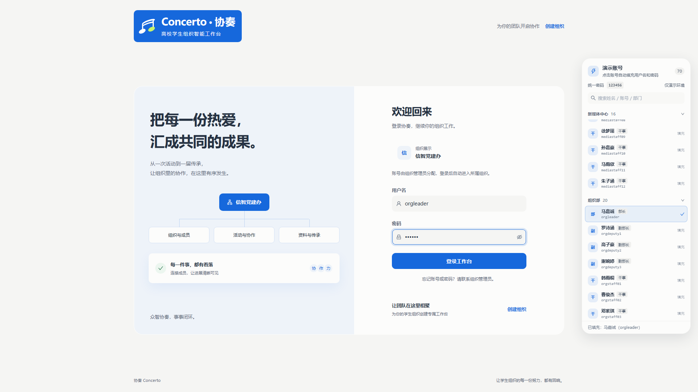

# PAMS 演示组织与账号种子

本目录根据用户提供的「部门 / 职位」表，生成一套可直接登录的演示数据：

- **组织**：信息与智能工程学院党建办公室（信智党建办，`PARTY`，启用 `party` / `volunteer` / `club` 领域包）
- **架构**：主任办公室（中心）、青年科技部、文秘部、新媒体中心、组织部；对应图示 5 个部门分组
- **账号**：70 个，统一密码 `123456`
  - 图示 68 个岗位：1 主任 + 2 副主任 + 4 部长 + 9 副部长 + 52 干事
  - 另有 1 个指导老师账号、1 个系统管理员账号（组织所有者）
- **成员名册**：第九届预置 68 人，职位、部门与图示逐行对应
- **角色映射**：
  - 主任 / 副主任 → `DIRECTOR`
  - 青年科技部 部长 / 副部长 → `TECH_LEADER`
  - 文秘部 部长 / 副部长 → `SECRETARY_LEADER`
  - 新媒体中心 部长 / 副部长 → `MEDIA_LEADER`
  - 组织部 部长 / 副部长 → `ORG_LEADER`
  - 干事 → `STAFF`
  - 指导老师 / 系统管理员 → `TEACHER`

完整账号见 [demo-accounts.md](demo-accounts.md)，也可用 [demo-accounts.csv](demo-accounts.csv) 导入表格软件。

## 文件

| 文件 | 用途 |
| --- | --- |
| `reset-and-seed-demo.sql` | 清空业务/账号数据，重建组织、岗位与 70 个账号 |
| `generate_demo_seed.py` | 重新生成 SQL、账号清单与前端演示账号数据 |
| `demoAccounts.generated.ts` | 前端登录页演示账号数据（生成后复制到 `pams-web/src/components/auth/demoAccounts.ts`） |
| `demo-accounts.md` / `.csv` | 账号凭据清单 |
| `apply-demo-data.ps1` | 备份 + 执行种子 SQL 的一键脚本 |

## 使用

在仓库根目录运行：

```powershell
powershell -ExecutionPolicy Bypass -File scripts/demo-data/apply-demo-data.ps1
```

脚本会：

1. 检查 MySQL；
2. 将当前 `pams_db` 备份到 `.backups/pams_db-<时间戳>.sql`；
3. 执行 `reset-and-seed-demo.sql`；
4. 输出完成提示。

数据库连接默认 `root/root@localhost:3306`，可通过 `DB_USER`、`DB_PASSWORD`、`DB_HOST`、`DB_PORT` 覆盖。仓库根 `.env` 中的 `DB_PASSWORD` 也会被读取。

## 清空范围

会清空：活动、策划、议程、任务、签到、排班、成员/届别、党务、宣传、材料、公告、通知、群聊、知识库、Agent 会话与运行记录、审计、组织架构、组织岗位、组织邀请、委派、全部账号、其它组织及其授权。

会保留：Flyway 迁移历史、权限点、角色模板、组织 1 的已发布角色授权、Agent 定义等系统配置。

> 执行前请确认已备份。演示账号使用弱口令，仅用于本地/演示环境。

## 恢复备份

```powershell
cmd /c "mysql -u root -proot pams_db < .backups\pams_db-<时间戳>.sql"
```

## 登录页演示账号面板

登录页右侧提供演示账号列表：宽屏（≥ 1860px）固定显示完整列表；较窄屏幕显示右侧竖排页签，点击后从右侧抽屉打开同一列表。点击任一账号会把用户名和统一密码填入登录表单，不自动提交，也不改变登录卡片的布局和位置。



- 组件：`pams-web/src/components/auth/DemoAccountPicker.tsx`
- 数据：`pams-web/src/components/auth/demoAccounts.ts`（由本目录生成脚本产出）
- 样式：`pams-web/src/styles/demo-accounts.css`

修改账号后，重新运行生成脚本，把 `demoAccounts.generated.ts` 复制为 `pams-web/src/components/auth/demoAccounts.ts` 即可同步。

## 说明

- `sys_user` 表没有「职位」字段，账号侧通过角色 + 部门表达；成员名册的 `position` 字段保留了主任/副主任/部长/副部长/干事五种精确职位。
- 首次以空业务库启动后端时，`DataSeeder` 会按产品既有逻辑生成一条示例活动及配套数据；这与本次账号/架构/名册种子相互独立。
